# 操作系统实验报告

## 实验基本信息

| 项目 | 内容 |
|------|------|
| 实验名称 | 操作系统实验三：断，都可以断 |
| 小组成员 | 2413669 张懿鸾、2412419 张祎然、2413788 张旗庭 |
| 代码分支 | `lab3` |
| 报告整理日期 | 2026-11-02 |
| 实验内容 | Trap 入口与上下文恢复、中断处理、异常处理 |
| 当前进度 | 2号已完成独立编译、时钟运行、GDB 分支检查及关机验证 |

### 小组分工

| 成员 | 负责模块 | 完成情况 |
|------|----------|----------|
| 1号：2413669 张懿鸾 | `kern/trap/trapentry.S` 中的 `RESTORE_ALL` 与 `__alltraps`；准备公共代码、协调合并和集成测试 | 已完成汇编实现，独立编译和反汇编检查通过，见 4.1 |
| 2号：2412419 张祎然 | `kern/trap/trap.c` 中的 `interrupt_handler()` | 已完成中断分类、时钟重设、计数、周期输出和关机；独立测试中 Test 3 显示 `PASS (40/40, ticks=200)`，最终输出10次后 QEMU 正常退出 |
| 3号：2413788 张旗庭 | `kern/trap/trap.c` 中的 `exception_handler()` | 负责断点、非法指令及其他异常处理，实现和测试记录待补充 |

### 实验报告分工

- **1号：** 4.1 的 Trap 入口与恢复实现、5.1 的测试记录，以及 6.1、6.2 中的个人总结。
- **2号：** 4.2 的中断处理实现、5.2 的测试与调试记录，以及 6.1、6.2 中的个人总结。
- **3号：** 4.3 的异常处理实现、5.3 的测试记录，以及 6.1、6.2 中的个人总结。
- **共同部分：** 实验目的、环境、整体流程、模块接口、5.4 的集成测试，以及 6.3、6.4 的原理分析和后续内容。

报告先说明 Trap 的执行流程和各模块的关系，再介绍实现与调试过程。目前记录了1号的汇编检查结果和2号的独立测试结果，小组完整评分仍需在正式代码合并后补充。

---

## 一、实验目的

实验二完成了基本的物理内存管理。本次实验继续处理内核运行中的中断和异常：当程序被时钟打断，或者执行到断点、非法指令时，内核需要保存现场、判断原因，完成处理后回到正确的位置继续执行。

本实验主要学习以下内容：

1. 理解 Trap 发生时硬件和软件各自负责的工作。硬件记录 `sepc`、`scause`、`stval` 和相关状态位，软件在调用 C 函数前保存通用寄存器。
2. 核对 `SAVE_ALL`、`struct trapframe` 和 `RESTORE_ALL` 的布局，按照 RISC-V 调用约定传递 TrapFrame 地址，并通过 `sret` 返回。
3. 完成具体事件的处理。时钟中断需要重新设置定时事件、更新 `ticks`、定期输出，并在达到设定次数后关机；断点和非法指令异常需要输出信息，并按实际指令长度调整返回位置。
4. 通过编译、QEMU 运行和 GDB 调试检查实现，观察中断能否持续触发、计数是否正确、返回地址是否符合预期。

---

## 二、实验环境

### 2.1 软硬件环境

2号进行独立测试时使用的环境如下。

| 项目 | 使用情况 |
|------|----------|
| 开发环境 | Windows、VS Code、WSL2，Ubuntu 22.04.5 LTS |
| 目标平台 | QEMU `virt`，RV64 内核，运行日志显示内存为128 MB |
| 编译与调试工具 | `riscv64-unknown-elf-gcc`、`riscv64-unknown-elf-gdb` |
| 编译配置 | 沿用 Makefile 中的 `-mcmodel=medany`、`-std=gnu99`、`-O2`、`-g`、`-Wall`、`-Werror` 等选项 |
| 最终使用的模拟器 | QEMU 4.1.1 |
| 固件与启动方式 | `-bios default`，将 `bin/ucore.img` 加载到 `0x80200000` |
| 独立测试目录 | `/tmp/lab3-c-test.AXvPFB` |
| 调试连接 | QEMU GDB stub，时钟调试使用 `127.0.0.1:1235` |
| 测试参数 | `GRADE_LAB3_TIMER`、临时声明头、`-Dsbadaddr=stval` |

最终运行时使用的 QEMU 路径为：

```text
/home/zhangyiran/lab1-tools/qemu-4.1.1-install/bin/qemu-system-riscv64
```

本机同时安装了其他版本。直接执行 `qemu-system-riscv64` 时，实际调用的是 `/opt/qemu/bin/qemu-system-riscv64`，版本为7.0.0。确认这一点后，我改用上述完整路径运行4.1.1，排查过程见 5.2.3。

1号记录的环境为 Windows + WSL2、Ubuntu 24.04.5 LTS、交叉 GCC 13.2.0、QEMU 4.1.1、普通 GDB 与 RISC-V GDB 15.1、Make 4.3、Git 2.43.0、Binutils 2.42，QEMU 安装目录位于 `/home/win/opt/`。

### 2.2 AI 工具使用情况

| 成员 | 使用工具 | 主要用途 |
|------|----------|----------|
| 1号 | Codex（VS Code）、ChatGPT；对话记录见 [prompt.md](prompt.md) | 分析已有代码和汇编接口，辅助完成 `RESTORE_ALL`、`__alltraps`，再通过源码检查、编译和反汇编确认结果 |
| 2号 | Codex（VS Code）、ChatGPT | 解释接口、提供基础框架并检查本人编写的代码；由本人完成中断处理实现、编译、运行和调试 |
| 3号 | 原记录登记为 Codex（VS Code）、ChatGPT | 具体使用过程待3号补充 |

### 2.3 源码与独立测试目录

仓库的 `code/` 保存实验源码，`report/` 保存报告、截图和日志。2号的正式改动集中在 `interrupt_handler()`。由于测试时尚未合入3号的异常处理函数，我在 `/tmp` 下建立副本，加入测试代码和临时异常处理函数，使时钟测试能够单独运行。

临时异常函数在遇到异常时打印现场并停止，没有实现3号负责的异常返回功能。它只用于测试副本，最终合并时使用正式的异常处理实现。

---

## 三、实验整体逻辑分析

### 3.1 Trap 的处理流程

RISC-V 将中断和异常统称为 Trap。时钟中断由异步事件触发，断点和非法指令异常则与当前执行的指令有关。它们共用入口和现场保存方式，进入 C 函数后再分别处理。

本实验的执行流程如下：

```text
中断或异常发生
    ↓ 硬件记录原因、返回位置和状态
stvec → __alltraps → SAVE_ALL
    ↓ a0 = 当前 TrapFrame 地址
trap(tf) → trap_dispatch(tf)
    ├─ 中断：interrupt_handler(tf)
    └─ 异常：exception_handler(tf)
    ↓ C 函数返回
__trapret → RESTORE_ALL → sret
    ↓
恢复到所保存或按要求调整后的执行位置
```

| 阶段 | 完成者 | 主要工作 |
|------|--------|----------|
| 进入 S 模式 Trap | 硬件及已有的特权级、委托配置 | 记录 `sepc`、`scause`、`stval`，更新 `sstatus`，跳转到 `stvec` 指定的入口 |
| 保存现场 | `SAVE_ALL` | 将通用寄存器和相关 CSR 保存到内核栈，形成 TrapFrame |
| 调用 C 函数 | `__alltraps` | 将 TrapFrame 地址放入 `a0`，调用 `trap()` |
| 分类和处理 | `trap_dispatch()`、两个 handler | 判断中断或异常，执行对应分支 |
| 恢复并返回 | `RESTORE_ALL`、`sret` | 恢复 CSR 和通用寄存器，最后恢复原 `sp`，返回执行 |

进入 S 模式 Trap 时，硬件将原来的中断使能状态保存到 `SPIE`，清除 `SIE`，用 `SPP` 记录进入前的特权级。`sret` 根据这些状态完成返回。通用寄存器仍需由汇编代码保存，否则 C 函数使用寄存器后，原程序的现场就可能丢失。

本实验的内核运行在 S 模式，时钟中断可以在内核执行过程中发生。这里验证的是这条中断处理路径，用户进程切换和系统调用还需要其他实现。

### 3.2 时钟初始化与中断触发

[entry.S](../code/kern/init/entry.S) 建立启动环境后进入 [kern_init()](../code/kern/init/init.c)，依次完成控制台、物理内存和 Trap 入口等初始化，再设置时钟并开启中断。相关函数如下。

| 函数 | 所在文件 | 作用 |
|------|----------|------|
| `idt_init()` | `kern/trap/trap.c` | 初始化 `sscratch`，将 `__alltraps` 地址写入 `stvec`；函数名称沿用框架，实际设置的是 RISC-V Trap 入口 |
| `clock_init()` | `kern/driver/clock.c` | 使能时钟中断，安排第一次事件，将 `ticks` 清零 |
| `intr_enable()` | `kern/driver/intr.c` | 设置 `sstatus.SIE`，允许内核响应中断 |
| `clock_set_next_event()` | `kern/driver/clock.c` | 读取当前时间，通过 `sbi_set_timer()` 安排下一次事件 |

设置定时事件、使能时钟中断和打开 S 模式全局中断都需要完成。事件到达后，内核沿统一 Trap 路径进入 `interrupt_handler()`，在其中重新设置下一次事件并更新计数，返回后继续执行原程序。实验中的周期性时钟由软件反复安排单次事件形成。

### 3.3 TrapFrame 布局与模块接口

[trap.h](../code/kern/trap/trap.h) 中的 `struct trapframe` 依次包含 `gpr`、`status`、`epc`、`badvaddr` 和 `cause`。当前框架使用64位 `uintptr_t`，整个结构包含36个槽位，共288字节。

| 槽位 | 字段 | 含义 |
|------|------|------|
| 0～31 | `gpr` | 对应 `x0`～`x31`，其中 `x2` 槽位保存进入 Trap 前的栈指针 |
| 32 | `status` | 保存进入 Trap 后读出的 `sstatus`，包括返回时需要的状态信息 |
| 33 | `epc` | 保存 `sepc`，决定返回位置 |
| 34 | `badvaddr` | 保存 `stval` 对应的辅助信息；源码使用旧名称 `sbadaddr` |
| 35 | `cause` | 保存 `scause`，用于判断事件类型 |

`SAVE_ALL` 先通过 `sscratch` 保留原来的 `sp`，再分配 TrapFrame 空间。恢复时，当前 `sp` 仍是读取各槽位的基址，所以必须等其他寄存器恢复完成后再恢复它。这部分由1号实现，两个 C handler 使用入口传入的 `tf`。

时钟中断处理后保持 `tf->epc` 不变；对于实验要求跳过的断点或非法指令，异常处理函数按实际指令长度推进 `tf->epc`。

### 3.4 模块合并与测试安排

1号负责汇编入口和恢复，2号、3号分别编写中断和异常处理函数。两个 C 函数都位于 `trap.c`，合并时按函数核对改动，避免用整个文件覆盖另一人的实现。

2号先独立编译 `trap.c`，再用临时副本运行时钟测试，最后提交函数补丁、日志和截图。这样可以在异常处理尚未合入时检查中断函数。副本中的异常占位遇到异常就停止，便于发现运行中出现的意外情况。

完整测试需要合入三个正式模块，并统一工具链和 QEMU 版本。Test 1 涉及入口、寄存器恢复和断点返回；Test 2 涉及非法指令与两个 handler 的其他分支；Test 3 检查时钟处理和反复返回。现有结果及待完成项目见 5.4。

---

## 四、实验内容与实现

### 4.1 功能模块一：Trap 上下文恢复与 Trap 入口

**负责人：2413669 张懿鸾（1号）**

#### 4.1.1 任务与实现思路

本模块补充 `code/kern/trap/trapentry.S` 中的 `RESTORE_ALL` 和 `__alltraps`，对应位置如下：

```c
.macro RESTORE_ALL// Trap 上下文恢复宏
.endm

__alltraps:// Trap 统一入口
```

汇编入口调用的 C 函数接口为：

```c
void trap(struct trapframe *tf);
```

实现前，先对照已有的 `SAVE_ALL` 和 `struct trapframe` 确定保存位置。`RESTORE_ALL` 从相应槽位恢复 `sepc`、`sstatus` 和通用寄存器。当前 `sp` 指向 TrapFrame，要留到最后恢复；`x0` 始终为零，无需加载。

`__alltraps` 在保存现场后，把 TrapFrame 地址放入 `a0`，调用 `trap()`。C 函数返回后进入已有的 `__trapret`，恢复现场并执行 `sret`。实现时保留 `SAVE_ALL`、结构体布局和 `trap()` 的函数签名，使入口、处理与返回使用同一份现场。

```text
发生中断或异常
      |
      v
  __alltraps
      |
      v
   SAVE_ALL
      |
      v
保存处理器上下文
      |
      v
传递 Trap frame 地址
      |
      v
  trap(tf)
      |
      v
  __trapret
      |
      v
 RESTORE_ALL
      |
      v
    sret
      |
      v
恢复原执行流
```

#### 4.1.2 使用的提示词

本模块使用下面的提示词完成一次代码生成。提示词要求先检查模板和保存位置，再补充缺失的汇编，并将修改限制在 `trapentry.S`。

```markdown
你现在负责操作系统实验三（RISC-V uCore）的一个独立子任务：**Trap 入口与上下文恢复**。

## 一、本次授权范围

唯一允许修改的文件：

`code/kern/trap/trapentry.S`

允许只读查看以下文件，以确认接口和数据布局：

- `code/kern/trap/trap.h`
- `code/kern/trap/trap.c`
- `code/libs/riscv.h`
- `code/kern/mm/pmm.h`（仅在确有必要时）

**不得修改其他文件，不得提交或推送 Git，不得切换分支。**

## 二、实施要求

### 1. 先检查现状，再修改

确认当前模板的实际内容和待填标记位置。不要假定模板与其他版本完全相同。

### 2. 正确理解 Trap 帧布局

根据现有 `SAVE_ALL` 和 `struct trapframe`，核对寄存器保存槽位与 C 结构体字段的对应关系。

Trap 帧共 36 个机器字：

- 偏移索引 0～31：通用寄存器 x0～x31。
- 索引 32：`status`，对应 `sstatus`。
- 索引 33：`epc`，对应 `sepc`。
- 索引 34：`badvaddr`。
- 索引 35：`cause`，对应 `scause`。

RV64 下每个机器字为 8 字节，必须使用现有汇编宏和项目的寄存器保存约定，不得擅自改变 Trap 帧布局。

### 3. 完成上下文恢复

检查并补全 `RESTORE_ALL` 中的 `lab3 function1` 待填部分，确保：

- 从 Trap 帧恢复保存的 `sstatus` 和 `sepc`。
- 恢复所有应恢复的通用寄存器。
- 正确处理 x2（sp），避免在仍需要使用 Trap 帧时提前覆盖当前栈指针。
- 不错误地恢复 x0，也不遗漏应恢复的寄存器。
- 恢复顺序符合 RISC-V 汇编和现有 `SAVE_ALL` 的约定。

不得为了通过编译而随意删除寄存器保存、恢复指令或屏蔽错误。

### 4. 检查 `__alltraps` 入口流程

根据现有代码，确认 Trap 入口流程是否完整：

1. 进入 `__alltraps`。
2. 调用现有 `SAVE_ALL` 保存上下文。
3. 将当前 Trap 帧地址作为 `trap()` 的第一个参数传入 a0。
4. 调用现有的 `trap()`。
5. 返回后进入 `__trapret`。
6. 调用 `RESTORE_ALL`。
7. 使用 `sret` 返回被中断或发生异常的执行上下文。

如果模板已经包含某一步，保留现有正确实现，不要重复添加指令或标签。只补充确实缺失的部分。

同时检查 `stvec` 指向的入口与现有 `idt_init()` 是否一致，但不要修改 `idt_init()` 或其他 C 文件。

### 5. 严格限制本次任务边界

本次不实现、不修改：

- `trap.c` 中的 `interrupt_handler()`。
- `trap.c` 中的 `exception_handler()`。
- 时钟初始化与时钟中断处理。
- `clock.c`、`intr.c`、`init.c`。
- `Makefile`、评分脚本、测试文件。
- `SAVE_ALL` 中已有且正确的代码，除非发现明确的必要问题；如发现问题，先报告，不要擅自扩大修改范围。

## 四、验证要求
修改后执行：

git diff --check
git diff -- code/kern/trap/trapentry.S
git status --short --branch

然后尝试只编译 Trap 入口汇编目标：
如果该目标名称在当前 Makefile 中不成立，请先检查实际目标规则，不要修改 Makefile 来迁就命令。

本次不要运行完整评分测试，不要修改 `trap.c` 来解决其他编译错误。

## 五、完成报告

完成后请提供：

1. 修改了哪个文件。
2. 填补了哪些待填标记，分别解决什么问题。
3. `RESTORE_ALL` 的寄存器恢复顺序及原因。
4. `__alltraps` 的入口调用流程。
5. 完整的 `git diff`。
6. `git diff --check` 和汇编目标编译结果。
7. 当前 Git 工作区状态。

如果发现模板存在歧义、寄存器保存约定不明确，或必须修改其他文件才能继续，请先停止并报告，不要自行扩大任务范围。本次只修改和验证，不提交、不推送。
```

#### 4.1.3 实现结果

本次补充了两处待填内容。`RESTORE_ALL` 先用 `a0` 从槽位33恢复 `sepc`，从槽位32恢复 `sstatus`，再恢复 `x1` 和 `x3`～`x31`，其中包括原来的 `a0`。最后从槽位2恢复 `x2(sp)`，以免后续加载失去 TrapFrame 基址。

`__alltraps` 增加了以下两条指令：

```c
mv a0, sp
jal trap
```

第一条指令传递 TrapFrame 地址，第二条调用 `trap()`。返回后继续执行已有的 `__trapret`、`RESTORE_ALL` 和 `sret`。本次只修改 `code/kern/trap/trapentry.S`。

#### 4.1.4 编译与反汇编检查

代码完成后，先用 `git diff --check` 检查空白符，再查看文件差异，确认没有改动其他模块。检查入口时，重点核对保存现场之后是否执行了下面的调用：

```c
mv a0, sp
jal trap
```

在 Ubuntu 24.04 WSL 环境下进入 `~/oslab/OS-Lab/code`，执行 `make clean`，再执行 `make obj/kern/trap/trapentry.o`。输出如下：

```c
rm -f -r obj bin
+ cc kern/trap/trapentry.S
```

汇编目标编译通过后，使用反汇编工具查看生成的指令：

```c
riscv64-unknown-elf-objdump -dr obj/kern/trap/trapentry.o
```

反汇编中可以看到 `csrw sepc,a0`、`csrw sstatus,a0`、通用寄存器恢复指令、`mv a0,sp`、对 `trap` 的调用重定位，以及最后的 `sret`。这些检查与源码中的实现相符；完整的上下文运行测试还需结合其他模块进行。

### 4.2 功能模块二：中断处理

**负责人：2412419 张祎然（2号）**

#### 4.2.1 任务理解与源码阅读

我负责实现 `interrupt_handler(struct trapframe *tf)`。沿正常 Trap 路径进入函数时，汇编已经保存现场，公共分发也已判断事件属于中断。函数需要读取原因码、执行对应操作，再返回统一的恢复流程。

开始时，我还不清楚 `tf` 从哪里传入，因此先按下面的顺序阅读代码，把输入、依赖接口和返回过程联系起来。

| 阅读对象 | 重点内容 | 对实现的帮助 |
|----------|----------|--------------|
| `kern/trap/trap.h`、`libs/defs.h` | TrapFrame 字段和数据宽度 | 确认原因码使用64位 `uintptr_t`，`epc` 保存返回位置 |
| `kern/trap/trap.c` | `trap()`、`trap_dispatch()`、`print_ticks()` | 理解分发过程，沿用已有输出函数 |
| `libs/riscv.h` | `IRQ_*` 常量 | 将去掉最高标志位后的原因号与常量匹配 |
| `kern/driver/clock.c`、`clock.h` | `ticks` 和下一次事件的设置 | 每次时钟中断重设事件并更新共享计数 |
| `libs/sbi.c`、`sbi.h` | 定时和关机接口 | 使用已有的 `sbi_set_timer()`、`sbi_shutdown()` 封装 |
| `kern/init/init.c`、`kern/driver/intr.c` | 初始化和中断使能 | 区分第一次事件的设置与 handler 中的后续重设 |
| `tools/test_lab3.c`、`tools/grade.sh` | 测试内容和输出要求 | 核对时钟、软件中断提示和未知原因处理 |

阅读 `clock_set_next_event()` 后，我确认它只安排一次未来事件。因此，每次时钟中断都要再次调用它，才能持续触发；`ticks` 已在时钟模块中定义，也不需要在函数里重新声明。

#### 4.2.2 实现要求

函数输入为有效的 `struct trapframe *tf`。时钟分支会更新 `ticks`、输出次数和下一次定时事件，其他分支输出相应提示。各项要求和检查方法如下。

| 编号 | 实现要求 | 检查方法 |
|------|----------|----------|
| C1 | 保持函数接口，正式改动限于本函数区域 | 查看源码差异和补丁 |
| C2 | 清除 RV64 原因码的最高位，将结果存入局部变量，保留 `tf->cause` | 检查表达式，读取真实中断原因码 |
| C3 | 每次进入 `IRQ_S_TIMER` 都调用 `clock_set_next_event()` | 观察调用栈、SBI 参数和持续运行结果 |
| C4 | 每次 Supervisor 时钟中断只使 `ticks` 增加一次 | 比较入口与 `__trapret` 处的计数 |
| C5 | 每累计 `TICK_NUM` 次调用 `print_ticks()` | 核对条件和 `100 ticks` 输出 |
| C6 | 累计输出达到 `SHUTDOWN_AFTER` 后调用 `sbi_shutdown()` | 统计输出行数，检查 QEMU 退出状态 |
| C7 | 其他已知类型输出对应提示，不增加时钟计数 | 检查软件中断分支输入和源码 |
| C8 | 未知原因输出原因号和 TrapFrame | 用原因号15检查 `default` 分支 |
| C9 | 保持 `tf->epc` 不变 | 比较进入和返回时保存的完整地址 |
| C10 | 保留汇编、异常处理、公共分发和结构体布局；测试辅助只放在副本中 | 核对修改文件和测试目录 |

本次将关机阈值设为10次输出，这是实现中的配置值。`TICK_NUM = 100`，因此从正常初始化状态开始，代码会在第1000次时钟中断完成第10次输出并请求关机。提供的要求没有指定统一的输出次数。

#### 4.2.3 与 AI 的对话和修改过程

我先说明自己负责整个中断处理模块，并限定修改区域，再核对 TrapFrame、原因号、时钟和打印接口。AI 提供基础框架和接口说明，具体处理逻辑由我填写，再贴出代码进行检查。提示词也写清模块的输入、处理结果和返回要求，以及必须保留的公共定义和其他成员代码。

检查实现时，我重点核对原因分类是否符合 RV64 定义、时钟事件能否持续产生、计数和输出是否分开处理，以及非时钟分支是否保持原状态。任务中的功能和验证要求概括如下，完整提示词见 `prompt.md`。

```text
【Prompt：任务说明】
我负责实现 Lab3 的中断处理模块，包含原因识别、持续时钟、计数与输出、结束条件和其他中断提示。
请解释相关接口，只给出基础框架，函数体由我编写，贴出后再帮我检查。
修改限定在 trap.c 中本人 lab3 function2 区域，实验标记使用学号2412419。
保留已有结构体、宏、公共函数、汇编入口、异常处理和测试断言，不改驱动及构建配置。
提供思路、问题分析和编译、运行、GDB 检查步骤，不代写实现；测试依赖由我在独立副本中准备。

【Rely：依赖说明】
使用 trap.h、defs.h 的 TrapFrame 与类型定义，trap.c 的分发和打印接口，
riscv.h 的 IRQ_*，clock.h、clock.c 的共享计数与定时接口，以及 sbi.h、sbi.c 的关机接口。
验证时核对现有持续时钟和 handler 分支测试。

【Guarantee：接口清单】
保持 void interrupt_handler(struct trapframe *tf) 的签名和外部链接属性。
使用已有 ticks、clock_set_next_event、print_ticks、print_trapframe、sbi_shutdown。
辅助函数仅在本人区域内作为私有实现，正常处理后返回公共恢复路径。

【Specification：行为规格】
前置条件为有效的 RV64 TrapFrame，框架已完成初始化，ticks 和输出次数从0开始。
原因分类不改写原始现场，所有中断处理均保持 epc 不变。
每次 Supervisor 时钟处理安排后续事件，ticks 恰好增加一次；
每累计 TICK_NUM=100次输出一次，累计10次输出后请求关机。
其他已知类型输出对应提示；未知原因输出原因号和 TrapFrame。
非时钟分支保持计数与现场不变，不重设定时器或请求关机。
检查原因码、调用链、计数和返回地址，并检查输出边界及其他分支。
最终独立运行应出现 Test 3 的 ticks=200 PASS、10行100 ticks和正常退出状态0。
```

初版已经通过持续时钟测试，但仍会一直打印。我让 AI 帮忙检查遗漏的结束条件，再自行补上 `tick_print_count`、阈值判断和 `sbi_shutdown()`。更新测试副本并重新运行后，通过输出行数和退出状态检查了这一行为。

排错过程中，我也会确认建议的修改是否属于自己的模块。启动停滞时，讨论曾涉及启动页表，检查实际调用路径后发现运行的是 QEMU 7.0.0。改用本机已有的4.1.1后，原启动代码即可运行时钟测试，因此没有把启动代码改动加入自己的实现。

#### 4.2.4 最终实现

源码位于 [code/kern/trap/trap.c](../code/kern/trap/trap.c)，实验标记为 `lab3 function2 2412419`。交付的函数如下。

```c
void interrupt_handler(struct trapframe *tf) {
    extern void sbi_shutdown(void);
    enum { SHUTDOWN_AFTER = 10 };
    static size_t tick_print_count = 0;

    uintptr_t cause = tf->cause & ~((uintptr_t)1 << 63);

    switch (cause) {
    case IRQ_U_SOFT:
        cprintf("User software interrupt\n");
        break;

    case IRQ_S_SOFT:
        cprintf("Supervisor software interrupt\n");
        break;

    case IRQ_M_SOFT:
        cprintf("Machine software interrupt\n");
        break;

    case IRQ_U_TIMER:
        cprintf("User timer interrupt\n");
        break;

    case IRQ_S_TIMER:
        clock_set_next_event();
        ticks++;

        if (ticks % TICK_NUM == 0) {
            print_ticks();
            tick_print_count++;

            if (tick_print_count >= SHUTDOWN_AFTER) {
                sbi_shutdown();
            }
        }
        break;

    case IRQ_M_TIMER:
        cprintf("Machine timer interrupt\n");
        break;

    case IRQ_U_EXT:
        cprintf("User external interrupt\n");
        break;

    case IRQ_S_EXT:
        cprintf("Supervisor external interrupt\n");
        break;

    case IRQ_M_EXT:
        cprintf("Machine external interrupt\n");
        break;

    default:
        cprintf("Unknown interrupt: cause %lu\n",
                (unsigned long)cause);
        print_trapframe(tf);
        break;
    }
}
```

#### 4.2.5 原因码与分支选择

框架将 `scause` 保存在 `tf->cause` 中。RV64 的最高位区分中断和异常，低位给出具体原因。真实时钟调试读到 `0x8000000000000005`，其中最高位为1、原因号为5，对应 `IRQ_S_TIMER`。

`tf->cause & ~((uintptr_t)1 << 63)` 先将常量1转换为64位无符号类型，再构造并取反掩码，清除最高位。结果存入局部变量 `cause`，原始值仍留在 TrapFrame 中，便于调试和打印。这里不能用普通32位 `int` 常量直接左移63位。

该写法针对当前 RV64 框架。其余 `IRQ_U_*`、`IRQ_M_*` 等分支按照框架要求保留类型提示，本次没有逐一触发这些级别的真实中断，也未实现完整的设备中断确认和清除操作。

#### 4.2.6 时钟重设、计数与输出

时钟分支先重设下一次事件，再执行 `ticks++`，随后判断是否输出，并在输出后检查关机次数。

`clock_set_next_event()` 调用 `sbi_set_timer(get_cycles() + timebase)`。虽然函数名是 `get_cycles()`，当前 RV64 实现使用的指令是 `rdtime`，读取时间计数值。框架中 `timebase = 100000`，按10 MHz计数频率换算，标称间隔约为10 ms。GDB 暂停会影响实际运行过程，因此本次没有用调试时的墙钟耗时测量周期。

`ticks` 记录已处理的 Supervisor 时钟中断次数，在 `clock.c` 中声明为 `volatile size_t`。普通执行流读取它时能够观察到中断路径的更新，但 `volatile` 不提供多核同步，也不会让加一操作自动具有原子性。本次在单核、未主动开启中断嵌套的条件下检查计数。

当 `ticks % TICK_NUM == 0` 时调用 `print_ticks()`。它每次都输出固定的 `100 ticks`，第二次出现相同文本表示又完成了100次中断。`tick_print_count` 则单独统计输出次数，使用局部 `static` 变量，在多次函数调用之间保留数值。

| 本次处理后的 `ticks` | 是否输出 | `tick_print_count` | 后续操作 |
|---------------------|----------|--------------------|----------|
| 1～99 | 否 | 0 | 返回，等待下一次事件 |
| 100 | 第1次输出 | 1 | 返回 |
| 200 | 第2次输出 | 2 | 返回；测试主流程可观察到 `ticks=200` 并输出 Test 3 PASS |
| 900 | 第9次输出 | 9 | 返回 |
| 1000 | 第10次输出 | 10 | 调用 `sbi_shutdown()` |

表中的计数从正常初始化状态推算。GDB 分支检查中会临时改变输入，因此最终关机测试重新启动了 QEMU，单独记录结果。

#### 4.2.7 返回地址与其他分支

时钟中断打断的是正常执行过程，处理后应继续运行，所以函数保持 `tf->epc` 不变。调试时，我比较了同一次中断入口和返回处的地址，并观察下一次中断能否到达。

已知的非时钟分支输出类型提示后退出 `switch`，不更新时钟计数。`default` 先输出 `Unknown interrupt: cause ...`，再调用 `print_trapframe(tf)`，保留排查问题所需的现场。这里完成的是分类与提示，真实外设的挂起状态仍需要相应驱动处理。

关机接口通过函数内的 `extern void sbi_shutdown(void)` 引用已有定义，阈值使用局部枚举，输出次数使用局部静态变量。这样可以将改动保留在自己的函数中。声明已与 `libs/sbi.h`、`libs/sbi.c` 核对；后续合并时，如需统一头文件和阈值配置，再由小组共同调整。

### 4.3 功能模块二：物理内存分配功能的任务二——Best-Fit 分配算法

**负责人：**

## 五、测试验证与 GDB 调试

### 5.1 1号成员测试与验证

1号完成了 `git diff --check`、`trapentry.o` 独立编译和反汇编检查。生成的指令包含 CSR 与通用寄存器恢复、向 `trap()` 传参和调用，以及最后的 `sret`，详细过程见 4.1.4。完整的寄存器上下文测试结果待集成后补充。

### 5.2 2号成员测试与验证

我先检查 `trap.c` 能否编译，再构建独立测试内核运行时钟，并用 GDB 观察函数内的状态变化。软件中断和未知原因分支通过临时修改函数输入检查，最后重新启动内核验证关机条件。

图 C1～C3、C6～C12 对应加入关机条件前的版本，图 C13 对应补齐关机后的最终版本。后一次修改增加了输出次数和关机判断，时钟重设、`ticks++`、其他类型分支和 `epc` 的处理没有变化；这些早期截图保留为调试过程记录。

#### 5.2.1 独立编译 `trap.c`

当时的工作副本还没有合入正式的异常处理函数。我先用临时头文件声明 `exception_handler()`，使编译器能够检查公共分发中的调用。声明只解决编译阶段的接口问题，完整链接仍需要函数定义。

编译时保留框架的选项和头文件搜索目录，通过 `-include /tmp/lab3-c-declarations.h` 引入声明，再用 `-c kern/trap/trap.c` 生成 `/tmp/lab3-c-trap.o`。终端显示“C部分编译检查通过”，如图 C1。

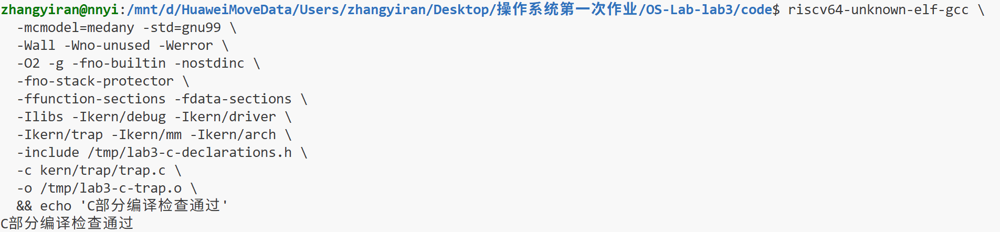

*图 C1：保留警告检查和 RV64 编译配置后，`trap.c` 独立编译通过。*

这一步确认了当前代码通过所启用的语法和类型检查。由于 `-c` 不链接也不运行内核，定时器和 Trap 返回还需要后续测试。

#### 5.2.2 构建独立测试内核

我在 `/tmp/lab3-c-test.AXvPFB` 中准备测试副本，保留已有的 Trap 入口与恢复实现，通过 `tools/inject.py` 注入测试代码。启用 `GRADE_LAB3_TIMER` 后，测试会在开启中断后等待 `ticks` 达到200，检查时钟能否持续进入并返回。

副本中的异常占位函数在意外异常发生时打印现场并停止，用于满足链接和排查运行问题。临时声明头用 `__ASSEMBLER__` 条件排除汇编预处理场景。这些辅助内容没有放入正式函数补丁。

第一次构建报错 `unknown CSR 'sbadaddr'`。报错位置是 `trapentry.S` 中 `SAVE_ALL` 读取辅助信息寄存器的语句，如图 C2。

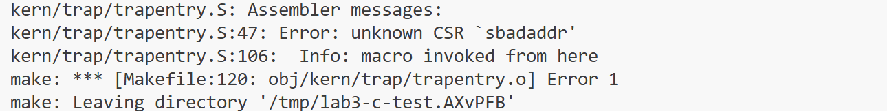

*图 C2：汇编器在 `trapentry.S:47` 处无法识别旧 CSR 名称。*

确认是名称兼容问题后，在测试构建参数中加入 `-Dsbadaddr=stval`，让 `.S` 文件预处理时使用当前工具链接受的名称。关键命令如下：

```bash
lab3_c_test_dir='/tmp/lab3-c-test.AXvPFB'
make -C "$lab3_c_test_dir" \
  "DEFS=-DGRADE_LAB3_TIMER -include $lab3_c_test_dir/c_only_declarations.h -Dsbadaddr=stval"
```

添加参数后，构建成功链接 `bin/kernel`，并生成 `bin/ucore.img`。这一处理只作用于测试构建参数，汇编源码和 TrapFrame 布局保持原样。

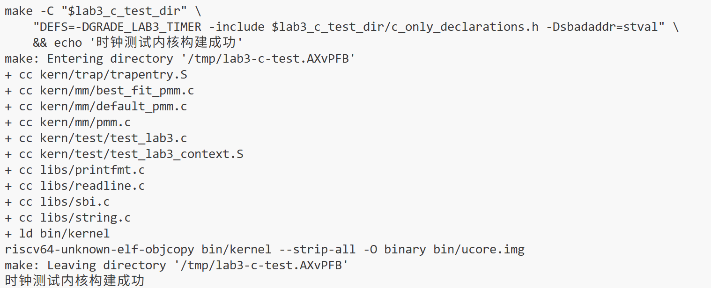

*图 C3：加入兼容参数后，链接和镜像生成完成。*

#### 5.2.3 排查启动停滞与 QEMU 版本

初次运行只显示固件信息，没有出现内核的时钟输出。检查命令路径后发现，默认运行的是 QEMU 7.0.0，本机另外安装了4.1.1。图 C4 记录了默认路径、版本和4.1.1的安装位置。

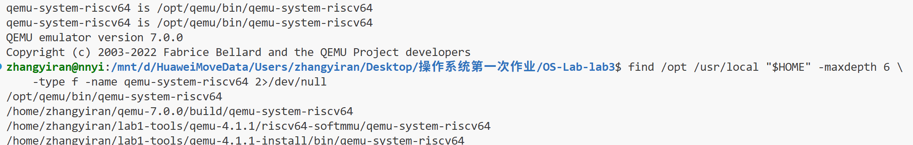

*图 C4：默认命令调用7.0.0，运行4.1.1需要使用对应路径。*

在 QEMU 7 下调试时，GDB 能停在物理入口 `0x80200000`，但继续执行后没有到达 `kern_init()`。此时 `satp = 0x8000000000080206`，`scause = 0xc`，`sepc` 和 `stval` 都是 `0x80200038`，并出现无法访问 `0x80200000` 的提示。

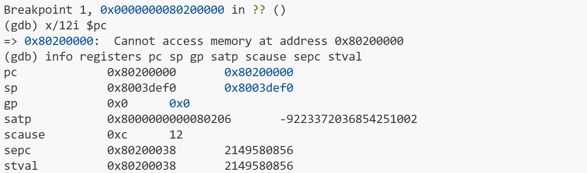

*图 C5：开启分页后的启动过程发生取指缺页，此时尚未进入中断处理函数。*

根据 `satp` 可判断 Sv39 已开启，原因码12表示取指缺页，出错位置仍在低地址启动区域。结合 `entry.S` 中仅配置高地址映射的启动页表，可以推测本次故障发生在开启地址翻译后的过渡阶段。这个现场还不足以判断 QEMU 7 本身是否有问题。

排查时曾讨论调整测试副本的启动映射。重新确认课程环境后，我先用本机已有的 QEMU 4.1.1和原启动代码运行，时钟测试能够正常进行，因此没有把启动页表修改加入交付代码。此次解决的是实验环境下的运行问题，对新版 QEMU 的适配没有继续展开。

#### 5.2.4 观察真实时钟中断入口

QEMU 4.1.1启动后，GDB 加载对应 `bin/kernel` 的符号并连接调试端口。在 `interrupt_handler` 设置硬件断点，第一次命中时读取原因码、计数和返回地址：

```gdb
hbreak interrupt_handler
continue
p/x tf->cause
p ticks
p/x tf->epc
```

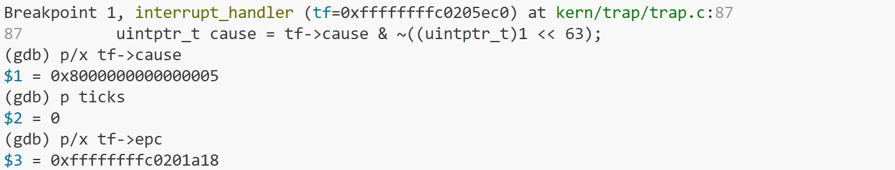

*图 C6：第一次进入时，原因码为 `0x8000000000000005`，`ticks` 为0。*

图中 `tf = 0xffffffffc0205ec0`，`tf->epc = 0xffffffffc0201a18`。原因码最高位为1、低位为5，说明收到的是 Supervisor 时钟中断。断点位于函数入口，尚未执行 `ticks++`，所以计数为0。

我保存了这次入口的 `tf` 和 `epc`，用于之后比较。地址与当次构建有关，重新编译后应按函数符号设置断点，再读取实际值。

#### 5.2.5 检查下一次时钟事件的设置

为了检查重设接口是否由当前中断调用，我先保存 `tf` 和 `epc`，再依次在 `clock_set_next_event()`、`sbi_set_timer()` 设置临时硬件断点：

```gdb
set $c_tf = tf
set $c_epc = tf->epc
thbreak clock_set_next_event
continue
bt 4
thbreak sbi_set_timer
continue
info args
p ticks
```

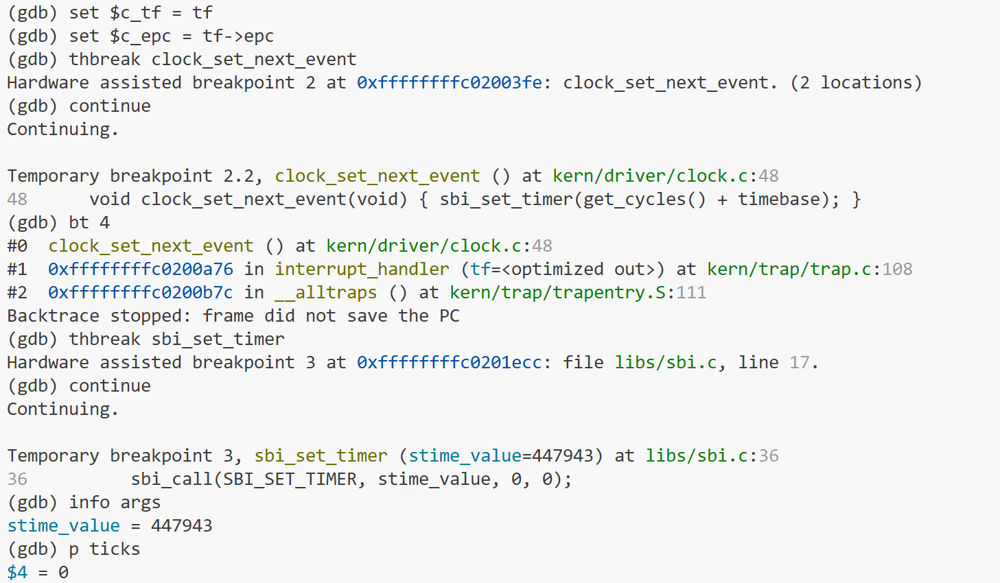

*图 C7：从 handler 进入时钟重设函数，随后调用 `sbi_set_timer(stime_value=447943)`。*

调用栈包含 `interrupt_handler()` 和 `__alltraps`，说明这次重设来自中断处理。进入 `sbi_set_timer()` 时，`stime_value = 447943`，`ticks` 仍为0，与代码中先重设、后计数的顺序一致。

447943是这次调用设置的绝对触发时间。截图没有同时读取调用前的时间值，不能据此计算实际间隔；代码中的间隔由 `get_cycles() + timebase` 决定。重设后能否再次触发，还要继续运行观察。

调试中也出现了 `tf=<optimized out>` 和 `Backtrace stopped: frame did not save the PC`。前者与 `-O2` 优化有关，后者说明 GDB 无法继续按普通调用帧展开汇编入口。我因此在入口保存需要比较的值，并改到 `__trapret` 处直接观察现场。

#### 5.2.6 比较返回前后的计数与地址

在 `__trapret` 设置临时硬件断点，检查本次中断处理后的状态，再继续到下一次 handler 入口：

```gdb
thbreak __trapret
continue
p ticks
p/x $c_tf->epc
p $c_tf->epc == $c_epc
continue
p/x tf->cause
p ticks
```

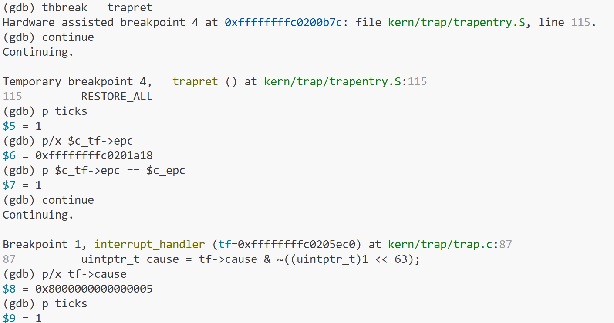

*图 C8：第一次处理后 `ticks = 1`，`epc` 比较结果为真；继续运行后再次进入时钟中断。*

在返回位置，计数从0变为1，`$c_tf->epc == $c_epc` 的结果为1。继续执行后再次命中 `interrupt_handler()`，原因码仍为 `0x8000000000000005`，入口处的 `ticks` 为1。这说明本次处理只增加了一次计数，保存的返回地址未变，下一次时钟也成功到达。

本次检查观察了时钟函数到返回路径的执行过程，没有逐个比较全部通用寄存器。完整的寄存器恢复仍需由 Test 1 检查。

#### 5.2.7 检查软件中断和未知原因分支

框架的 `test_lab3_handler_fallbacks()` 会构造 TrapFrame 后直接调用 handler。我在 GDB 中采用类似方法：已经进入 `interrupt_handler()`、尚未读取原因码时，临时修改 `tf->cause`，到返回处检查状态，再恢复原值。

**（1）Supervisor 软件中断分支**

先保存 `$case_tf`、`$case_cause`、`$case_epc` 和 `$case_ticks`，将 `tf->cause` 设为 `0x8000000000000001`，再运行到 `__trapret`。

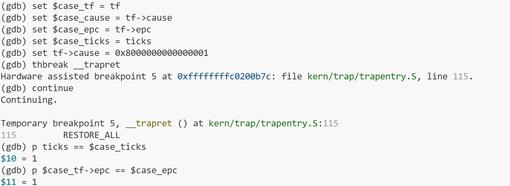

*图 C9：计数和返回地址与进入前相同，两个比较结果均为1。*

控制台同时输出了对应提示：

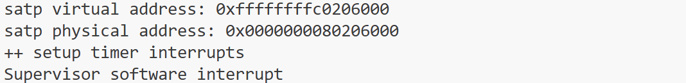

*图 C10：控制台输出 `Supervisor software interrupt`。*

给定这一输入后，函数进入了对应分支，没有增加时钟计数或修改 `epc`。由于没有设置硬件的软件中断挂起位，这项记录属于函数输入检查。

**（2）未知原因分支**

下一次进入 handler 时保存现场，将 `tf->cause` 临时改为15。到返回位置后，计数和地址仍与进入前相同，随后恢复原原因值。

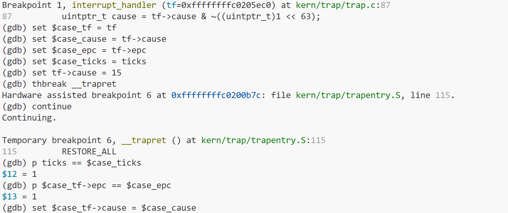

*图 C11：未知原因分支的两个状态比较均返回1。*

控制台输出 `Unknown interrupt: cause 15`，并打印 TrapFrame，末尾原因字段为 `0x0000000f`。

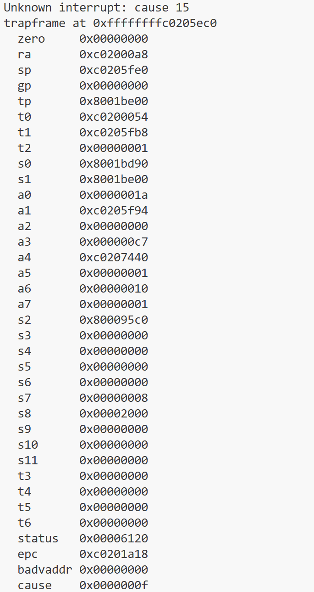

*图 C12：未知原因号和 TrapFrame 均被输出。*

原因值15没有设置最高中断标志位。本次修改发生在公共分发之后，因此检查的是 handler 内的 `default` 分支，不能据此判断真实 `scause=15` 会怎样经过 `trap_dispatch()`。人工替换时钟原因后也没有执行重设事件，恢复 TrapFrame 字段不会重新设置硬件定时器，所以最终持续运行测试另行重启。

图中的 `epc` 显示为 `0xc0201a18`，GDB 则能读取完整的 `0xffffffffc0201a18`。原有 `print_trapframe()` 对相关字段使用 `%08x`，只显示低32位；这里以 GDB 中的完整值比较来判断地址是否改变，公共打印函数未作修改。

#### 5.2.8 补齐关机条件后重新运行

初版在 `ticks=200` 时通过了 Test 3，之后仍会一直输出。重新核对要求后，我在函数中增加 `tick_print_count`、`SHUTDOWN_AFTER = 10` 和 `sbi_shutdown()`，更新测试副本并重新构建。

最终测试重新启动 QEMU 4.1.1，不再通过 GDB 修改输入。运行时保留30秒超时限制，并保存控制台日志：

```bash
lab3_c_test_dir='/tmp/lab3-c-test.AXvPFB'
lab3_qemu4='/home/zhangyiran/lab1-tools/qemu-4.1.1-install/bin/qemu-system-riscv64'
timeout 30s "$lab3_qemu4" \
  -machine virt -nographic -bios default \
  -device loader,file="$lab3_c_test_dir/bin/ucore.img",addr=0x80200000 \
  -serial stdio -monitor none -no-reboot 2>&1 \
  | tee "$lab3_c_test_dir/timer-qemu4-shutdown.log"
lab3_qemu_status=${PIPESTATUS[0]}
printf 'QEMU_EXIT_STATUS=%s\n' "$lab3_qemu_status"
printf 'TICK_OUTPUT_LINES='
grep -c '^100 ticks' "$lab3_c_test_dir/timer-qemu4-shutdown.log"
```

管道结束后立即保存 Bash 的 `${PIPESTATUS[0]}`，读取 `timeout` 包装的 QEMU 命令状态。若只看 `tee` 的退出码，只能知道日志是否保存成功。

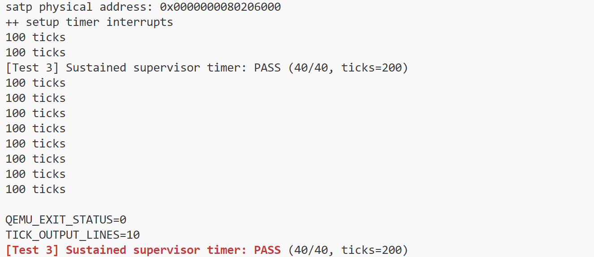

*图 C13：Test 3 通过，累计输出10行 `100 ticks`，进程退出状态为0。*

| 观察项 | 实际结果 | 说明 |
|--------|----------|------|
| 时钟初始化 | `++ setup timer interrupts` | 已执行时钟初始化 |
| 持续时钟测试 | `[Test 3] Sustained supervisor timer: PASS (40/40, ticks=200)` | 测试主流程观察到200次中断计数 |
| 输出行数 | `TICK_OUTPUT_LINES=10` | 达到本次设置的输出次数 |
| 退出状态 | `QEMU_EXIT_STATUS=0` | 正常退出，没有被超时命令终止 |

10次输出和正常退出与源码中的关机条件相符。根据每100次输出一次的逻辑，可以推算关机发生在第1000次中断；截图没有在关机瞬间直接读取这一计数值。

Test 3 在计数达到200时就输出 PASS，之后仍然循环，并不检查第10次输出后的关机。因此本次另行统计输出行数并检查退出状态。图 C13 底部的红色 PASS 行是再次检索日志得到的同一条结果。

控制台日志保存为 [timer-qemu4-shutdown.log](C_2412419/evidence/timer-qemu4-shutdown.log)，其中包含内核输出和十行 `100 ticks`。`QEMU_EXIT_STATUS`、`TICK_OUTPUT_LINES` 由 Shell 在运行结束后打印，记录在图 C13 中。

#### 5.2.9 修改范围与测试结果

交付前，我排除了 Windows/WSL 行尾差异，再检查实际源码改动。`code/` 下只有 `kern/trap/trap.c` 发生变化，共增加62行、删除1行，内容是替换 `YOUR CODE` 标记并加入自己的中断处理函数。

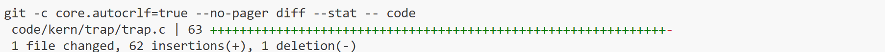

*图 C14：源码修改集中在 `code/kern/trap/trap.c`。*

补丁保存为 [interrupt_handler.patch](C_2412419/interrupt_handler.patch)。合并时按函数和上下文检查，保留3号在同一文件中的异常处理实现。

| 检查项目 | 结果 | 对应记录 |
|----------|------|----------|
| 独立编译 | 通过 | 图 C1 |
| 测试内核构建 | 通过，使用临时声明、异常占位和 CSR 兼容参数 | 图 C3 |
| 真实时钟原因码 | 与 Supervisor 时钟中断一致 | 图 C6 |
| 时钟重设 | 观察到 handler 调用和 SBI 参数 | 图 C7，后续中断见 C8、C13 |
| 计数和返回地址 | 一次处理后计数从0到1，`epc` 不变 | 图 C8 |
| 软件中断分支 | 提示和状态检查通过 | 图 C9、C10，属于人工输入检查 |
| 未知原因分支 | 原因号、现场输出和状态检查通过 | 图 C11、C12 |
| 最终运行与关机 | Test 3 显示40/40，10次输出，正常退出 | 图 C13、最终日志 |
| 小组完整评分 | 尚未取得完整结果 | 需正式模块合并后运行 `make grade` |

#### 5.2.10 调试中遇到的问题

| 现象 | 原因或定位结果 | 处理方法 |
|------|----------------|----------|
| VS Code 在 `set_csr(sie, MIP_STIP)` 附近标红 | `sie` 是 CSR 宏使用的名称，编辑器配置可能与交叉编译环境不同 | 阅读宏定义，以实际编译输出判断 |
| 在 Ubuntu 中再次执行 `wsl -d ...` 报错 | 提示符已显示 Linux 用户和 `/mnt/d/...` 路径 | 直接使用 Linux 命令，不另装无关的 `wsl` 包 |
| Bash 报 `cprintf`、`break` 错误 | 将 C 代码粘进了终端 | 将代码写回编辑器，终端用于运行命令 |
| Git 显示大量无关文件变化 | Windows 与 WSL 的 CRLF/LF 行尾差异 | 先排除行尾影响，再检查实际改动 |
| 汇编器不识别 `sbadaddr` | 旧 CSR 名称与当前工具链不兼容 | 在测试构建参数中映射为 `stval` |
| 固件输出后没有继续运行 | 默认使用 QEMU 7.0.0，GDB 发现启动阶段取指缺页 | 改用 QEMU 4.1.1完整路径和原启动代码 |
| GDB 显示变量被优化或回溯停止 | `-O2` 优化和汇编入口栈展开限制 | 在入口保存需要比较的值，在返回符号处检查 |
| Test 3 通过后持续输出 | 初版缺少输出次数统计和关机条件 | 补齐逻辑后，重新检查输出行数和退出状态 |

这些问题出现在不同阶段。之后遇到报错时，我会先看当前执行的是编辑器、Shell、编译器还是 GDB，再根据出错位置检查对应代码和环境。这样更容易找到原因，也能减少无关修改。

### 5.3 3号成员测试与验证

### 5.4 集成测试与当前进度

完整评分由 [tools/grade.sh](../code/tools/grade.sh) 执行。脚本分别使用不同测试宏重建内核、运行 QEMU，再检查对应输出。各项分值和当前情况如下。

| 用例 | 分值 | 检查内容 | 当前情况 |
|------|------|----------|----------|
| Test 1 | 35 | Trap 入口、寄存器恢复和断点返回，检查对应 PASS 与 `Breakpoint at` | 正式模块集成后补充运行结果 |
| Test 2 | 25 | 非法指令返回，以及软件中断、未知中断和其他异常提示 | 2号检查了其中两个中断分支，非法指令和异常分支仍需验证 |
| Test 3 | 40 | 时钟重设和反复返回，检查 PASS、`100 ticks`、`ticks=200` | 2号独立副本已取得对应输出 |
| 总分 | 100 | 三个用例全部通过 | 尚无完整 `Total Score: 100/100` 记录 |

集成时需要换用正式的 `exception_handler()`，统一 QEMU 版本和 CSR 名称兼容方式。`grade.sh` 直接执行 `qemu-system-riscv64`，因此运行前要确认这个命令实际对应的程序；只设置 Makefile 的 `QEMU` 变量未必会改变评分脚本的选择。

完成三个用例后，还需保留输出次数和关机结果。最终总分以小组实际运行记录为准。

---

## 六、实验总结与收获

### 6.1 对操作系统的理解

#### 1号成员：张懿鸾 2413669

这次编写 Trap 入口和恢复代码后，我对保存现场有了更具体的理解。处理器通过 `stvec` 找到入口，用 `sepc`、`sstatus`、`scause` 等寄存器记录状态，通用寄存器则需要由软件保存。`SAVE_ALL` 和 `RESTORE_ALL` 必须使用相同的槽位，尤其要注意当前 `sp` 还是读取 TrapFrame 的基址，不能提前恢复。

汇编和 C 函数之间的连接也变得清楚了：`__alltraps` 按调用约定用 `a0` 传入现场地址，C 层处理完成后再由汇编恢复并执行 `sret`。中断和异常虽然共用这条路径，但触发原因和返回地址的处理不同，编写入口时需要为两者保留一致的接口。

实验二的内存管理提供了运行基础，本次增加了内核响应事件的能力。时钟可以为调度提供触发条件，异常入口也能用于后续缺页处理和系统调用；进程通信、文件系统、死锁处理等功能仍需要更多数据结构和内核代码。

#### 2号成员：张祎然 2412419

这次实验让我把时钟中断和完整的执行过程联系起来。我的代码虽然只有一个 C 函数，但它依赖汇编先保存现场并传入 `tf`，处理完成后也要依靠恢复代码返回。阅读调用关系后，我才理解为什么修改 `cause`、`epc` 或公共结构时必须格外仔细。

GDB 中最直观的一次观察是：第一次进入时 `ticks=0`，到 `__trapret` 时变为1，保存的 `epc` 没有变化；继续运行后，又收到同一种时钟中断。这说明中断函数可以更新自己的计数，同时让原程序继续执行。时钟中断发生时，原指令并没有出错，因此不能照搬某些异常处理中的做法去推进 `epc`。

我也弄清了计数、输出和重设定时器的区别。`ticks` 记录处理次数，`print_ticks()` 方便观察，`clock_set_next_event()` 则决定下一次事件能否到达。每次重新设置单次事件，才形成了本实验中的周期性时钟。

这些实现为后续功能提供了基础，但当前还没有调度队列和进程状态管理；`volatile` 也不能解决多核竞争。把已有代码做到什么程度弄清楚，有助于继续理解进程调度、同步和虚拟内存等内容。

#### 3号成员：张旗庭 2413788

### 6.2 AI 协作开发的经验

#### 1号成员：张懿鸾 2413669

我在提示词中先写明只修改 `trapentry.S`，并要求检查已有 `SAVE_ALL` 和 `struct trapframe`。这样生成的代码能够以当前模板为依据，重点处理寄存器槽位、`sp` 的恢复顺序，以及向 `trap()` 传递参数的方式。

代码生成后，我结合源码检查了每个恢复位置，再用 `git diff` 确认修改范围，独立编译目标文件，并查看反汇编中的 CSR 恢复、调用重定位和 `sret`。各阶段的结果通过 Git 保存。这个过程让我逐渐形成了先说明接口和要求、再检查生成代码的习惯。读懂这些指令，才能判断生成结果是否符合要求。

#### 2号成员：张祎然 2412419

这次使用 AI 时，我先把自己负责的模块讲清楚，让它提供基础框架和解释，具体代码由我编写，写好后再一起检查。中断处理虽然只有一个对外入口，但要同时考虑原因分类、时钟重设、计数、输出、关机和返回。把这些要求放在一起，再说明已有接口和不能修改的部分，讨论时就更容易发现缺少了什么，也能避免改动同学负责的代码。

我将提示词分为任务说明、依赖说明、接口清单和行为规格四部分。依赖只列出 TrapFrame、原因号、时钟、打印和 SBI 等相关定义；接口保持 `interrupt_handler(struct trapframe *tf)` 不变。行为要求则写成能够检查的结果，例如一次时钟处理后计数增加一次、返回地址不变，其他类型的中断不更新时钟状态。写好代码后，我就按这些条件逐项核对，再把拿不准的地方发给 AI 讨论。

初版漏掉关机条件给我的印象最深。当时 Test 3 已经显示 PASS，但程序仍然一直输出。重新检查后才补上累计输出次数和关机逻辑，并再次运行，确认共输出10次、QEMU 退出状态为0。这让我认识到，测试通过之前要先弄清测试检查了什么。持续时钟和达到次数后结束是两个要求，需要分别验证。

排错时也需要把环境和具体报错说清楚。我遇到过把 C 代码粘进 Bash、编辑器无法识别 CSR 宏，以及 QEMU 启动停滞等问题。特别是 QEMU 那次，讨论已经涉及页表，检查实际路径后才发现默认运行的是7.0.0。改用本机已有的4.1.1后就能继续测试。先核对版本、输入位置和出错阶段，能少做很多无关修改。

最后，我把修改范围、运行日志和 GDB 观察结果放在一起检查。真实时钟触发、人工修改原因码和完整评分分别验证不同内容，报告里的结论也要与实际记录对应。AI 能帮助解释代码和安排调试步骤，最终仍需要自己执行、观察并反馈结果，才能判断问题是否解决。

#### 3号成员：张旗庭 2413788

### 6.3 共同部分：实验知识点与操作系统原理的对应

| 实验中的知识点 | 含义及本实验体现 | 对应的 OS 原理 | 联系与区别 |
|----------------|-----------------|----------------|------------|
| 中断与异常分类 | `scause` 最高位用于分类，低位用于选择具体处理逻辑 | 操作系统对异步事件和同步错误的响应机制 | 二者共用 Trap 通道，但触发条件和返回地址处理不同，不能统一跳过一条指令 |
| TrapFrame | 将通用寄存器及有关 CSR 按固定布局保存在内核栈 | 执行现场保护、上下文管理 | TrapFrame 是保存现场的数据表示；保存和恢复一次中断现场不等于切换到了另一个进程 |
| 汇编与 C 的接口 | `__alltraps` 用 `a0` 传递 `tf`，C 层处理后返回 `__trapret` | 硬件机制与内核软件的衔接 | 普通函数调用约定负责参数和调用关系，Trap 入口还必须保护被打断代码的寄存器状态 |
| 特权级与 CSR | `stvec` 决定入口，`sepc` 决定返回位置，`sstatus` 保存相关状态 | 处理器保护机制、内核控制权 | 进入处理程序和恢复权限依赖硬件支持，具体处理策略由内核实现；本实验不等于完成了用户进程体系 |
| 周期时钟服务 | handler 通过 SBI 重新安排单次事件并增加 `ticks` | 定时、时间片与抢占的基础 | 时钟提供调度触发条件；实际调度还需要可运行进程、状态管理和调度策略 |
| 中断使能与临界区 | `sie` 控制中断类别，`sstatus.SIE` 控制 S 模式使能，相关内存管理代码保存并恢复中断状态 | 共享状态保护和原子性 | 单核屏蔽中断可避免本核中断处理打断临界区；不自动阻止其他 CPU 同时访问数据 |
| `volatile` 计数 | 普通执行流可重新读取由中断更新的 `ticks` | 编译器可见性与并发状态 | `volatile` 不等于锁、原子读改写或跨核内存同步 |
| SBI 封装 | 通过 `sbi_set_timer()`、`sbi_shutdown()` 请求固件服务 | 特权服务接口和硬件抽象 | C 封装隐藏了调用细节，但不能据此假定所有平台和版本的行为都相同 |
| 分层验证 | 编译、真实时钟、GDB 比较、人工输入、集成评分分别提供证据 | 模块化设计与系统验证 | 局部函数通过不等于整体系统通过；输入构造测试不等于硬件端到端触发 |

从这些对应可以看出，本实验的核心是把处理器提供的事件入口组织成内核可使用的服务。正确的实现既依赖局部逻辑，也依赖不同层次之间的约定一致：保存布局要与恢复布局一致，硬件原因码要与软件分类一致，返回位置的处理要与事件语义一致，测试结论也要与实际覆盖范围一致。

### 6.4 共同部分：本实验尚未覆盖的重要内容

| OS 原理中的重要内容 | 与本实验的联系 | 本次未覆盖的具体部分 |
|---------------------|----------------|----------------------|
| 进程调度与抢占 | 时钟中断可以成为调度时机 | 没有建立进程控制块、就绪队列、时间片分配和进程间上下文切换 |
| 系统调用及用户态隔离 | Trap 机制可作为系统调用入口 | 截图中标注的 `CHALLENGE 1`（`lab3_switch_test()`）不列入本次要求；基础 Trap 路径的验证不等于已实现完整的用户进程体系、用户地址检查或系统调用分发 |
| 缺页处理与虚拟内存 | 异常原因和故障地址提供定位依据 | 没有完成按需分配、换入换出、写时复制等修复机制；输出现场不能代替修复 |
| 完整设备驱动 | 外部中断可进入事件处理流程 | 未实现中断控制器的完整分发、设备确认、中断挂起清除和数据传输协议 |
| 多核同步与内存一致性 | 中断处理可能访问共享状态 | 本次时钟计数按单核运行验证，未设计跨核锁、原子操作和内存屏障协议 |
| 进程通信、文件系统和死锁 | 需要稳定的内核执行与事件响应基础 | 本实验没有实现管道、消息队列、文件管理、资源等待与死锁处理 |

后续扩展应建立在这些边界之上。例如，将时钟处理扩展为抢占调度时，需要明确哪个进程被打断、其状态保存在哪里以及何时切换；将异常输出扩展为缺页处理时，需要决定是否可以修复地址映射、是否应重新执行故障指令。当前实验提供了进入、处理和返回的基础通道，完整策略仍需额外的数据结构与验证。

---
