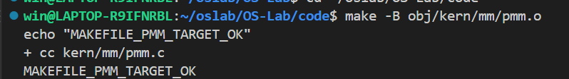
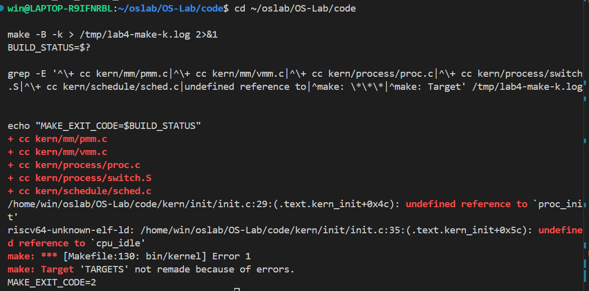

# 操作系统实验报告

## 实验基本信息

| 项目 | 内容 |
|------|------|
| **实验名称** | 操作系统实验四：进程管理 |
| **小组成员** | 2413669-张懿鸾、2412419—张祎然、2413788-张旗庭|
| **完成日期** | 2026-11-20 |

### 小组分工

| 成员 | 负责的练习/模块 | 实际完成情况 |
|------|----------------|--------------|
| 2413669-张懿鸾（1号） | 功能模块一：虚拟内存页操作；Challenge 问题2、问题3         | 完成 page_insert() 和 page_remove() 的实现，恢复 Lab2 物理内存管理及 Lab3 Trap 相关代码  |
| 2412419—张祎然（2号） | 功能模块二：进程创建及初始化  | 负责 PCB 初始化、内核线程创建、进程创建及相关辅助函数的实现         |
| 2413788-张旗庭（3号） |功能模块三：进程调度和Challenge 问题1|负责空闲线程、调度策略、进程切换及底层上下文切换函数的实现  |


### 实验报告分工

- **1号（2413669-张懿鸾）：** 负责实验报告的整体组织与撰写，包括实验目的、实验整体逻辑分析，以及本人负责的虚拟内存页操作模块的实验原理、代码实现、测试分析和总结。同时负责两个 Challenge 问题的分析与解答。

- **2号（2412419—张祎然）：**  负责进程创建及初始化功能模块的实验报告，主要包括 PCB 数据结构、进程初始化、内核线程创建、do_fork() 和相关辅助函数的实现原理与过程分析。

- **3号（2413788-张旗庭）：** 负责进程调度功能模块的实验报告，主要包括 FIFO 调度策略、schedule()、proc_run()、switch_to() 的实现原理，以及上下文切换和页表切换过程的分析。

---

## 一、实验目的
- 了解虚拟内存管理的基本结构，掌握虚拟内存的组织与管理方式

- 了解内核线程创建/执行的管理过程

- 了解内核线程的切换和基本调度过程


---

## 二、实验环境

### 2.1 软硬件环境

| 项目 | 版本或配置 |
|------|------------|
| 操作系统/WSL 环境 | Windows + WSL2，Ubuntu 24.04.5 LTS |
| RISC-V 交叉编译器 | `riscv64-unknown-elf-gcc` 13.2.0 |
| 常规 QEMU | QEMU 4.1.1，路径：`/home/win/opt/qemu-4.1.1-install/bin/qemu-system-riscv64` |
| 带调试信息的 QEMU | QEMU 4.1.1，路径：`/home/win/opt/qemu-4.1.1/riscv64-softmmu/qemu-system-riscv64`；已确认包含 `.debug_info` 等调试信息，且未剥离符号 |
| 普通 GDB | GNU GDB 15.1，x86-64 宿主机调试器，用于附加并调试 QEMU 进程 |
| RISC-V GDB | `riscv64-unknown-elf-gdb` 15.1；通过 QEMU GDB stub 调试模拟 RISC-V CPU，目标架构设置为 `riscv:rv64` |
| 其他工具 | GNU Make 4.3、Git 2.43.0、RISC-V GNU Binutils 2.42、QEMU 源码及 GDB 调试工具 |

### 2.2 AI 工具使用情况

| 成员 | AI 编程工具/使用入口 | 底层模型及版本 | 主要用途 |
|------|--------------------|----------------|----------|
| 2413669-张懿鸾 |  Codex（VS Code）+ ChatGPT | Codex 使用 DeepSeek 后端（Deepseek-Flash）| [待填写] |
| 2412419—张祎然| [待填写] | [待填写] | [待填写] |
| 2412419—张祎然、2413788-张旗庭 | [待填写] | [待填写] | [待填写] |

---

## 三、实验整体逻辑分析

### 3.1 本章节的逻辑主线

实验2主要完成了物理内存管理和基础页表机制，实验3完成了 Trap 入口、上下文保存与恢复以及中断和异常处理。本实验则在这些已有功能的基础上，进一步实现操作系统的虚拟内存管理、进程创建与初始化以及进程调度功能，使内核从具备基本内存管理能力逐步发展到能够创建、管理和调度多个内核线程。

本次实验围绕三条主要功能主线展开：

1. **虚拟内存页操作：** 在已有多级页表机制和物理内存管理框架上，实现虚拟地址与物理页面之间的动态映射和解除映射。通过 `page_insert()` 和 `page_remove()` 管理页表项、物理页面引用计数以及 TLB 状态，为后续进程地址空间管理提供基础。
2. **进程创建及初始化：** 建立进程控制块（PCB）及相关管理结构，实现进程的初始化、内核线程创建和进程创建。通过 `alloc_proc()`、`proc_init()`、`kernel_thread()`、`do_fork()` 等函数，将内核线程的执行入口、内核栈和上下文信息组织起来，使其成为内核能够管理的可运行实体。
3. **进程调度：** 在已经创建进程的基础上，实现线程选择和上下文切换。通过 `cpu_idle()`、`schedule()`、`proc_run()` 和 `switch_to()`，完成从当前线程到目标线程的切换，使新创建的内核线程能够获得 CPU 执行机会。

虚拟内存页操作为进程及其地址空间管理提供基础，进程创建模块负责生成并初始化可运行的线程，进程调度模块则负责选择线程并完成实际的执行权转移。

本次实验的整体执行链可以概括为：

```text
                    kern_init
                        |
                        v
                    pmm_init
                        |
                        v
               pic_init / idt_init
                        |
                        v
                    vmm_init
                        |
                        v
                    proc_init
                        |
                 +------+------+
                 |             |
                 v             v
              idleproc       initproc
                 |
                 v
               cpu_idle
                 |
                 v
              schedule
                 |
                 v
               proc_run
                 |
                 v
              switch_to
                 |
                 v
           目标线程获得执行权
```

其中，`pmm_init()` 负责初始化物理内存管理及基础页表，`vmm_init()` 负责完成虚拟内存管理相关初始化；`proc_init()` 则建立进程管理所需的基础结构，并创建空闲线程 `idleproc` 和第一个内核线程 `initproc`。随后，内核进入 `cpu_idle()`，在需要调度时调用 `schedule()` 选择下一个可运行线程，并通过 `proc_run()` 和 `switch_to()` 完成上下文切换。

因此，本次实验的核心目标是将物理内存管理、虚拟内存映射、线程创建和进程调度等机制连接起来，形成一个完整的内核线程管理与执行流程。

### 3.2 功能的逐步实现

**第一阶段：虚拟内存页操作**

本阶段主要在 `kern/mm/pmm.c` 中完成 `page_insert()` 和 `page_remove()` 两个函数的实现。

首先，利用已有的 `get_pte()` 函数查找指定虚拟地址对应的页表项，在必要时创建中间级页表。随后，通过 `page_insert()` 建立或更新虚拟地址与物理页面之间的映射，并根据映射情况维护物理页面的引用计数；通过 `page_remove()` 删除已有映射，在清除页表项后更新 TLB，并在页面引用计数归零时将物理页面归还给物理内存分配器。

这一阶段重点解决页表映射、物理页面生命周期管理和 TLB 一致性问题。

**第二阶段：进程创建及初始化**

本阶段主要在 `kern/process/proc.c` 中完成进程管理相关函数的实现。

首先，通过 `alloc_proc()` 分配并初始化进程控制块，建立进程的基本信息；随后，通过 `proc_init()` 初始化进程管理所需的全局数据结构，并创建系统中的空闲线程 `idleproc` 和第一个内核线程 `initproc`。

在此基础上，利用 `kernel_thread()` 将普通内核函数包装成可运行的内核线程，通过 `do_fork()` 完成新进程的创建及相关资源管理，并由 `copy_thread()` 和 `copy_mm()` 分别处理线程执行上下文和地址空间相关信息。

这一阶段的重点是正确组织进程控制块、内核栈、PID、链表以及 TrapFrame 和 Context 等数据结构，保证新创建的线程能够具备首次运行所需的执行环境。

**第三阶段：进程调度与上下文切换**

本阶段主要涉及 `kern/process/proc.c`、`kern/schedule/sched.c` 和 `kern/process/switch.S` 三个文件。

首先，通过 `cpu_idle()` 建立系统的空闲线程执行循环；当内核需要重新选择执行线程时，由 `schedule()` 根据进程状态和调度策略，从进程链表中选择下一个可运行线程。

随后，`proc_run()` 更新当前运行进程，并根据目标进程的地址空间情况完成页表切换，最后调用底层汇编函数 `switch_to()` 保存当前线程的执行上下文并恢复目标线程的上下文。

对于新创建的线程，其首次运行还需要依赖前一阶段准备好的 Context 和 TrapFrame，通过 `forkret`、`forkrets` 和 `__trapret` 等入口完成首次执行现场的恢复。

这一阶段最终将前两个阶段建立的进程管理结构与实际 CPU 执行过程连接起来，使系统能够从最初的空闲线程切换到其他可运行线程，完成内核线程的调度与执行。

综上，本次实验按照“虚拟内存页操作 → 进程创建及初始化 → 进程调度”的顺序逐步推进，三个功能模块既具有相对独立的实现内容，又通过物理内存管理、页表机制、进程控制块和上下文切换等接口相互联系，共同构成了本次实验的完整实现流程。

---

## 四、实验内容与实现

### 4.1 功能模块一：虚拟内存页操作功能

**负责人：** 张懿鸾-2413669（1号）

#### 模块功能描述

**需要实现/修改的函数：**

```c
// kern/mm/pmm.c

int page_insert(pde_t *pgdir, struct Page *page,uintptr_t la, uint32_t perm);

void page_remove(pde_t *pgdir, uintptr_t la);
```

**功能说明：**

本模块负责实现虚拟地址与物理页面之间的动态映射管理，是操作系统虚拟内存管理机制的重要组成部分。

在分页机制下，程序使用虚拟地址访问内存，处理器通过多级页表将虚拟地址转换为实际物理地址。本模块位于物理内存管理（PMM）与虚拟内存管理（VMM）之间，负责维护页表中的具体映射关系，并保证物理页面引用计数与页表状态的一致性。

本模块主要实现以下两个功能：

1. **建立和更新页面映射（`page_insert()`）：** 将指定物理页面映射到目标虚拟地址，并根据传入的权限参数设置页表项。当目标地址已经存在映射时，需要区分新旧映射是否指向同一个物理页面，并正确处理页面引用计数，避免重复增加引用或错误释放物理页面。
2. **删除页面映射（`page_remove()`）：** 撤销指定虚拟地址对应的物理页面映射。删除前需要判断页表项是否存在且有效，随后清除页表项、刷新对应 TLB 项，并减少物理页面的引用计数。当引用计数归零时，将物理页面归还给物理内存分配器。

两个函数共同维护以下三个方面的一致性：

- **页表项：** 保证虚拟地址与物理页面之间的映射关系正确。
- **物理页面引用计数：** 保证页面只有在不再被任何有效映射引用时才被释放。
- **TLB：** 在页表映射发生变化后及时使对应的地址转换缓存失效，避免继续使用旧的地址转换结果。

本模块依赖已有的 `get_pte()`、`pte_create()`、`pte2page()`、`page2ppn()`、`page_ref_inc()`、`page_ref_dec()`、`alloc_page()`、`free_page()` 和 `tlb_invalidate()` 等接口。

此外，`page_insert()` 和 `page_remove()` 也是后续进程地址空间管理、页表映射检查以及缺页处理等功能的基础。

#### 核心实现代码

**1. `page_remove()`：删除虚拟地址映射**

```c
void page_remove(pde_t *pgdir, uintptr_t la)
{
    pte_t *ptep = get_pte(pgdir, la, 0);
    if (ptep == NULL || !(*ptep & PTE_V))
    {
        return;
    }

    struct Page *page = pte2page(*ptep);
    *ptep = 0;
    tlb_invalidate(pgdir, la);

    if (page_ref_dec(page) == 0)
    {
        free_page(page);
    }
}
```

实现过程如下：

1. 调用 `get_pte(pgdir, la, 0)` 查找目标虚拟地址对应的页表项。第二个参数为 0，表示只查找、不创建新的中间页表。
2. 如果页表项不存在，或者页表项的有效位 `PTE_V` 未设置，则直接返回。
3. 通过 `pte2page()` 获取该页表项对应的物理页面描述符。
4. 将页表项清零，解除虚拟地址与物理页面之间的映射。
5. 调用 `tlb_invalidate()` 使对应虚拟地址的 TLB 项失效。
6. 调用 `page_ref_dec()` 减少物理页面的引用计数。如果引用计数降为零，则调用 `free_page()` 将物理页面归还给物理内存分配器。

该实现同时保证了删除操作的幂等性：第一次删除后，页表项已经无效，后续重复调用不会再次减少引用计数或重复释放物理页面。

**2. `page_insert()`：建立或更新虚拟地址映射**

```c
int page_insert(pde_t *pgdir, struct Page *page,
                uintptr_t la, uint32_t perm)
{
    pte_t *ptep = get_pte(pgdir, la, 1);
    if (ptep == NULL)
    {
        return -E_NO_MEM;
    }

    if (*ptep & PTE_V)
    {
        if (pte2page(*ptep) == page)
        {
            *ptep = pte_create(page2ppn(page), perm);
            tlb_invalidate(pgdir, la);
            return 0;
        }
        page_remove(pgdir, la);
    }

    page_ref_inc(page);
    *ptep = pte_create(page2ppn(page), perm);
    tlb_invalidate(pgdir, la);
    return 0;
}
```

实现过程如下：

1. 调用 `get_pte(pgdir, la, 1)` 查找目标页表项。如果对应的中间级页表不存在，则尝试分配并建立相应的页表结构。
2. 如果获取页表项失败，说明页表创建过程中发生内存分配失败，函数返回 `-E_NO_MEM`。
3. 如果目标页表项已经有效，则通过 `pte2page()` 获取其对应的物理页面，并与新传入的 `page` 进行比较。
4. 如果新旧映射指向同一个物理页面，则只更新页表项及权限，不重复增加引用计数，也不释放页面。
5. 如果新旧映射指向不同物理页面，则调用 `page_remove()` 删除原映射，正确减少旧页面的引用计数，并在必要时释放旧页面。
6. 对新页面调用 `page_ref_inc()`，增加其引用计数。
7. 使用 `pte_create()` 创建新的页表项，将物理页号和权限信息写入页表。
8. 调用 `tlb_invalidate()` 使对应虚拟地址的 TLB 项失效，最后返回 0。

通过对不同映射情况进行区分，保证了页面映射更新过程中页表项、物理页面引用计数和 TLB 状态的一致性。

#### 最终提示词

以下是根据实际实现过程整理的最终提示词。由于两个函数之间存在调用依赖，实际开发时先实现 `page_remove()`，再实现 `page_insert()`。

```markdown
[PROMPT]

请在当前 Lab4 操作系统实验项目中，实现虚拟内存页操作功能。

本次需要实现的函数位于 kern/mm/pmm.c：

1. void page_remove(pde_t *pgdir, uintptr_t la);
2. int page_insert(pde_t *pgdir, struct Page *page,
                   uintptr_t la, uint32_t perm);

本模块负责维护虚拟地址与物理页面之间的映射关系，
需要重点保证页表项、物理页面引用计数以及 TLB 状态的一致性。

请先阅读当前项目的相关源码，理解已有接口和数据结构，
然后分两个阶段实现：

第一阶段：实现 page_remove()。
第二阶段：在 page_remove() 已经实现的基础上，实现 page_insert()。

[RELY]

可以依赖当前项目中已经存在的以下内容：

1. kern/mm/pmm.c：
   - get_pte()
   - get_page()
   - tlb_invalidate()
   - page2pa()
   - pa2page()
   - pte2page()
   - page2ppn()
   - pte_create()

2. kern/mm/pmm.h：
   - struct Page
   - pde_t、pte_t
   - page_ref()
   - page_ref_inc()
   - page_ref_dec()
   - alloc_page()
   - free_page()

3. 已有的页表权限宏：
   - PTE_V
   - PTE_U
   - PTE_R
   - PTE_W
   - PTE_X

4. 现有测试代码：
   - kern/mm/pmm.c 中的 check_pgdir()
   - tools/test_lab4.c 中的 PMM 测试部分

请以当前 lab4 分支中的实际代码为准，
不要假设历史版本中的接口与当前版本完全一致。

[GUARANTEE]

1. 不得修改函数签名。
2. 不得修改与本模块无关的函数或文件。
3. 不得覆盖整个 pmm.c。
4. 不得修改已经完成的 Lab2 物理内存管理代码。
5. 不得擅自修改 get_pte()、tlb_invalidate() 等已有辅助函数。
6. 必须复用已有的页面引用计数接口，不得通过直接修改
   page->ref 绕过引用计数管理。
7. 必须考虑同一物理页面被多个虚拟地址映射的情况。
8. 必须考虑重复删除、重复插入和映射替换等边界情况。
9. 不得声称尚未实际运行的测试已经通过。
10. 完成后提供完整代码、执行流程、边界情况分析、
    编译检查结果和实际修改文件列表。

[SPECIFICATION]

一、page_remove()

函数原型：

void page_remove(pde_t *pgdir, uintptr_t la);

功能：

删除指定页目录 pgdir 中，虚拟地址 la 对应的有效页面映射。

#### Pre-Condition

1. pgdir 指向有效的页目录。
2. la 表示需要删除映射的虚拟地址。
3. 目标物理页面由现有页表项描述。

#### Post-Condition

情况1：页表项不存在。

- 不创建新的中间页表。
- 不修改任何物理页面的引用计数。
- 不释放任何物理页面。
- 直接返回。

情况2：页表项存在但 PTE_V 未设置。

- 不调用 pte2page()。
- 不修改引用计数。
- 不释放页面。
- 直接返回。

情况3：页表项有效，物理页面引用计数大于1。

- 获取原物理页面描述符。
- 清除对应页表项。
- 调用 tlb_invalidate()。
- 减少页面引用计数。
- 不释放仍被其他映射引用的页面。

情况4：页表项有效，物理页面引用计数为1。

- 清除对应页表项。
- 刷新对应 TLB 项。
- 将页面引用计数减少至0。
- 调用 free_page() 归还物理页面。

情况5：重复删除同一地址。

- 第二次调用应安全返回。
- 不允许引用计数下溢。
- 不允许重复释放页面。

二、page_insert()

函数原型：

int page_insert(pde_t *pgdir, struct Page *page,
                uintptr_t la, uint32_t perm);

功能：

在页目录 pgdir 中，将物理页面 page 映射到虚拟地址 la，
并设置相应的页面访问权限。

#### Pre-Condition

1. pgdir 指向有效的页目录。
2. page 指向已经分配、可以用于映射的物理页面。
3. la 表示需要建立映射的虚拟地址。
4. perm 表示需要设置的页面权限。

#### Post-Condition

情况1：目标地址没有有效映射。

- 使用 get_pte(pgdir, la, 1) 获取或创建页表项。
- 增加新物理页面的引用计数。
- 使用 pte_create() 建立有效页表项。
- 刷新对应 TLB 项。
- 返回0。

情况2：目标地址已经映射到同一个物理页面。

- 不调用 page_remove()。
- 不增加或减少物理页面引用计数。
- 只更新页表项及其权限。
- 刷新对应 TLB 项。
- 返回0。

情况3：目标地址已经映射到其他物理页面。

- 调用 page_remove() 删除旧映射。
- 正确减少旧物理页面的引用计数。
- 如果旧页面引用计数归零，则释放旧页面。
- 增加新物理页面的引用计数。
- 建立新的页表映射。
- 刷新对应 TLB 项。
- 返回0。

情况4：get_pte() 创建或查找页表项失败。

- 返回 -E_NO_MEM。
- 不建立叶子页表映射。
- 不修改传入物理页面的引用计数。
- 不释放传入物理页面。
- 注意检查 get_pte() 自身在多级页表分配失败时
  是否可能留下已经分配的中间级页表。

情况5：同一个物理页面被映射到不同虚拟地址。

- 每增加一个有效映射，引用计数增加一次。
- 删除其中一个映射时，只减少一次引用计数。
- 只有最后一个映射被删除时才释放页面。

三、TLB 一致性要求

1. 清除旧映射后，应在释放旧物理页面之前刷新对应 TLB 项。
2. 建立新映射后，应刷新对应 TLB 项。
3. 更新同一物理页面的权限时，也应刷新对应 TLB 项。
4. 复用当前项目已有的 tlb_invalidate() 接口。

四、实现要求

1. 先实现 page_remove()，再实现 page_insert()。
2. page_insert() 应复用 page_remove() 处理旧映射，
   避免重复实现页面释放逻辑。
3. 不得改变其他已有函数的行为。
4. 代码必须符合当前项目的 RISC-V 编译环境。
5. 最终需要对照 check_pgdir() 和 tools/test_lab4.c
   检查实现是否满足测试契约。
```

#### 实现迭代过程

本模块按照两个函数之间的依赖关系，分为两轮完成。两轮均完成了对应的代码实现与编译检查，没有出现需要通过反复修改提示词才能解决的编译错误。

---

##### 第一次迭代：实现 page_remove()

**实现目标：**

首先完成页面映射删除功能，为后续 `page_insert()` 处理已有映射的替换操作提供基础。

**实现内容：**

在 `kern/mm/pmm.c` 中实现 `page_remove()`，主要包括：

1. 使用 `get_pte(pgdir, la, 0)` 查找目标页表项，避免删除操作意外创建新的页表。
2. 检查页表项是否存在，以及 `PTE_V` 是否有效。
3. 使用 `pte2page()` 获取原物理页面。
4. 清除页表项，并调用 `tlb_invalidate()` 刷新对应地址的 TLB。
5. 使用 `page_ref_dec()` 减少页面引用计数。
6. 当引用计数归零时调用 `free_page()` 释放物理页面。

**遇到的问题：**

本轮实现过程中没有发现需要修改提示词才能解决的代码问题。

实现时重点确认了以下两个细节：

- 必须先检查 `PTE_V`，再调用 `pte2page()`，避免将无效页表项中的内容错误解释为物理页面。
- 必须先清除页表项并刷新 TLB，再根据引用计数决定是否释放物理页面。

**问题解决策略：**

通过明确删除操作的执行顺序，并区分物理页面仍被其他映射引用和引用计数归零两种情况，保证页面释放过程正确。

**最终结果：**

`page_remove()` 实现完成，并通过以下检查：

- [x] 使用 `get_pte(pgdir, la, 0)`，不创建新的页表。
- [x] 正确判断页表项是否有效。
- [x] 正确清除页表项。
- [x] 正确刷新 TLB。
- [x] 正确维护物理页面引用计数。
- [x] 仅在引用计数归零时释放页面。
- [x] 重复删除不会造成引用计数下溢或重复释放。
- [x] RISC-V 单文件编译通过。

---

##### 第二次迭代：实现 page_insert()

**实现目标：**

在已经完成 `page_remove()` 的基础上，实现虚拟地址与物理页面之间的映射建立和更新功能。

**实现内容：**

在 `kern/mm/pmm.c` 中实现 `page_insert()`，主要包括：

1. 调用 `get_pte(pgdir, la, 1)` 获取或创建目标页表项。
2. 检查页表项是否获取成功，失败时返回 `-E_NO_MEM`。
3. 判断目标地址是否已经存在有效映射。
4. 对于新旧映射指向同一个物理页面的情况，只更新页表项及权限，不修改引用计数。
5. 对于新旧映射指向不同物理页面的情况，调用已经完成的 `page_remove()` 删除旧映射。
6. 增加新物理页面的引用计数。
7. 使用 `pte_create()` 创建新的页表项。
8. 刷新对应 TLB 项并返回成功。

**遇到的问题：**

本轮实现没有出现编译错误，但在实现过程中需要特别处理两个容易出错的情况。

- **问题1：同一个物理页面重复插入时，引用计数可能错误增加。**

  如果不区分新旧映射是否指向同一个物理页面，而直接执行删除和重新插入，可能导致页面引用计数短暂归零，甚至被错误释放。

- **问题2：替换不同物理页面时，旧页面可能没有得到正确释放。**

  如果直接覆盖原页表项，而不减少旧物理页面的引用计数，就会造成物理页面无法正常回收。

**问题解决策略：**

- 针对问题1：在 `page_insert()` 中增加 `pte2page(*ptep) == page` 判断。如果新旧映射指向同一个物理页面，则只更新权限和页表项，不重复增加引用计数。
- 针对问题2：复用第一轮已经实现的 `page_remove()`。当目标地址已经映射到其他物理页面时，先删除旧映射，再增加新页面的引用计数并建立新映射。

**最终结果：**

`page_insert()` 实现完成，并通过以下检查：

- [x] 正确获取或创建目标页表项。
- [x] 页表项分配失败时返回 `-E_NO_MEM`。
- [x] 正确处理首次建立映射。
- [x] 正确处理同一物理页面重复插入。
- [x] 正确处理不同物理页面之间的映射替换。
- [x] 正确维护共享物理页面的引用计数。
- [x] 正确设置页表项权限。
- [x] 映射建立或更新后刷新 TLB。
- [x] RISC-V 单文件编译通过。

**关键改进点总结：**

1. **明确函数之间的依赖关系：** 先实现 `page_remove()`，再实现 `page_insert()`，使映射替换能够复用已有的删除逻辑。
2. **增加同一物理页面的特殊处理：** 避免重复插入时引用计数错误增加，以及页面被意外释放。
3. **明确页表、引用计数和 TLB 的更新顺序：** 保证删除和建立映射时相关状态的一致性。
4. **补充内存分配失败处理：** 当 `get_pte()` 返回 NULL 时，及时返回 `-E_NO_MEM`，不继续修改叶子页表项和传入物理页面的引用计数。

---

#### 编译检查与阶段性验证

完成两个函数后，使用 RISC-V 交叉编译器对 `pmm.c` 进行单文件编译，并使用项目 Makefile 进行目标文件构建，均通过检查。

随后执行：

```bash
make -k
```


图 4-1 PMM 模块单独编译与目标文件构建结果



图 4-2 Lab4 全项目编译及链接检查结果

检查结果表明，项目中所有指定源文件均完成编译，`pmm.c` 没有出现编译错误。但最终链接阶段由于另外两个功能模块尚未完成，出现以下未定义符号：

```text
undefined reference to `proc_init'
undefined reference to `cpu_idle'
```

这两个函数分别属于进程创建及初始化模块和进程调度模块，并非本模块实现的函数。

此外，还对照 `kern/mm/pmm.c` 中的 `check_pgdir()` 和 `tools/test_lab4.c` 中的 PMM 测试部分进行了静态检查，确认测试涉及的新建映射、映射替换、共享页面引用计数、权限更新以及重复删除等场景均与当前实现相对应。


### 4.2 功能模块二：进程创建及初始化功能
**负责人：** 


### 4.3 功能模块三：进程调度
**负责人：** 

### 4.4 Challenge：

**1.说明语句 local_intr_save(intr_flag); ... local_intr_restore(intr_flag); 是如何实现开关中断的，** 

#### 2. 深入理解 Sv32、Sv39、Sv48 不同分页模式的工作原理
**负责人：张懿鸾（2413669）**

RISC-V 架构提供了多种虚拟内存分页模式，包括 Sv32、Sv39 和 Sv48。它们的核心思想都是通过多级页表实现虚拟地址到物理地址的转换，但在虚拟地址长度、页表层级数量以及每级页表索引的位数等方面存在区别。

**（1）Sv32 分页模式**

Sv32 主要用于 RV32 架构，即 32 位 RISC-V 处理器。它采用两级页表结构，虚拟地址共 32 位，其中：

- VPN[1]：10 位，一级页表索引。
- VPN[0]：10 位，二级页表索引。
- Offset：12 位，页内偏移。

其虚拟地址结构如下：

```text
 31          22 21          12 11           0
+--------------+--------------+--------------+
|    VPN[1]    |    VPN[0]    |    Offset    |
|    10 bits   |    10 bits   |    12 bits   |
+--------------+--------------+--------------+
       |              |
       v              v
   一级页表  ------> 二级页表
                         |
                         v
                      物理页
```

Sv32 中每个页表项占用 4 字节，一个 4KB 页表页可以容纳 1024 个页表项。其基础页大小为 4KB，理论虚拟地址空间为 4GB。

**（2）Sv39 分页模式**

Sv39 用于 RV64 架构，即 64 位 RISC-V 处理器。它采用三级页表结构，虚拟地址有效位宽为 39 位，其中：

- VPN[2]：9 位，一级页表索引。
- VPN[1]：9 位，二级页表索引。
- VPN[0]：9 位，三级页表索引。
- Offset：12 位，页内偏移。

其虚拟地址结构如下：

```text
 38      30 29      21 20      12 11       0
+----------+----------+----------+----------+
|  VPN[2]  |  VPN[1]  |  VPN[0]  |  Offset  |
|  9 bits  |  9 bits  |  9 bits  | 12 bits  |
+----------+----------+----------+----------+
      |          |          |
      v          v          v
   一级页表 -> 二级页表 -> 三级页表
                              |
                              v
                           物理页
```

Sv39 中每个页表项占用 8 字节，一个 4KB 页表页可以容纳 512 个页表项。基础页大小仍然是 4KB，理论虚拟地址编码空间为 512GB。

与 Sv32 不同，Sv39 使用 64 位页表项，并且增加了一级页表，因此能够管理更大的虚拟地址空间。

需要注意，Sv39 的虚拟地址还必须满足规范地址（Canonical Address）要求，即高位需要按照第 38 位进行符号扩展，不能任意使用全部 64 位地址。

**（3）Sv48 分页模式**

Sv48 同样用于 RV64 架构，采用四级页表结构，虚拟地址有效位宽为 48 位，其中：

- VPN[3]：9 位，一级页表索引。
- VPN[2]：9 位，二级页表索引。
- VPN[1]：9 位，三级页表索引。
- VPN[0]：9 位，四级页表索引。
- Offset：12 位，页内偏移。

其虚拟地址结构如下：

```text
 47      39 38      30 29      21 20      12 11       0
+----------+----------+----------+----------+----------+
|  VPN[3]  |  VPN[2]  |  VPN[1]  |  VPN[0]  |  Offset  |
|  9 bits  |  9 bits  |  9 bits  |  9 bits  | 12 bits  |
+----------+----------+----------+----------+----------+
      |          |          |          |
      v          v          v          v
   一级页表 -> 二级页表 -> 三级页表 -> 四级页表
                                        |
                                        v
                                     物理页
```

Sv48 与 Sv39 的页表项格式相同，每个页表项占用 8 字节，每个 4KB 页表页仍然能够容纳 512 个页表项。区别在于 Sv48 增加了一级页表，因此可以支持更大的虚拟地址空间，理论虚拟地址编码空间达到 256TB。

Sv48 同样要求虚拟地址满足规范地址要求，即高位按照第 47 位进行符号扩展。

**（4）三种分页模式的对比**

| 比较项目 | Sv32 | Sv39 | Sv48 |
|---|---|---|---|
| 适用架构 | RV32 | RV64 | RV64 |
| 虚拟地址有效位宽 | 32 位 | 39 位 | 48 位 |
| 页表层级 | 2 级 | 3 级 | 4 级 |
| 每级索引位数 | 10 位 | 9 位 | 9 位 |
| 页表项大小 | 4 字节 | 8 字节 | 8 字节 |
| 每页表项数量 | 1024 | 512 | 512 |
| 基础页大小 | 4KB | 4KB | 4KB |
| 理论虚拟地址编码空间 | 4GB | 512GB | 256TB |

三种分页模式虽然层级数量和索引位数不同，但其基本工作原理是一致的：

1. CPU 从 `satp` 寄存器中获取当前页表根节点的物理页号。
2. 根据虚拟地址中的 VPN 字段，逐级查找对应页表项。
3. 如果当前页表项是有效的非叶子页表项，则通过其中保存的下一级页表物理地址继续遍历。
4. 如果找到有效叶子页表项，则从中获取物理页号（PPN）。
5. 将物理页号与原虚拟地址中的页内偏移组合，得到最终物理地址。
6. 如果页表项无效或访问权限不满足要求，则产生相应的异常。

此外，RISC-V 还支持超级页映射，即在较高层级直接使用叶子页表项映射更大的连续物理内存区域，而不必一直遍历到最低级页表。本实验的页面操作主要围绕 4KB 基础页展开。

#### 3. get_pte() 中两段形式类似的代码为什么如此相像？查找页表项和分配页表页是否应该拆分为两个函数？
**负责人：张懿鸾（2413669）**

**（1）get_pte() 的基本作用**

`get_pte()` 位于 `kern/mm/pmm.c`，主要负责根据给定的页目录和线性地址，找到该地址对应的叶子页表项。

其函数接口为：

```c
pte_t *get_pte(pde_t *pgdir, uintptr_t la, bool create);
```

其中：

- `pgdir`：当前页表根节点的虚拟地址。
- `la`：需要查找的线性地址。
- `create`：是否允许在页表项不存在时分配新的中间级页表。
- 返回值：成功时返回目标叶子页表项的地址；无法找到或分配失败时返回 `NULL`。

由于本实验使用 Sv39 三级页表，因此需要依次经过一级页表、二级页表和三级页表，最终定位到对应的叶子页表项。

其基本查找过程如下：

```text
                 虚拟地址 la
                      |
                      v
             提取 PDX1(la)
                      |
                      v
              一级页表查找
                      |
             +--------+--------+
             |                 |
          PTE有效           PTE无效
             |                 |
             |            create == 1 ?
             |              /       \
             |             是        否
             |             |         |
             |          分配页表页   返回NULL
             |             |
             +-------------+
                      |
                      v
             提取 PDX0(la)
                      |
                      v
              二级页表查找
                      |
             +--------+--------+
             |                 |
          PTE有效           PTE无效
             |                 |
             |            create == 1 ?
             |              /       \
             |             是        否
             |             |         |
             |          分配页表页   返回NULL
             |             |
             +-------------+
                      |
                      v
               提取 PTX(la)
                      |
                      v
             返回对应叶子 PTE 地址
```

**（2）两段形式类似的代码为什么如此相像？**

在 `get_pte()` 中，需要分别检查一级页表项和二级页表项。如果对应的页表项不存在，并且 `create` 参数允许创建，则需要分配一个新的物理页作为下一级页表。

这两个过程的核心操作基本相同：

1. 检查当前页表项是否有效，即检查 `PTE_V` 标志位。
2. 如果页表项无效，先判断 `create` 是否允许创建。
3. 如果不允许创建，则直接返回 `NULL`。
4. 如果允许创建，则通过 `alloc_page()` 分配一个新的物理页。
5. 对新分配的页表页进行初始化，清零其中的内容。
6. 将新页表页的物理页号写入当前页表项，建立上下级页表之间的联系。
7. 继续访问下一级页表。

之所以两段代码形式相似，是因为它们实际上执行的是同一种操作：**检查当前层级的页表项，并在必要时创建下一级页表。**

在 Sv39 中，一级页表项和二级页表项都采用相同的页表项结构，且每张页表的大小都是一个物理页。因此，无论当前处于哪个非叶子层级，创建下一级页表的基本过程都相同。

两段代码的主要区别只是当前处理的页表层级不同，以及使用的虚拟地址索引不同：

- 第一段处理 `PDX1(la)`，负责一级页表到二级页表的连接。
- 第二段处理 `PDX0(la)`，负责二级页表到三级页表的连接。
- 最后通过 `PTX(la)` 定位三级页表中的具体叶子页表项。

从分页模式的角度看，这种相似性也具有普遍意义。Sv32、Sv39 和 Sv48 虽然页表层级不同，但每一级页表都采用相同的基本组织方式，因此逐级遍历和创建下一级页表的逻辑可以重复使用。区别主要是需要遍历的层级数量和每一级索引的位数不同。

**（3）查找页表项和分配页表页是否应该拆分？**

目前 `get_pte()` 将页表查找和页表页分配合并在同一个函数中，通过 `create` 参数决定是否允许分配新的页表页。

这种设计具有一定的优点。

首先，能够减少代码重复。无论是只查找页表，还是需要创建中间级页表，都可以复用同一套逐级遍历逻辑，不需要分别实现两套页表遍历代码。

其次，接口使用比较方便。调用者只需要根据自身需求传入不同的 `create` 参数即可：

```c
// 只查找已有页表，不分配新页表
pte_t *ptep = get_pte(pgdir, la, 0);

// 查找页表，必要时创建中间级页表
pte_t *ptep = get_pte(pgdir, la, 1);
```

例如，本实验实现的 `page_remove()` 只需要查找已有映射，因此使用 `create = 0`，避免在删除映射时意外分配新的页表页。

而 `page_insert()` 需要确保目标地址对应的页表项存在，因此使用 `create = 1`，允许在页表结构不完整时创建缺少的中间级页表。

但是，这种设计也存在一定的不足。

第一，函数同时承担了查找和内存分配两种职责，存在一定的副作用隐藏问题。如果调用者没有注意 `create` 参数，就可能在原本只希望查询页表的操作中意外分配物理内存。

第二，错误处理相对复杂。当创建多级页表时，如果前一级页表已经分配成功并挂接到页表树中，而后一级页表分配失败，函数虽然能够返回 `NULL`，但之前已经分配的中间页表可能仍然保留。这会导致一次失败的查找操作留下不必要的页表资源。

第三，随着虚拟内存管理功能逐渐复杂，查找和分配可能需要不同的锁管理、错误处理和资源回收策略，将两种操作分开有利于提高代码的可维护性。

因此，可以考虑将其拆分为两个职责更加明确的函数：

- `get_pte()`：只负责遍历已有页表，查找指定线性地址对应的叶子页表项，不进行任何内存分配。
- `get_pte_create()`：负责在查找过程中检查缺失的中间级页表，并在必要时分配、初始化和挂接新的页表页。

这种设计能够让函数职责更加清晰，也方便针对页表查找和页表创建分别进行测试。


综合来看，将页表查找与页表页分配合并在一个函数中，并不是错误的设计。通过 `create` 参数明确控制是否允许创建，在规模较小、功能相对简单的教学操作系统中，能够减少重复代码，也使接口更加简洁。

但是，从软件设计和后续功能扩展的角度来看，将两种职责拆分能够提供更清晰的接口语义，尤其是在需要完善内存分配失败回滚、资源释放和并发访问控制时，更容易进行独立管理。

当前实验暂时保留了原有的 `get_pte()` 实现，因为现有接口已经能够满足 `page_insert()` 和 `page_remove()` 的调用需求。

## 五、gdb 调试

### 5.1 1号成员测试与验证

### 5.2 2号成员测试与验证

### 5.3 3号成员测试与验证

---

## 六、实验总结与收获：

### 6.1 对操作系统的理解

#### 1号成员：张懿鸾 2413669

**（1）本实验涉及的重要知识点及其与 OS 原理的联系**

1. **虚拟内存与多级页表：** 操作系统通过页表建立虚拟地址到物理地址的映射。本实验使用 RISC-V 的 Sv39 三级页表，通过逐级查找页表项实现地址转换，与 OS 原理中的分页存储管理相对应。实验进一步涉及页表项的创建、映射和删除，使理论上的地址转换机制落实到了具体代码中。

2. **物理内存管理与页面映射：** 通过 `alloc_page()`、`page_insert()` 和 `page_remove()` 等函数实现物理页的分配、映射和回收，对应 OS 原理中的内存分配与回收机制。本实验还涉及页面引用计数和 TLB 刷新，使我们认识到内存管理不仅需要维护页表，还需要保证相关状态的一致性。

3. **进程与线程管理：** 通过进程控制块（PCB）描述进程状态、内核栈和上下文等信息，对应 OS 原理中的进程控制与管理。本实验通过 `alloc_proc()`、`do_fork()` 等函数完成内核线程的创建与初始化，使抽象的进程管理概念有了具体实现。

4. **进程调度与上下文切换：** 本实验使用 FIFO 调度策略，通过 `schedule()` 选择可运行线程，并通过 `switch_to()` 保存和恢复寄存器上下文，对应 OS 原理中的处理机调度和进程切换机制。

**（2）OS 原理中重要但本实验尚未涉及的知识点**

1. **请求分页与页面置换：** 本实验主要采用预映射方式建立页表，没有实现按需分页，也没有实现页面换入换出机制。操作系统原理中的缺页异常处理、页面置换算法等内容仍有待后续实验实现。

2. **用户进程与地址空间隔离：** 本实验主要实现内核线程，多个内核线程共享内核地址空间，尚未真正实现用户进程的独立地址空间及用户态、内核态之间的完整切换。

3. **进程同步与死锁：** 本实验涉及中断屏蔽和临界区保护，但尚未深入实现完整的进程同步机制，也没有涉及死锁的预防、避免和检测等内容。

通过本次实验，我对虚拟内存管理、进程创建以及进程调度之间的联系有了更加完整的认识，也理解了操作系统如何通过这些机制实现多个执行流的管理。

#### 2号成员：

#### 3号成员：

### 6.2 AI 协作开发的经验

#### 1号成员：张懿鸾 2413669

本次实验让我认识到，AI 可以有效辅助理解复杂的操作系统代码，并帮助梳理函数之间的调用关系、分析实现思路和定位程序错误。但是，AI 生成的代码并不一定完全符合当前实验环境和 RISC-V 架构要求，不能直接照搬。

在实际开发过程中，我逐渐形成了先理解功能需求和接口，再借助 AI 分析实现方案，最后通过代码阅读、编译和运行测试验证结果的工作方式。尤其是在多级页表和上下文切换等涉及底层硬件机制的部分，需要结合 RISC-V 规范和实验代码进行核对。

我认为，AI 更适合作为辅助学习和开发的工具，而不是替代开发者进行思考。只有真正理解代码的实现原理，才能在出现问题时独立分析和解决，也才能在答辩中清楚地解释自己的实现。

#### 2号成员：

#### 3号成员：
