# 操作系统实验报告

## 实验基本信息

| 项目 | 内容 |
|------|------|
| **实验名称** | 操作系统实验四：进程管理 |
| **小组成员** | 2413669-张懿鸾、2412419—张祎然、2413788-张旗庭|
| **完成日期** | 2026-11-20 |

### 小组分工

| 成员 | 负责的练习/模块 | 实际完成情况 |
|------|----------------|--------------|
| 2413669-张懿鸾（1号） | 功能模块一：虚拟内存页操作；Challenge 问题2、问题3         | 完成 page_insert() 和 page_remove() 的实现，恢复 Lab2 物理内存管理及 Lab3 Trap 相关代码  |
| 2412419—张祎然（2号） | 功能模块二：进程创建及初始化 | 完成六个函数的实现、单文件编译与 GDB 验证，并手动执行全组评分（30/30）；完成本人模块报告与提示词记录 |
| 2413788-张旗庭（3号） |功能模块三：进程调度和Challenge 问题1|完成 `cpu_idle()`、`schedule()`、`proc_run()` 和 `switch_to()` 四个函数的实现；完成中断状态保存与恢复机制的分析；并进行测试验证 |


### 实验报告分工

- **1号（2413669-张懿鸾）：** 负责实验报告的整体组织与撰写，包括实验目的、实验整体逻辑分析，以及本人负责的虚拟内存页操作模块的实验原理、代码实现、测试分析和总结。同时负责两个 Challenge 问题的分析与解答。

- **2号（2412419—张祎然）：**  负责进程创建及初始化功能模块的实验报告，主要包括 PCB 数据结构、进程初始化、内核线程创建、do_fork() 和相关辅助函数的实现原理与过程分析。

- **3号（2413788-张旗庭）：** 负责进程调度功能模块的实验报告，主要包括 FIFO 调度策略、schedule()、proc_run()、switch_to() 的实现原理，以及上下文切换和页表切换过程的分析。

---

## 一、实验目的
- 了解虚拟内存管理的基本结构，掌握虚拟内存的组织与管理方式

- 了解内核线程创建/执行的管理过程

- 了解内核线程的切换和基本调度过程


---

## 二、实验环境

### 2.1 软硬件环境

| 项目 | 版本或配置 |
|------|------------|
| 操作系统/WSL 环境 | Windows + WSL2，Ubuntu 24.04.5 LTS |
| RISC-V 交叉编译器 | `riscv64-unknown-elf-gcc` 13.2.0 |
| 常规 QEMU | QEMU 4.1.1，路径：`/home/win/opt/qemu-4.1.1-install/bin/qemu-system-riscv64` |
| 带调试信息的 QEMU | QEMU 4.1.1，路径：`/home/win/opt/qemu-4.1.1/riscv64-softmmu/qemu-system-riscv64`；已确认包含 `.debug_info` 等调试信息，且未剥离符号 |
| 普通 GDB | GNU GDB 15.1，x86-64 宿主机调试器，用于附加并调试 QEMU 进程 |
| RISC-V GDB | `riscv64-unknown-elf-gdb` 15.1；通过 QEMU GDB stub 调试模拟 RISC-V CPU，目标架构设置为 `riscv:rv64` |
| 其他工具 | GNU Make 4.3、Git 2.43.0、RISC-V GNU Binutils 2.42、QEMU 源码及 GDB 调试工具 |

### 2.2 AI 工具使用情况

| 成员 | AI 编程工具/使用入口 | 底层模型及版本 | 主要用途 |
|------|--------------------|----------------|----------|
| 2413669-张懿鸾 |  Codex（VS Code）+ ChatGPT | Codex 使用 DeepSeek 后端（Deepseek-Flash）| [待填写] |
| 2412419—张祎然 | Codex（桌面端） | — | 辅助理解源码和接口、提供基础框架、检查本人编写的代码及分析调试结果；六个函数由本人在 VS Code 中实现，编译、GDB 调试和评分命令由本人执行 |
| 2413788-张旗庭 | ChatGPT+ Codex（VS Code） | ChatGPT：GPT-6 | 使用大模型分析实验要求、梳理函数调用关系、理解数据结构，阅读项目源码、分阶段实现四个核心函数；本人负责检查代码和测试验证 |

---

## 三、实验整体逻辑分析

### 3.1 本章节的逻辑主线

实验2主要完成了物理内存管理和基础页表机制，实验3完成了 Trap 入口、上下文保存与恢复以及中断和异常处理。本实验则在这些已有功能的基础上，进一步实现操作系统的虚拟内存管理、进程创建与初始化以及进程调度功能，使内核从具备基本内存管理能力逐步发展到能够创建、管理和调度多个内核线程。

本次实验围绕三条主要功能主线展开：

1. **虚拟内存页操作：** 在已有多级页表机制和物理内存管理框架上，实现虚拟地址与物理页面之间的动态映射和解除映射。通过 `page_insert()` 和 `page_remove()` 管理页表项、物理页面引用计数以及 TLB 状态，为后续进程地址空间管理提供基础。
2. **进程创建及初始化：** 建立进程控制块（PCB）及相关管理结构，实现进程的初始化、内核线程创建和进程创建。通过 `alloc_proc()`、`proc_init()`、`kernel_thread()`、`do_fork()` 等函数，将内核线程的执行入口、内核栈和上下文信息组织起来，使其成为内核能够管理的可运行实体。
3. **进程调度：** 在已经创建进程的基础上，实现线程选择和上下文切换。通过 `cpu_idle()`、`schedule()`、`proc_run()` 和 `switch_to()`，完成从当前线程到目标线程的切换，使新创建的内核线程能够获得 CPU 执行机会。

虚拟内存页操作为进程及其地址空间管理提供基础，进程创建模块负责生成并初始化可运行的线程，进程调度模块则负责选择线程并完成实际的执行权转移。

本次实验的整体执行链可以概括为：

```text
                    kern_init
                        |
                        v
                    pmm_init
                        |
                        v
               pic_init / idt_init
                        |
                        v
                    vmm_init
                        |
                        v
                    proc_init
                        |
                 +------+------+
                 |             |
                 v             v
              idleproc       initproc
                 |
                 v
               cpu_idle
                 |
                 v
              schedule
                 |
                 v
               proc_run
                 |
                 v
              switch_to
                 |
                 v
           目标线程获得执行权
```

其中，`pmm_init()` 负责初始化物理内存管理及基础页表，`vmm_init()` 负责完成虚拟内存管理相关初始化；`proc_init()` 则建立进程管理所需的基础结构，并创建空闲线程 `idleproc` 和第一个内核线程 `initproc`。随后，内核进入 `cpu_idle()`，在需要调度时调用 `schedule()` 选择下一个可运行线程，并通过 `proc_run()` 和 `switch_to()` 完成上下文切换。

因此，本次实验的核心目标是将物理内存管理、虚拟内存映射、线程创建和进程调度等机制连接起来，形成一个完整的内核线程管理与执行流程。

### 3.2 功能的逐步实现

**第一阶段：虚拟内存页操作**

本阶段主要在 `kern/mm/pmm.c` 中完成 `page_insert()` 和 `page_remove()` 两个函数的实现。

首先，利用已有的 `get_pte()` 函数查找指定虚拟地址对应的页表项，在必要时创建中间级页表。随后，通过 `page_insert()` 建立或更新虚拟地址与物理页面之间的映射，并根据映射情况维护物理页面的引用计数；通过 `page_remove()` 删除已有映射，在清除页表项后更新 TLB，并在页面引用计数归零时将物理页面归还给物理内存分配器。

这一阶段重点解决页表映射、物理页面生命周期管理和 TLB 一致性问题。

**第二阶段：进程创建及初始化**

本阶段主要在 `kern/process/proc.c` 中完成进程管理相关函数的实现。

首先，通过 `alloc_proc()` 分配并初始化进程控制块，建立进程的基本信息；随后，通过 `proc_init()` 初始化进程管理所需的全局数据结构，并创建系统中的空闲线程 `idleproc` 和第一个内核线程 `initproc`。

在此基础上，利用 `kernel_thread()` 将普通内核函数包装成可运行的内核线程，通过 `do_fork()` 完成新进程的创建及相关资源管理，并由 `copy_thread()` 和 `copy_mm()` 分别处理线程执行上下文和地址空间相关信息。

这一阶段的重点是正确组织进程控制块、内核栈、PID、链表以及 TrapFrame 和 Context 等数据结构，保证新创建的线程能够具备首次运行所需的执行环境。

**第三阶段：进程调度与上下文切换**

本阶段主要涉及 `kern/process/proc.c`、`kern/schedule/sched.c` 和 `kern/process/switch.S` 三个文件。

首先，通过 `cpu_idle()` 建立系统的空闲线程执行循环；当内核需要重新选择执行线程时，由 `schedule()` 根据进程状态和调度策略，从进程链表中选择下一个可运行线程。

随后，`proc_run()` 更新当前运行进程，并根据目标进程的地址空间情况完成页表切换，最后调用底层汇编函数 `switch_to()` 保存当前线程的执行上下文并恢复目标线程的上下文。

对于新创建的线程，其首次运行还需要依赖前一阶段准备好的 Context 和 TrapFrame，通过 `forkret`、`forkrets` 和 `__trapret` 等入口完成首次执行现场的恢复。

这一阶段最终将前两个阶段建立的进程管理结构与实际 CPU 执行过程连接起来，使系统能够从最初的空闲线程切换到其他可运行线程，完成内核线程的调度与执行。

综上，本次实验按照“虚拟内存页操作 → 进程创建及初始化 → 进程调度”的顺序逐步推进，三个功能模块既具有相对独立的实现内容，又通过物理内存管理、页表机制、进程控制块和上下文切换等接口相互联系，共同构成了本次实验的完整实现流程。

---

## 四、实验内容与实现

### 4.1 功能模块一：虚拟内存页操作功能

**负责人：** 张懿鸾-2413669（1号）

#### 模块功能描述

**需要实现/修改的函数：**

```c
// kern/mm/pmm.c

int page_insert(pde_t *pgdir, struct Page *page,uintptr_t la, uint32_t perm);

void page_remove(pde_t *pgdir, uintptr_t la);
```

**功能说明：**

本模块负责实现虚拟地址与物理页面之间的动态映射管理，是操作系统虚拟内存管理机制的重要组成部分。

在分页机制下，程序使用虚拟地址访问内存，处理器通过多级页表将虚拟地址转换为实际物理地址。本模块位于物理内存管理（PMM）与虚拟内存管理（VMM）之间，负责维护页表中的具体映射关系，并保证物理页面引用计数与页表状态的一致性。

本模块主要实现以下两个功能：

1. **建立和更新页面映射（`page_insert()`）：** 将指定物理页面映射到目标虚拟地址，并根据传入的权限参数设置页表项。当目标地址已经存在映射时，需要区分新旧映射是否指向同一个物理页面，并正确处理页面引用计数，避免重复增加引用或错误释放物理页面。
2. **删除页面映射（`page_remove()`）：** 撤销指定虚拟地址对应的物理页面映射。删除前需要判断页表项是否存在且有效，随后清除页表项、刷新对应 TLB 项，并减少物理页面的引用计数。当引用计数归零时，将物理页面归还给物理内存分配器。

两个函数共同维护以下三个方面的一致性：

- **页表项：** 保证虚拟地址与物理页面之间的映射关系正确。
- **物理页面引用计数：** 保证页面只有在不再被任何有效映射引用时才被释放。
- **TLB：** 在页表映射发生变化后及时使对应的地址转换缓存失效，避免继续使用旧的地址转换结果。

本模块依赖已有的 `get_pte()`、`pte_create()`、`pte2page()`、`page2ppn()`、`page_ref_inc()`、`page_ref_dec()`、`alloc_page()`、`free_page()` 和 `tlb_invalidate()` 等接口。

此外，`page_insert()` 和 `page_remove()` 也是后续进程地址空间管理、页表映射检查以及缺页处理等功能的基础。

#### 核心实现代码

**1. `page_remove()`：删除虚拟地址映射**

```c
void page_remove(pde_t *pgdir, uintptr_t la)
{
    pte_t *ptep = get_pte(pgdir, la, 0);
    if (ptep == NULL || !(*ptep & PTE_V))
    {
        return;
    }

    struct Page *page = pte2page(*ptep);
    *ptep = 0;
    tlb_invalidate(pgdir, la);

    if (page_ref_dec(page) == 0)
    {
        free_page(page);
    }
}
```

实现过程如下：

1. 调用 `get_pte(pgdir, la, 0)` 查找目标虚拟地址对应的页表项。第二个参数为 0，表示只查找、不创建新的中间页表。
2. 如果页表项不存在，或者页表项的有效位 `PTE_V` 未设置，则直接返回。
3. 通过 `pte2page()` 获取该页表项对应的物理页面描述符。
4. 将页表项清零，解除虚拟地址与物理页面之间的映射。
5. 调用 `tlb_invalidate()` 使对应虚拟地址的 TLB 项失效。
6. 调用 `page_ref_dec()` 减少物理页面的引用计数。如果引用计数降为零，则调用 `free_page()` 将物理页面归还给物理内存分配器。

该实现同时保证了删除操作的幂等性：第一次删除后，页表项已经无效，后续重复调用不会再次减少引用计数或重复释放物理页面。

**2. `page_insert()`：建立或更新虚拟地址映射**

```c
int page_insert(pde_t *pgdir, struct Page *page,
                uintptr_t la, uint32_t perm)
{
    pte_t *ptep = get_pte(pgdir, la, 1);
    if (ptep == NULL)
    {
        return -E_NO_MEM;
    }

    if (*ptep & PTE_V)
    {
        if (pte2page(*ptep) == page)
        {
            *ptep = pte_create(page2ppn(page), perm);
            tlb_invalidate(pgdir, la);
            return 0;
        }
        page_remove(pgdir, la);
    }

    page_ref_inc(page);
    *ptep = pte_create(page2ppn(page), perm);
    tlb_invalidate(pgdir, la);
    return 0;
}
```

实现过程如下：

1. 调用 `get_pte(pgdir, la, 1)` 查找目标页表项。如果对应的中间级页表不存在，则尝试分配并建立相应的页表结构。
2. 如果获取页表项失败，说明页表创建过程中发生内存分配失败，函数返回 `-E_NO_MEM`。
3. 如果目标页表项已经有效，则通过 `pte2page()` 获取其对应的物理页面，并与新传入的 `page` 进行比较。
4. 如果新旧映射指向同一个物理页面，则只更新页表项及权限，不重复增加引用计数，也不释放页面。
5. 如果新旧映射指向不同物理页面，则调用 `page_remove()` 删除原映射，正确减少旧页面的引用计数，并在必要时释放旧页面。
6. 对新页面调用 `page_ref_inc()`，增加其引用计数。
7. 使用 `pte_create()` 创建新的页表项，将物理页号和权限信息写入页表。
8. 调用 `tlb_invalidate()` 使对应虚拟地址的 TLB 项失效，最后返回 0。

通过对不同映射情况进行区分，保证了页面映射更新过程中页表项、物理页面引用计数和 TLB 状态的一致性。

#### 最终提示词

以下是根据实际实现过程整理的最终提示词。由于两个函数之间存在调用依赖，实际开发时先实现 `page_remove()`，再实现 `page_insert()`。

```markdown
[PROMPT]

请在当前 Lab4 操作系统实验项目中，实现虚拟内存页操作功能。

本次需要实现的函数位于 kern/mm/pmm.c：

1. void page_remove(pde_t *pgdir, uintptr_t la);
2. int page_insert(pde_t *pgdir, struct Page *page,
                   uintptr_t la, uint32_t perm);

本模块负责维护虚拟地址与物理页面之间的映射关系，
需要重点保证页表项、物理页面引用计数以及 TLB 状态的一致性。

请先阅读当前项目的相关源码，理解已有接口和数据结构，
然后分两个阶段实现：

第一阶段：实现 page_remove()。
第二阶段：在 page_remove() 已经实现的基础上，实现 page_insert()。

[RELY]

可以依赖当前项目中已经存在的以下内容：

1. kern/mm/pmm.c：
   - get_pte()
   - get_page()
   - tlb_invalidate()
   - page2pa()
   - pa2page()
   - pte2page()
   - page2ppn()
   - pte_create()

2. kern/mm/pmm.h：
   - struct Page
   - pde_t、pte_t
   - page_ref()
   - page_ref_inc()
   - page_ref_dec()
   - alloc_page()
   - free_page()

3. 已有的页表权限宏：
   - PTE_V
   - PTE_U
   - PTE_R
   - PTE_W
   - PTE_X

4. 现有测试代码：
   - kern/mm/pmm.c 中的 check_pgdir()
   - tools/test_lab4.c 中的 PMM 测试部分

请以当前 lab4 分支中的实际代码为准，
不要假设历史版本中的接口与当前版本完全一致。

[GUARANTEE]

1. 不得修改函数签名。
2. 不得修改与本模块无关的函数或文件。
3. 不得覆盖整个 pmm.c。
4. 不得修改已经完成的 Lab2 物理内存管理代码。
5. 不得擅自修改 get_pte()、tlb_invalidate() 等已有辅助函数。
6. 必须复用已有的页面引用计数接口，不得通过直接修改
   page->ref 绕过引用计数管理。
7. 必须考虑同一物理页面被多个虚拟地址映射的情况。
8. 必须考虑重复删除、重复插入和映射替换等边界情况。
9. 不得声称尚未实际运行的测试已经通过。
10. 完成后提供完整代码、执行流程、边界情况分析、
    编译检查结果和实际修改文件列表。

[SPECIFICATION]

一、page_remove()

函数原型：

void page_remove(pde_t *pgdir, uintptr_t la);

功能：

删除指定页目录 pgdir 中，虚拟地址 la 对应的有效页面映射。

#### Pre-Condition

1. pgdir 指向有效的页目录。
2. la 表示需要删除映射的虚拟地址。
3. 目标物理页面由现有页表项描述。

#### Post-Condition

情况1：页表项不存在。

- 不创建新的中间页表。
- 不修改任何物理页面的引用计数。
- 不释放任何物理页面。
- 直接返回。

情况2：页表项存在但 PTE_V 未设置。

- 不调用 pte2page()。
- 不修改引用计数。
- 不释放页面。
- 直接返回。

情况3：页表项有效，物理页面引用计数大于1。

- 获取原物理页面描述符。
- 清除对应页表项。
- 调用 tlb_invalidate()。
- 减少页面引用计数。
- 不释放仍被其他映射引用的页面。

情况4：页表项有效，物理页面引用计数为1。

- 清除对应页表项。
- 刷新对应 TLB 项。
- 将页面引用计数减少至0。
- 调用 free_page() 归还物理页面。

情况5：重复删除同一地址。

- 第二次调用应安全返回。
- 不允许引用计数下溢。
- 不允许重复释放页面。

二、page_insert()

函数原型：

int page_insert(pde_t *pgdir, struct Page *page,
                uintptr_t la, uint32_t perm);

功能：

在页目录 pgdir 中，将物理页面 page 映射到虚拟地址 la，
并设置相应的页面访问权限。

#### Pre-Condition

1. pgdir 指向有效的页目录。
2. page 指向已经分配、可以用于映射的物理页面。
3. la 表示需要建立映射的虚拟地址。
4. perm 表示需要设置的页面权限。

#### Post-Condition

情况1：目标地址没有有效映射。

- 使用 get_pte(pgdir, la, 1) 获取或创建页表项。
- 增加新物理页面的引用计数。
- 使用 pte_create() 建立有效页表项。
- 刷新对应 TLB 项。
- 返回0。

情况2：目标地址已经映射到同一个物理页面。

- 不调用 page_remove()。
- 不增加或减少物理页面引用计数。
- 只更新页表项及其权限。
- 刷新对应 TLB 项。
- 返回0。

情况3：目标地址已经映射到其他物理页面。

- 调用 page_remove() 删除旧映射。
- 正确减少旧物理页面的引用计数。
- 如果旧页面引用计数归零，则释放旧页面。
- 增加新物理页面的引用计数。
- 建立新的页表映射。
- 刷新对应 TLB 项。
- 返回0。

情况4：get_pte() 创建或查找页表项失败。

- 返回 -E_NO_MEM。
- 不建立叶子页表映射。
- 不修改传入物理页面的引用计数。
- 不释放传入物理页面。
- 注意检查 get_pte() 自身在多级页表分配失败时
  是否可能留下已经分配的中间级页表。

情况5：同一个物理页面被映射到不同虚拟地址。

- 每增加一个有效映射，引用计数增加一次。
- 删除其中一个映射时，只减少一次引用计数。
- 只有最后一个映射被删除时才释放页面。

三、TLB 一致性要求

1. 清除旧映射后，应在释放旧物理页面之前刷新对应 TLB 项。
2. 建立新映射后，应刷新对应 TLB 项。
3. 更新同一物理页面的权限时，也应刷新对应 TLB 项。
4. 复用当前项目已有的 tlb_invalidate() 接口。

四、实现要求

1. 先实现 page_remove()，再实现 page_insert()。
2. page_insert() 应复用 page_remove() 处理旧映射，
   避免重复实现页面释放逻辑。
3. 不得改变其他已有函数的行为。
4. 代码必须符合当前项目的 RISC-V 编译环境。
5. 最终需要对照 check_pgdir() 和 tools/test_lab4.c
   检查实现是否满足测试契约。
```

#### 实现迭代过程

本模块按照两个函数之间的依赖关系，分为两轮完成。两轮均完成了对应的代码实现与编译检查，没有出现需要通过反复修改提示词才能解决的编译错误。

---

##### 第一次迭代：实现 page_remove()

**实现目标：**

首先完成页面映射删除功能，为后续 `page_insert()` 处理已有映射的替换操作提供基础。

**实现内容：**

在 `kern/mm/pmm.c` 中实现 `page_remove()`，主要包括：

1. 使用 `get_pte(pgdir, la, 0)` 查找目标页表项，避免删除操作意外创建新的页表。
2. 检查页表项是否存在，以及 `PTE_V` 是否有效。
3. 使用 `pte2page()` 获取原物理页面。
4. 清除页表项，并调用 `tlb_invalidate()` 刷新对应地址的 TLB。
5. 使用 `page_ref_dec()` 减少页面引用计数。
6. 当引用计数归零时调用 `free_page()` 释放物理页面。

**遇到的问题：**

本轮实现过程中没有发现需要修改提示词才能解决的代码问题。

实现时重点确认了以下两个细节：

- 必须先检查 `PTE_V`，再调用 `pte2page()`，避免将无效页表项中的内容错误解释为物理页面。
- 必须先清除页表项并刷新 TLB，再根据引用计数决定是否释放物理页面。

**问题解决策略：**

通过明确删除操作的执行顺序，并区分物理页面仍被其他映射引用和引用计数归零两种情况，保证页面释放过程正确。

**最终结果：**

`page_remove()` 实现完成，并通过以下检查：

- [x] 使用 `get_pte(pgdir, la, 0)`，不创建新的页表。
- [x] 正确判断页表项是否有效。
- [x] 正确清除页表项。
- [x] 正确刷新 TLB。
- [x] 正确维护物理页面引用计数。
- [x] 仅在引用计数归零时释放页面。
- [x] 重复删除不会造成引用计数下溢或重复释放。
- [x] RISC-V 单文件编译通过。

---

##### 第二次迭代：实现 page_insert()

**实现目标：**

在已经完成 `page_remove()` 的基础上，实现虚拟地址与物理页面之间的映射建立和更新功能。

**实现内容：**

在 `kern/mm/pmm.c` 中实现 `page_insert()`，主要包括：

1. 调用 `get_pte(pgdir, la, 1)` 获取或创建目标页表项。
2. 检查页表项是否获取成功，失败时返回 `-E_NO_MEM`。
3. 判断目标地址是否已经存在有效映射。
4. 对于新旧映射指向同一个物理页面的情况，只更新页表项及权限，不修改引用计数。
5. 对于新旧映射指向不同物理页面的情况，调用已经完成的 `page_remove()` 删除旧映射。
6. 增加新物理页面的引用计数。
7. 使用 `pte_create()` 创建新的页表项。
8. 刷新对应 TLB 项并返回成功。

**遇到的问题：**

本轮实现没有出现编译错误，但在实现过程中需要特别处理两个容易出错的情况。

- **问题1：同一个物理页面重复插入时，引用计数可能错误增加。**

  如果不区分新旧映射是否指向同一个物理页面，而直接执行删除和重新插入，可能导致页面引用计数短暂归零，甚至被错误释放。

- **问题2：替换不同物理页面时，旧页面可能没有得到正确释放。**

  如果直接覆盖原页表项，而不减少旧物理页面的引用计数，就会造成物理页面无法正常回收。

**问题解决策略：**

- 针对问题1：在 `page_insert()` 中增加 `pte2page(*ptep) == page` 判断。如果新旧映射指向同一个物理页面，则只更新权限和页表项，不重复增加引用计数。
- 针对问题2：复用第一轮已经实现的 `page_remove()`。当目标地址已经映射到其他物理页面时，先删除旧映射，再增加新页面的引用计数并建立新映射。

**最终结果：**

`page_insert()` 实现完成，并通过以下检查：

- [x] 正确获取或创建目标页表项。
- [x] 页表项分配失败时返回 `-E_NO_MEM`。
- [x] 正确处理首次建立映射。
- [x] 正确处理同一物理页面重复插入。
- [x] 正确处理不同物理页面之间的映射替换。
- [x] 正确维护共享物理页面的引用计数。
- [x] 正确设置页表项权限。
- [x] 映射建立或更新后刷新 TLB。
- [x] RISC-V 单文件编译通过。

**关键改进点总结：**

1. **明确函数之间的依赖关系：** 先实现 `page_remove()`，再实现 `page_insert()`，使映射替换能够复用已有的删除逻辑。
2. **增加同一物理页面的特殊处理：** 避免重复插入时引用计数错误增加，以及页面被意外释放。
3. **明确页表、引用计数和 TLB 的更新顺序：** 保证删除和建立映射时相关状态的一致性。
4. **补充内存分配失败处理：** 当 `get_pte()` 返回 NULL 时，及时返回 `-E_NO_MEM`，不继续修改叶子页表项和传入物理页面的引用计数。

---

#### 编译检查与阶段性验证

完成两个函数后，使用 RISC-V 交叉编译器对 `pmm.c` 进行单文件编译，并使用项目 Makefile 进行目标文件构建，均通过检查。

随后执行：

```bash
make -k
```
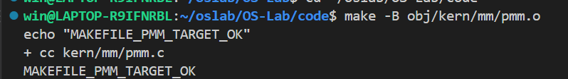

图 4-1 PMM 模块单独编译与目标文件构建结果

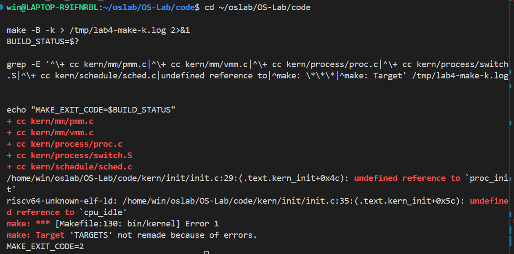

图 4-2 Lab4 全项目编译及链接检查结果

上述截图记录的是模块一完成时的阶段性构建结果：当时所有指定源文件均完成编译，`pmm.c` 没有出现编译错误，链接阶段出现以下未定义符号：

```text
undefined reference to `proc_init'
undefined reference to `cpu_idle'
```

这两个函数分别属于进程创建及初始化模块和进程调度模块，并非本模块实现的函数。该链接阻断是当时的阶段性状态；三个模块完成集成后，2号成员于 2026-11-14 完成完整构建和全组自动评分，结果为 30/30，实际环境、兼容参数与截图见 5.2 节。

此外，还对照 `kern/mm/pmm.c` 中的 `check_pgdir()` 和 `tools/test_lab4.c` 中的 PMM 测试部分进行了静态检查，确认测试涉及的新建映射、映射替换、共享页面引用计数、权限更新以及重复删除等场景均与当前实现相对应。


### 4.2 功能模块二：进程创建及初始化功能

**负责人：** 张祎然（2412419，2号）

本模块在 [`kern/process/proc.c`](../code/kern/process/proc.c) 中完成 `alloc_proc()`、`copy_mm()`、`copy_thread()`、`do_fork()`、`kernel_thread()` 和 `proc_init()` 六个函数。实现目标是把启动时已有的执行流组织成 `idleproc`，再创建具备独立内核栈和首次运行现场的 `initproc`，供调度模块选择执行。

#### 4.2.1 模块接口与实现约束

本次实现以当前 Lab4 的 `proc_struct`、RISC-V 寄存器约定和已有辅助函数为依据。实际编写顺序为：

```text
alloc_proc → copy_mm → copy_thread → do_fork → kernel_thread → proc_init
```

先完成底层辅助函数，再完成调用它们的创建接口，最后组织整个初始化过程。每完成一个函数，先保存文件，再进行源码检查和单文件编译。

| 函数 | 输入与作用 | 成功结果及失败处理 |
|---|---|---|
| `alloc_proc()` | 分配并初始化一个 PCB | 成功返回尚未登记的 PCB；分配失败返回 `NULL` |
| `copy_mm(clone_flags, proc)` | 地址空间处理接口；当前只支持 `mm == NULL` 的内核线程场景 | 断言父子 PCB 的 `mm` 均为空，返回 `0` |
| `copy_thread(proc, esp, tf)` | 在新内核栈上复制中断帧，构造首次切换所需的上下文 | 设置 `proc->tf`、中断帧中的返回值和栈指针，以及 `context.ra/sp` |
| `do_fork(clone_flags, stack, tf)` | 串联 PCB、内核栈、地址空间、上下文、PID 和登记操作 | 成功返回新线程 PID；失败返回负错误码，并释放已经取得的资源 |
| `kernel_thread(fn, arg, clone_flags)` | 将普通内核函数及参数包装成初始中断帧 | 调用 `do_fork()`，直接返回其 PID 或负错误码 |
| `proc_init()` | 初始化全局管理结构，建立 `idleproc` 并创建 `initproc` | 初始化完成时有两个可运行线程，`current` 仍指向 `idleproc`；关键创建失败时 `panic` |

本模块复用 `kmalloc()`、`kfree()`、`setup_kstack()`、`put_kstack()`、`get_pid()`、`hash_proc()`、`find_proc()`、`wakeup_proc()` 和链表接口。没有改变已有函数签名、结构体、Lab2/Lab3 功能，也没有修改其他成员负责的页操作和调度函数。

#### 4.2.2 PCB、内核栈与两种执行现场

`struct proc_struct` 的定义位于 [`proc.h`](../code/kern/process/proc.h)。`alloc_proc()` 返回时各成员的状态如下：

| 成员 | 含义 | 初始值 |
|---|---|---|
| `state` | 生命周期状态 | `PROC_UNINIT`，资源尚未准备完整，不能参与调度 |
| `pid` | 进程标识 | `-1`，表示尚未分配正式 PID |
| `runs` | 被调度运行的次数 | `0` |
| `kstack` | 内核栈基址 | `0`，由后续创建过程设置 |
| `need_resched` | 是否需要重新调度 | `0` |
| `parent` | 父进程指针 | `NULL` |
| `mm` | 用户地址空间管理结构 | `NULL`，当前内核线程没有独立用户地址空间 |
| `context` | 切换时保存的寄存器集合 | 全部清零；新线程随后设置 `ra` 和 `sp` |
| `tf` | 中断帧指针 | `NULL`；新线程随后指向自己的内核栈 |
| `pgdir` | 页表根节点的物理地址 | `boot_pgdir_pa`，使用已有内核页表 |
| `flags` | 进程标志 | `0` |
| `name` | 长度为 `PROC_NAME_LEN + 1` 的名称数组 | 全部清零 |
| `list_link` | 进程链表节点 | `list_init()` 初始化，前后指针均指向自身 |
| `hash_link` | PID 哈希表节点 | `list_init()` 初始化，前后指针均指向自身 |

这里的 `pgdir` 是物理地址，不能填入页表的内核虚拟地址，也不是已经编码好的 `satp` 值。`mm == NULL` 并不表示线程没有地址映射：内核线程仍通过共同的内核页表访问代码和数据，同时拥有各自的内核栈。

`context` 与 `trapframe` 的分工不同：

| 数据结构 | 本项目保存的内容 | 使用位置 |
|---|---|---|
| `struct context` | `ra`、`sp`、`s0`～`s11`，RV64 下共 112 字节 | `switch_to()` 保存和恢复线程切换现场 |
| `struct trapframe` | 32 个通用寄存器槽，以及 `status`、`epc`、`badvaddr`、`cause`，共 288 字节 | Trap 入口/返回；新线程首次运行时也借用这条恢复路径 |

本项目的 `KSTACKPAGE` 为 2，`KSTACKSIZE` 为 8192 字节。新线程的中断帧放在内核栈高地址端：

```text
高地址  kstack + KSTACKSIZE
        ┌──────────────────────────┐
        │ trapframe，288 字节      │
        └──────────────────────────┘ ← proc->tf
        │ 初始 sp 位于此处         │
        │ 运行栈向低地址增长       │
        │                          │
低地址  kstack
```

页对齐的内核栈顶减去 288 后仍满足 16 字节对齐。`copy_thread()` 构造的 `context.sp` 和内核线程的初始 `gpr.sp` 都指向 `proc->tf`，后续函数调用向低地址使用栈空间。

#### 4.2.3 六个函数的实现与分析

**（1）`alloc_proc()`：取得安全的初始 PCB**

```c
static struct proc_struct *
alloc_proc(void) {
    struct proc_struct *proc = kmalloc(sizeof(struct proc_struct));
    if (proc == NULL) {
        return NULL;
    }

    memset(proc, 0, sizeof(struct proc_struct));

    proc->state = PROC_UNINIT;
    proc->pid = -1;
    proc->pgdir = boot_pgdir_pa;

    list_init(&proc->list_link);
    list_init(&proc->hash_link);

    return proc;
}
```

先检查 `kmalloc()` 的返回值，避免对空指针执行清零。`memset()` 统一清零普通字段，再设置 `PROC_UNINIT`、`pid = -1` 和内核页表地址。两个链表节点必须单独调用 `list_init()`，仅清零不能得到合法的空链表节点。

该函数只创建 PCB，不分配内核栈和正式 PID，也不把 PCB 放入全局链表或设为可运行态。这样可以避免调度器看到尚未完成资源准备的线程。

**（2）`copy_mm()`：保留地址空间处理接口**

```c
static int
copy_mm(uint32_t clone_flags, struct proc_struct *proc)
{
    (void)clone_flags;

    assert(current != NULL && proc != NULL);
    assert(current->mm == NULL);
    assert(proc->mm == NULL);

    return 0;
}
```

`do_fork()` 在内核栈分配成功后调用本函数。当前 Lab4 创建的是内核线程，父线程 `current->mm` 和 `alloc_proc()` 初始化后的 `proc->mm` 都应为 `NULL`，因此无需复制 VMA、用户页面或新建用户页表；子线程已经由 `alloc_proc()` 设置为使用 `boot_pgdir_pa`。

`CLONE_VM` 的接口含义是共享地址空间，本阶段针对 `mm == NULL` 的内核线程，因此显式忽略 `clone_flags` 并返回 `0`。两个非空 PCB 指针和父子 `mm == NULL` 的断言用于检查调用约定；传入非空 `mm` 不属于当前函数支持的场景。

**（3）`copy_thread()`：准备首次恢复的现场**

```c
static void
copy_thread(struct proc_struct *proc, uintptr_t esp,
            struct trapframe *tf)
{
    assert(proc != NULL && tf != NULL);
    assert(proc->kstack != 0);

    proc->tf = (struct trapframe *)(proc->kstack + KSTACKSIZE - sizeof(struct trapframe));

    *(proc->tf) = *tf;

    proc->tf->gpr.a0 = 0;

    if (esp == 0) {
        proc->tf->gpr.sp = (uintptr_t)proc->tf;
    } else {
        proc->tf->gpr.sp = esp;
    }

    proc->context.ra = (uintptr_t)forkret;
    proc->context.sp = (uintptr_t)proc->tf;
}
```

这里有四个关键点：

1. `proc->tf` 指向新线程自己的内核栈，而不是指向 `kernel_thread()` 的局部变量。
2. `*(proc->tf) = *tf` 复制整个结构体，保证临时中断帧离开作用域后，新线程仍有有效的现场。
3. 将 `gpr.a0` 设为 `0`，保持子进程返回值的约定；`esp == 0` 时采用内核线程的栈指针约定，非零时采用调用者提供的栈值。
4. `context.ra` 指向 `forkret`，`context.sp` 指向中断帧。第一次 `switch_to()` 恢复这两个寄存器后，通过 `ret` 进入 `forkret()`。

此时无需把 `tf` 的所有寄存器再复制到 `context`。`s0`、`s1` 等初始值会在后续 `__trapret` 中从中断帧恢复。

**（4）`do_fork()`：完成资源准备、登记与唤醒**

```c
int
do_fork(uint32_t clone_flags, uintptr_t stack, struct trapframe *tf)
{
    int ret = -E_NO_FREE_PROC;
    struct proc_struct *proc = NULL;
    bool intr_flag;

    assert(current != NULL && tf != NULL);

    if (nr_process >= MAX_PROCESS) {
        goto fork_out;
    }

    ret = -E_NO_MEM;

    proc = alloc_proc();
    if (proc == NULL) {
        goto fork_out;
    }

    proc->parent = current;

    if ((ret = setup_kstack(proc)) != 0) {
        goto bad_fork_cleanup_proc;
    }

    if ((ret = copy_mm(clone_flags, proc)) != 0) {
        goto bad_fork_cleanup_kstack;
    }

    copy_thread(proc, stack, tf);

    local_intr_save(intr_flag);
    {
        proc->pid = get_pid();
        hash_proc(proc);
        list_add_before(&proc_list, &proc->list_link);
        nr_process++;

        wakeup_proc(proc);
        ret = proc->pid;
    }
    local_intr_restore(intr_flag);

fork_out:
    return ret;

bad_fork_cleanup_kstack:
    put_kstack(proc);

bad_fork_cleanup_proc:
    kfree(proc);
    goto fork_out;
}
```

正常路径按以下顺序执行：

```text
检查进程数量上限
  → 分配 PCB → 设置 parent
  → 分配内核栈 → copy_mm → copy_thread
  → 保存中断状态并关闭中断
  → 分配 PID → 加入哈希表 → 加入 proc_list → nr_process++
  → wakeup_proc → 记录返回 PID → 恢复原中断状态
```

先完成资源和上下文准备，再登记进程。`get_pid()` 分配唯一标识，`hash_proc()` 支持后续按 PID 查找，`list_add_before(&proc_list, ...)` 将新线程加入链表尾部。`wakeup_proc()` 在登记完成后把状态从 `PROC_UNINIT` 改为 `PROC_RUNNABLE`。

中断保护覆盖 PID 分配、哈希表和链表修改、数量更新以及唤醒操作。`local_intr_restore()` 恢复进入临界区前的中断状态，而不是无条件开启中断。这与当前单核实验中的共享结构保护要求相符，不等同于多核环境下的锁。

失败路径按照资源取得的相反顺序回收：

| 失败位置 | 返回值 | 清理操作 |
|---|---|---|
| 已达到 `MAX_PROCESS` | `-E_NO_FREE_PROC` | 尚未分配资源，直接返回 |
| `alloc_proc()` 返回空指针 | `-E_NO_MEM` | 尚未取得 PCB，直接返回 |
| `setup_kstack()` 失败 | 保留辅助函数的负错误码 | 只释放 PCB |
| `copy_mm()` 返回错误 | 保留辅助函数的负错误码 | 先 `put_kstack()`，再 `kfree(proc)` |

这些失败发生在全局登记之前，因此不需要从链表或哈希表删除节点，也不减少尚未增加的 `nr_process`。当前 `copy_mm()` 不分配地址空间资源，其合法路径始终返回 `0`；保留该清理分支是为了维持完整的创建流程，并不表示本次已做分配失败注入测试。

**（5）`kernel_thread()`：把函数和参数包装成线程入口**

```c
int
kernel_thread(int (*fn)(void *), void *arg, uint32_t clone_flags)
{
    struct trapframe tf;

    memset(&tf, 0, sizeof(tf));

    tf.gpr.s0 = (uintptr_t)fn;
    tf.gpr.s1 = (uintptr_t)arg;

    tf.status = (read_csr(sstatus) | SSTATUS_SPP | SSTATUS_SPIE) & ~SSTATUS_SIE;

    tf.epc = (uintptr_t)kernel_thread_entry;

    return do_fork(clone_flags | CLONE_VM, 0, &tf);
}
```

临时 `trapframe` 是新线程首次运行的模板，先整体清零，再填入必要字段：

| 字段 | 设置方式 | 原因 |
|---|---|---|
| `gpr.s0` | 保存 `fn` 的地址 | `entry.S` 用 `jalr s0` 调用线程函数 |
| `gpr.s1` | 保存 `arg` 的地址/值 | `entry.S` 用 `move a0, s1` 传入第一个参数 |
| `status` 的 `SPP` | 置 1 | `sret` 返回到 S 态 |
| `status` 的 `SPIE` | 置 1 | `sret` 将该位恢复到 `SIE`，使新线程开始运行时可响应 S 态中断 |
| `status` 的 `SIE` | 清零 | 恢复现场期间保持 S 态中断关闭 |
| `epc` | 指向 `kernel_thread_entry` | `__trapret` 恢复 `sepc` 后，`sret` 从此处开始执行 |

状态值基于 `read_csr(sstatus)` 进行位操作，保留其他状态位。`do_fork(clone_flags | CLONE_VM, 0, &tf)` 表达内核线程共享地址空间的意图，并以 `stack = 0` 选择当前项目的内核栈约定。`copy_thread()` 在调用返回前完成中断帧的值复制，因此不存在长期引用局部变量 `tf` 的问题。

**（6）`proc_init()`：建立 idleproc 和 initproc**

```c
void
proc_init(void)
{
    static const char idle_name[PROC_NAME_LEN + 1] = "idle";
    static const char init_name[PROC_NAME_LEN + 1] = "init";
    int pid;

    list_init(&proc_list);

    for (int i = 0; i < HASH_LIST_SIZE; i++) {
        list_init(&hash_list[i]);
    }

    nr_process = 0;

    idleproc = alloc_proc();
    if (idleproc == NULL) {
        panic("alloc idleproc failed.\n");
    }

    idleproc->pid = 0;
    idleproc->state = PROC_RUNNABLE;
    idleproc->kstack = (uintptr_t)bootstack;
    idleproc->need_resched = 1;

    set_proc_name(idleproc, idle_name);

    current = idleproc;
    nr_process++;

    pid = kernel_thread(init_main, "Hello world!!", 0);
    if (pid <= 0) {
        panic("create initproc failed: %d.\n", pid);
    }

    initproc = find_proc(pid);
    assert(initproc != NULL);

    set_proc_name(initproc, init_name);

    assert(current == idleproc);
    assert(idleproc->pid == 0);
    assert(initproc->pid == 1);
    assert(initproc->parent == idleproc);
    assert(initproc->state == PROC_RUNNABLE);
    assert(nr_process == 2);
}
```

首先初始化 `proc_list`、全部 PID 哈希桶，并将 `nr_process` 置零。随后调用 `alloc_proc()` 创建 `idleproc`，设置 PID 为 `0`、状态为 `PROC_RUNNABLE`，复用启动时的 `bootstack`，并令 `need_resched = 1`。此后把 `current` 指向 `idleproc`，进程数量增加到 1。

`idleproc` 接管的是已有启动执行流，没有通过 `do_fork()` 新建内核栈或初始中断帧。它不加入普通进程链表和 PID 哈希表，但计入进程总数；调度器在没有普通可运行线程时以它作为后备线程。

设置 `current` 后，再调用 `kernel_thread(init_main, "Hello world!!", 0)`，使 `do_fork()` 能正确记录父进程。创建成功后用 `find_proc(pid)` 取得 PCB，检查非空，再命名为 `init`。最终断言验证当前线程、PID、父子关系、可运行状态和进程数量。

本项目的 `set_proc_name()` 固定复制 `PROC_NAME_LEN` 个字节。因此这里使用长度为 `PROC_NAME_LEN + 1` 的静态名称数组，既提供完整可读的源缓冲区，也保留名称结尾的零字节。

#### 4.2.4 从创建到首次执行的衔接

```text
proc_init
 ├─ 初始化 proc_list、hash_list、nr_process
 ├─ alloc_proc → 设置 idleproc → current = idleproc
 └─ kernel_thread(init_main, "Hello world!!", 0)
     └─ 构造临时 tf → do_fork
         ├─ alloc_proc → parent = current → setup_kstack
         ├─ copy_mm → copy_thread
         └─ PID / 哈希表 / 链表 / 计数 → wakeup_proc
     → 返回 PID → find_proc → 命名 initproc → 完成断言

后续调度：
cpu_idle → schedule → proc_run → switch_to
 → forkret → forkrets → __trapret → sret
 → kernel_thread_entry → init_main(arg) → do_exit(返回值)
```

创建完成只表示新线程已经具备运行条件，并不表示 `init_main()` 已被调用。首次调度时，`switch_to()` 恢复 `context`；`forkret()` 将 `current->tf` 交给 `forkrets()`；后者设置 `sp` 并跳到 `__trapret`，恢复通用寄存器、状态和入口地址，最终进入 `kernel_thread_entry`。

当前 `do_exit()` 调用 `panic`。本模块完成的是创建和首次运行准备。

#### 4.2.5 AI 辅助分析与实现过程

我先阅读进程创建模块的源码，理清六个函数的调用关系，再按依赖顺序逐个实现。AI 主要帮助我理解接口、提供实现建议或 TODO 框架，并检查我写好的代码。六个函数的具体代码由我在 VS Code 中完成，随后自行编译和调试。对于流程较长的 `do_fork()`，我分别检查资源准备、进程登记和失败清理，确认各部分衔接正确。

| 阶段 | Prompt 的主要要求 | 本人完成的工作与检查重点 |
|---|---|---|
| 阅读项目 | 梳理六个函数的调用关系和现有接口 | 确定实现顺序、接口和分工边界 |
| `alloc_proc()` | 解释 PCB 的初始状态，提供带 TODO 的基础框架 | 手动初始化 PCB，检查空指针和两个链表节点 |
| `copy_mm()` | 解释 `mm`、`pgdir`、`CLONE_VM` 及内核线程共享页表的含义 | 编写接口逻辑，检查父子进程 `mm == NULL` 的断言 |
| `copy_thread()` | 提供基础框架，结合汇编解释中断帧与首次切换的关系 | 实现中断帧复制，设置返回值、栈指针和首次切换上下文 |
| `do_fork()` | 分析资源准备、进程登记和失败回收各自需要满足的条件 | 先准备资源，再完成临界区内登记、唤醒及失败清理 |
| `kernel_thread()` | 解释入口寄存器和状态位，提供基础框架 | 设置 `s0/s1/status/epc` 并调用 `do_fork()` |
| `proc_init()` | 提供初始化框架，对照测试断言 | 创建两个线程，检查 PID、名称、父子关系和数量 |
| 集成验证 | 区分单文件编译、完整链接、QEMU 运行与评分 | 手动执行 GDB 命令和 `make grade`，提交实际输出进行核对 |

下面是按实际对话整理的共同提示词结构；逐函数提示词与检查请求记录在 [`prompt.md`](prompt.md) 的模块二部分。

```text
[PROMPT]
我负责 uCore Lab4 的进程创建及初始化模块。
请先阅读当前项目，再只分析本轮指定的一个函数。
需要学习实现时给出 TODO 框架，由我手动补全；
检查阶段只审查保存后的代码，不直接修改文件。

[RELY]
以当前 proc.c、proc.h、trap.h、内存管理接口、entry.S、
switch.S、trapentry.S 和测试代码为准，不套用其他版本。

[GUARANTEE]
不修改结构体、函数签名、已有辅助接口、Lab2/Lab3 功能，
不补全其他函数，不修改其他组员的代码。
没有实际执行的测试不得写成已通过。

[SPECIFICATION]
明确参数、返回值、前置条件、成功后的状态和失败清理。
检查 PCB、内核栈、PID、链表、trapframe、context 的衔接，
解释中断保护范围，结合 Git diff 和实际编译/调试结果判断。
```

检查过程中，有一次 VS Code 中的修改没有保存，AI 读到的是磁盘上的旧版本；保存后，我重新核对了 `do_fork()`。完整构建时又遇到了 GCC 15.1.0 对项目原有接口的类型诊断，我在编译命令中加入兼容参数，保留原有源码和测试函数。随后完成单文件编译、GDB 手动验证和全组评分，结果见 5.2 节。

### 4.3 功能模块三：进程调度
**负责人：张旗庭 2413788 （3号）**  

#### 4.3.1 任务理解

本模块负责实现进程调度与上下文切换，是连接进程创建和实际 CPU 执行过程的关键环节。

在前两个功能模块中，1号成员完成了虚拟内存页操作，实现了虚拟地址与物理页面之间的映射管理，为内核页表管理提供了基础；2号成员完成了进程创建及初始化，实现了进程控制块（PCB）的分配与初始化、内核栈分配以及进程执行上下文的构造，并通过 `proc_init()` 创建了空闲线程 `idleproc` 和第一个内核线程 `initproc`。

但是，进程创建完成并不意味着进程已经开始执行。此时，系统虽然已经具备了可运行的内核线程，但仍然需要通过调度机制选择合适的线程，并完成 CPU 执行现场的切换，才能使新创建的线程真正获得执行机会。因此，本模块的主要任务就是将前两个模块建立的进程管理结构与 CPU 的实际执行过程连接起来。

**本模块的主要工作：**

本模块需要完成四个函数的实现，分别位于 `code/kern/process/proc.c`、`code/kern/schedule/sched.c` 和 `code/kern/process/switch.S` 中。

- `cpu_idle()`：作为空闲线程的执行入口，在需要重新调度时调用调度器。
- `schedule()`：从已有进程中选择下一个处于就绪状态的线程。
- `proc_run()`：完成当前进程的更新、页表切换，并调用底层上下文切换函数。
- `switch_to()`：通过汇编指令保存当前线程的执行上下文，并恢复目标线程的上下文。

这四个函数分别承担调度触发、进程选择、切换准备和底层上下文切换的职责，共同完成从一个线程到另一个线程的切换。

**实现约束与注意事项：**

本模块的实现建立在前两个模块已经完成的基础上，需要复用已有的进程控制块、进程链表、页表和上下文管理机制。

实现过程中主要需要注意以下几点：

1. 保持与已有接口和数据结构的一致性，特别是进程控制块中保存的进程状态、当前进程指针、页表基址和上下文信息。
2. 进程切换涉及进程状态、当前进程指针和 CPU 执行现场等信息，需要通过中断保护避免切换过程被本地中断打断。
3. 页表切换需要使用正确的物理地址构造 RISC-V 的 `satp` 寄存器值，并在切换后刷新 TLB。
4. 底层汇编实现必须与 `struct context` 中的寄存器排列和内存偏移保持一致，确保保存和恢复的上下文能够正确对应。
5. 本次实验主要实现内核线程调度。内核线程共享内核地址空间，但各自拥有独立的内核栈和执行上下文，因此本模块重点在于线程选择和执行现场切换，而不是用户进程独立地址空间的完整管理。

通过本模块的实现，系统能够利用前两个模块建立的进程管理基础，选择合适的可运行线程，并完成 CPU 执行权的转移，使创建好的内核线程真正运行起来。

#### 4.3.2 整体调度机制与关键数据结构

**（1）调度过程涉及的关键数据结构**

结合调度过程，主要涉及以下内容：

| 数据结构或变量 | 在调度过程中的作用 |
|---|---|
| `current` | 全局当前进程指针，指向当前正在执行的线程。调度和切换过程中需要及时更新。 |
| `idleproc` | 空闲线程。当没有其他可运行线程时，调度器选择它作为后备线程。 |
| `proc_list` | 进程链表，用于组织已经创建的普通进程，供调度器遍历查找。 |
| `state` | 进程状态，调度器通过判断状态是否为 `PROC_RUNNABLE` 来确定线程是否可以执行。 |
| `need_resched` | 重调度标志，用于控制空闲线程是否需要调用调度器。 |
| `runs` | 记录线程被调度选中的次数，在选择目标线程后更新。 |
| `context` | 保存线程切换所需的寄存器现场，由 `switch_to()` 进行保存和恢复。 |
| `pgdir` | 保存进程页表根节点的物理地址，供 `proc_run()` 构造 `satp` 寄存器值。 |

其中，`proc_list` 使用带头节点的循环双向链表。需要特别注意，按照本项目 `proc_init()` 和 `do_fork()` 的实现，`idleproc` 不加入普通进程链表，而是由全局指针单独管理；通过 `do_fork()` 创建的 `initproc` 等普通线程才会加入 `proc_list`。

进程状态定义在 `proc.h` 中，共有四种：

- `PROC_UNINIT`：进程尚未完成初始化，不能参与调度。
- `PROC_SLEEPING`：进程处于睡眠状态，暂时不能执行。
- `PROC_RUNNABLE`：进程处于就绪状态，具备执行条件，也可能表示当前正在运行。
- `PROC_ZOMBIE`：进程已经结束，等待父进程回收资源。

调度器只选择 `PROC_RUNNABLE` 状态的进程。本实验没有单独设置 `PROC_RUNNING` 状态，因此正在运行的线程仍然属于 `PROC_RUNNABLE`。

另外，`context` 和 `trapframe` 虽然都涉及寄存器现场，但用途不同：`context` 用于普通线程切换，保存 `ra`、`sp` 和 `s0~s11` 等寄存器；`trapframe` 用于中断现场保存与恢复，新线程第一次运行时也需要通过它恢复完整的执行现场。两者的具体结构已在4.2.2节介绍。

**（2）调度与上下文切换的协作过程**

结合指导书和实际实现，四个函数之间的协作可以分为以下几个步骤。

1. **进入空闲线程并触发调度**

   在 `proc_init()` 完成后，系统将 `current` 设置为 `idleproc`，并将 `idleproc->need_resched` 初始化为1。随后，内核进入 `cpu_idle()`，不断检查当前线程的重调度标志。当该标志不为0时，调用 `schedule()`，开始寻找其他可运行线程。

2. **遍历进程链表并选择目标线程**

   `schedule()` 首先清除当前线程的 `need_resched` 标志，然后遍历 `proc_list`，寻找状态为 `PROC_RUNNABLE` 的线程。

   查找时需要区分两种情况：
   - 如果当前线程是 `idleproc`，则从链表头开始查找，寻找第一个可运行的普通线程。
   - 如果当前线程不是 `idleproc`，则从当前线程的下一个链表节点开始查找；到达链表末尾后重新从链表头继续，直到完成一轮遍历。

   如果遍历一圈仍然没有找到其他可运行线程，则选择 `idleproc`。选定目标线程后，更新其 `runs` 计数；如果目标线程与当前线程不同，则调用 `proc_run()` 进行切换。

3. **更新当前进程并切换页表**

   `proc_run()` 首先判断目标线程是否就是当前线程。如果不是，则保存原来的进程指针，将 `current` 更新为目标线程。

   随后，根据目标线程的 `pgdir` 构造 RISC-V 的 `satp` 寄存器值，写入新的页表根节点信息，并调用 `flush_tlb()` 刷新 TLB，最后调用 `switch_to()` 完成底层上下文切换。

   本实验当前主要创建内核线程，它们的 `mm` 均为空，并使用共同的内核页表 `boot_pgdir_pa`。因此，本次线程切换虽然会执行 `satp` 写入和 TLB 刷新，但并不意味着每个线程都拥有独立的用户地址空间。

4. **保存和恢复线程上下文**

   `switch_to()` 使用 RISC-V 汇编指令完成寄存器现场的切换。首先将原线程的 `ra`、`sp` 和 `s0~s11` 保存到原线程的 `context` 中，然后从目标线程的 `context` 中恢复对应寄存器，最后通过 `ret` 跳转到恢复后的 `ra` 所指向的位置。

   对于已经运行过的线程，恢复后的 `ra` 指向此前调用 `switch_to()` 的返回位置，因此可以继续执行原来的代码；对于首次运行的新线程，其 `context.ra` 已由进程创建模块设置为 `forkret`，随后通过 `forkrets()` 和 `__trapret` 恢复中断帧，最终进入 `kernel_thread_entry`，执行指定的内核线程函数。首次运行的具体过程已在4.2.4节介绍。

**（3）调度过程中的中断保护**

在调度过程中，`schedule()` 和 `proc_run()` 都使用了 `local_intr_save()` 和 `local_intr_restore()`。
这是因为调度过程中需要修改当前进程指针、遍历进程链表以及切换页表和执行上下文。如果这些操作被本地中断打断，可能导致中断处理过程观察到尚未完成切换的中间状态。

因此，在操作这些关键数据和执行切换时，需要暂时关闭本地中断，并在相应操作结束后恢复原来的中断状态。由于 `schedule()` 调用 `proc_run()` 时可能形成嵌套保护，必须保存进入临界区前的中断状态，而不能在内层函数结束时无条件开启中断。相关实现原理将在4.4节 Challenge 1中进一步分析。

通过上述过程，系统将进程创建模块准备好的可运行线程与实际 CPU 执行过程连接起来。调度器负责决定下一个执行对象，进程切换函数负责准备新的执行环境，底层汇编则完成寄存器上下文的保存和恢复，最终使目标线程获得 CPU 执行权。

#### 4.3.3 核心函数的分析与实现

本模块主要涉及 `kern/process/proc.c`、`kern/schedule/sched.c` 和 `kern/process/switch.S` 三个文件，通过实现 `cpu_idle()`、`schedule()`、`proc_run()` 和 `switch_to()` 四个函数，完成从调度请求产生、可运行线程选择到 CPU 执行现场切换的过程。具体的AI提示词见prompt.md的3号部分。

#### （1）`cpu_idle()`：空闲线程执行循环

**函数作用：**

`cpu_idle()` 是空闲线程 `idleproc` 的执行主体。当系统没有其他线程需要立即执行时，空闲线程通过该函数维持运行，并持续检查是否需要进行进程调度。

**实现需要考虑：**

- 使用无限循环维持空闲线程的运行。
- 通过 `current->need_resched` 判断当前是否存在重新调度的需求。
- 当调度标志置位时，调用 `schedule()` 选择下一个可运行线程。
- 本函数不负责选择具体线程，只负责检查调度请求并触发调度。

**代码实现：**

文件：`code/kern/process/proc.c`

```c
void
cpu_idle(void)
{
    while (1)
    {
        if (current->need_resched)
        {
            schedule();
        }
    }
}
```

函数通过 `while (1)` 保证空闲线程持续运行。当 `need_resched` 为真时，调用 `schedule()` 进入调度过程；否则继续循环检查。

因此，`cpu_idle()` 相当于进程调度机制的等待入口，使内核在没有其他可运行线程时仍能维持正常的执行流程。

#### （2）`schedule()`：选择下一个可运行线程

**函数作用：**

`schedule()` 是进程调度的核心函数，负责根据当前进程的位置和进程状态，从全局进程链表 `proc_list` 中寻找下一个可运行线程，并将其交给 `proc_run()` 执行切换。

**实现需要考虑：**

- 调度过程涉及全局进程链表和当前进程状态，需要通过 `local_intr_save()` 和 `local_intr_restore()` 保护关键操作。
- 每次进入调度过程后，清除当前进程的 `need_resched` 标志。
- 根据当前线程是否为 `idleproc` 确定链表遍历的起始位置。
- 遍历过程中跳过链表头节点，并通过 `le2proc()` 获取对应的 PCB，判断其状态是否为 `PROC_RUNNABLE`。
- 如果没有找到其他可运行线程，则选择 `idleproc` 作为后备线程。
- 更新被选中线程的运行计数；只有目标线程与当前线程不同时，才调用 `proc_run()`。

**代码实现：**

文件：`code/kern/schedule/sched.c`

```c
void
schedule(void) {
    bool intr_flag;
    list_entry_t *last, *le;
    struct proc_struct *next = NULL;

    local_intr_save(intr_flag);
    current->need_resched = 0;
    last = (current == idleproc) ? &proc_list : &current->list_link;
    le = last;

    do {
        le = list_next(le);
        if (le != &proc_list) {
            next = le2proc(le, list_link);
            if (next->state == PROC_RUNNABLE) {
                break;
            }
        }
    } while (le != last);

    if (next == NULL || next->state != PROC_RUNNABLE) {
        next = idleproc;
    }

    next->runs++;
    if (next != current) {
        proc_run(next);
    }
    local_intr_restore(intr_flag);
}
```

**关键实现分析：**

首先，使用 `local_intr_save(intr_flag)` 保存原有中断状态并关闭中断，避免调度过程中受到中断干扰。随后清除当前进程的 `need_resched` 标志，表示本次调度请求已经开始处理。

接下来，根据当前线程确定遍历起点。如果当前线程是 `idleproc`，则从 `proc_list` 的头节点开始查找；否则从当前线程对应的链表节点之后开始查找。通过 `list_next()` 沿链表依次遍历，并利用 `le2proc()` 将链表节点转换为对应的进程控制块。

找到状态为 `PROC_RUNNABLE` 的线程后，将其设置为调度目标。如果遍历结束仍没有找到符合条件的线程，则选择 `idleproc`，保证系统始终有可执行的线程。

最后，通过 `next->runs++` 更新目标线程的运行计数，并在目标线程与当前线程不同时调用 `proc_run()`。调度结束后，使用 `local_intr_restore()` 恢复进入函数之前的中断状态。

本实现按照进程链表顺序进行循环查找，没有引入优先级或时间片判断，主要依据线程的可运行状态决定调度结果。

#### （3）`proc_run()`：执行进程切换准备

**函数作用：**

`proc_run()` 负责将调度器选出的目标线程设置为当前运行线程，并完成地址空间切换和上下文切换的准备工作，最后调用底层汇编函数 `switch_to()` 实现执行现场的转移。

**实现需要考虑：**

- 如果目标线程就是当前线程，则不需要进行重复切换。
- 使用 `local_intr_save()` 保护切换过程，并保存原来的当前线程指针。
- 更新 `current`，使其指向目标线程。
- 根据目标线程的页表根节点物理地址构造 RISC-V 的 `satp` 寄存器值。
- 切换页表后刷新 TLB，避免继续使用旧的地址转换缓存。
- 调用 `switch_to()` 保存当前线程的上下文并恢复目标线程的上下文。
- 在线程切换返回后，恢复原有中断状态。

**代码实现：**

文件：`code/kern/process/proc.c`

```c
void
proc_run(struct proc_struct *proc)
{
    if (proc == current)
    {
        return;
    }

    bool intr_flag;
    local_intr_save(intr_flag);
    struct proc_struct *prev = current;
    current = proc;

    write_csr(satp, 0x8000000000000000UL | (proc->pgdir >> RISCV_PGSHIFT));
    flush_tlb();
    switch_to(&prev->context, &proc->context);
    local_intr_restore(intr_flag);
}
```

**关键实现分析：**

首先，通过 `proc == current` 判断目标线程是否就是当前线程。如果相同，则直接返回，避免不必要的上下文切换。

随后关闭中断，并使用 `prev` 保存原来的当前线程指针，再将 `current` 更新为目标线程。

接下来，通过 `write_csr()` 修改 RISC-V 的 `satp` 寄存器。这里使用的 `0x8000000000000000UL` 用于设置 Sv39 分页模式对应的 MODE 字段，而 `proc->pgdir >> RISCV_PGSHIFT` 则将页表根节点的物理地址转换为物理页号（PPN），两者按位或后构成新的 `satp` 值。

修改页表寄存器后，调用 `flush_tlb()` 刷新 TLB，保证后续地址转换使用正确的页表信息。

最后，通过 `switch_to(&prev->context, &proc->context)` 将原线程和目标线程的上下文地址传递给底层汇编函数，完成寄存器现场的保存与恢复。

需要注意的是，`switch_to()` 并不是普通意义上立即返回的函数调用。原线程的执行现场被保存后，会暂时让出 CPU；只有当原线程以后再次获得执行权，才会从原来的切换位置继续执行，并最终恢复此前保存的中断状态。

#### （4）`switch_to()`：底层上下文切换

**函数作用：**

`switch_to()` 是整个进程切换过程的底层实现，采用 RISC-V 汇编语言编写。它负责保存当前线程的寄存器现场，并恢复目标线程之前保存的寄存器现场，使 CPU 能够从一个线程的执行过程转移到另一个线程。

**实现需要考虑：**

- 根据 `struct context` 的成员布局确定各寄存器的内存偏移。
- 保存当前线程的 `ra`、`sp` 和 `s0~s11`。
- 从目标线程的上下文结构中恢复对应寄存器。
- 最后通过 `ret` 指令跳转到恢复后的返回地址，继续目标线程的执行。

**代码实现：**

文件：`code/kern/process/switch.S`

```asm
.text
.globl switch_to
.type switch_to, @function

switch_to:
    sd ra, 0(a0)
    sd sp, 8(a0)
    sd s0, 16(a0)
    sd s1, 24(a0)
    sd s2, 32(a0)
    sd s3, 40(a0)
    sd s4, 48(a0)
    sd s5, 56(a0)
    sd s6, 64(a0)
    sd s7, 72(a0)
    sd s8, 80(a0)
    sd s9, 88(a0)
    sd s10, 96(a0)
    sd s11, 104(a0)

    ld ra, 0(a1)
    ld sp, 8(a1)
    ld s0, 16(a1)
    ld s1, 24(a1)
    ld s2, 32(a1)
    ld s3, 40(a1)
    ld s4, 48(a1)
    ld s5, 56(a1)
    ld s6, 64(a1)
    ld s7, 72(a1)
    ld s8, 80(a1)
    ld s9, 88(a1)
    ld s10, 96(a1)
    ld s11, 104(a1)

    ret

.size switch_to, .-switch_to
```

**关键实现分析：**

根据 RISC-V 函数调用约定，`a0` 和 `a1` 分别保存传入的两个上下文结构地址，对应 `proc_run()` 中传递的 `prev->context` 和 `proc->context`。

首先，使用 `sd` 指令将当前线程的寄存器值保存到 `a0` 指向的上下文结构中。其中，`ra` 保存函数返回地址，`sp` 保存当前线程的栈指针，`s0~s11` 保存被调用者保存寄存器的值。每个寄存器占用 8 字节，因此各寄存器按照连续的 8 字节偏移依次存储。

随后，使用 `ld` 指令从 `a1` 指向的目标上下文结构中恢复相应寄存器的值，使 CPU 获得目标线程原来的执行现场。

最后执行 `ret` 指令。该指令根据已经恢复的 `ra` 寄存器进行跳转，从而继续目标线程之前的执行过程。

这里需要区分 `context` 和 `trapframe`：`context` 只保存线程切换所需的部分寄存器，而不是完整的中断现场。对于新创建的线程，其初始 `context` 已经由前一模块的 `copy_thread()` 函数准备好，首次切换时会通过预设的 `ra` 进入 `forkret`，再衔接后续的 TrapFrame 恢复过程。

综上，四个函数分别承担不同的职责：`cpu_idle()` 负责检查调度请求，`schedule()` 负责选择目标线程，`proc_run()` 负责更新当前线程并完成地址空间切换，`switch_to()` 则通过汇编指令完成寄存器现场的保存与恢复。四者相互配合，使前一模块创建的内核线程能够真正获得 CPU 执行权。

#### 4.3.4 AI迭代过程

本实验进行三轮迭代，分别在三个文件里面实现函数。具体的提示词设计如下：

**（1）第一轮迭代：实现cpu_idle() 和 schedule()**

```markdown
请先阅读项目中与进程调度有关的源码，包括：
- kern/process/proc.c
- kern/process/proc.h
- kern/schedule/sched.c
- kern/schedule/sched.h
- libs/list.h
- kern/sync/sync.h

我负责 Lab4 功能模块三，当前只实现 cpu_idle() 和 schedule() 两个函数。

具体要求：

1. cpu_idle()：
   - 使用无限循环维持空闲线程运行。
   - 检查 current->need_resched。
   - 需要重新调度时调用 schedule()。

2. schedule()：
   - 使用 local_intr_save() 和 local_intr_restore() 保护调度过程。
   - 清除当前进程的 need_resched。
   - 根据 current 是否为 idleproc 确定链表遍历起点。
   - 遍历 proc_list，寻找状态为 PROC_RUNNABLE 的进程。
   - 跳过链表头节点，正确使用 list_next() 和 le2proc()。
   - 如果没有找到可运行进程，则选择 idleproc。
   - 更新目标进程的 runs，并在必要时调用 proc_run()。

约束：
- 以现有框架的数据结构和接口为准，不自行设计新的数据结构。
- 不修改其他成员负责的进程创建和内存管理代码。
- 不修改函数声明和已有接口。
- 保留 LAB4 function3 YOUR CODE 标记。
- 完成后检查代码修改范围和实现逻辑。
```

**（2）第二轮迭代：实现proc_run()**

```markdown
第一轮已经完成 cpu_idle() 和 schedule()。

现在请阅读现有 proc.c、proc.h、sync.h、riscv.h
以及内存管理模块中有关页表切换的实现。

本轮只实现 proc_run(struct proc_struct *proc)。

具体要求：

1. 如果目标进程与 current 相同，直接返回。
2. 使用 local_intr_save() 保存原中断状态并关闭中断。
3. 保存原来的 current 指针，并更新 current 为目标进程。
4. 根据目标进程的 pgdir 构造 Sv39 模式下的 satp 值：
   - MODE 设置为 8。
   - PPN 使用 pgdir >> RISCV_PGSHIFT。
   - ASID 使用 0。
5. 使用 write_csr() 写入 satp。
6. 调用 flush_tlb() 刷新 TLB。
7. 调用 switch_to() 完成上下文切换。
8. 在原进程以后恢复执行时，恢复之前保存的中断状态。

特别注意：
- pgdir 是页表根节点的物理地址。
- 不要直接使用旧版不适用于 Sv39 的 satp 实现。
- 正确处理 local_intr_save/restore 的嵌套关系。
- 本轮只修改 proc_run()，不得修改第一轮已经完成的函数或其他成员代码。

完成后检查 diff，并使用现有工具进行目标文件编译验证。
```

**（3）第三轮迭代：实现switch_to()**

```markdown
前两轮已经完成 cpu_idle()、schedule() 和 proc_run()。

现在请阅读：
- kern/process/switch.S
- kern/process/proc.h 中 struct context 的定义
- 项目使用的 RISC-V RV64 调用约定

本轮只实现 switch.S 中的 switch_to() 函数。

函数参数：
- a0：原进程的 context 地址。
- a1：目标进程的 context 地址。

具体要求：

1. 使用 sd 指令保存原进程的寄存器：
   ra、sp、s0~s11。
2. 按照 struct context 的实际成员布局确定偏移。
3. 使用 ld 指令从目标进程的 context 中恢复上述寄存器。
4. 最后使用 ret 跳转到恢复后的 ra。

注意：
- RV64 每个寄存器占用 8 字节。
- 不要遗漏任何需要保存的寄存器。
- 不要错误覆盖 a0 和 a1。
- 不需要额外建立栈帧。
- 不要自行修改 struct context。
- 不要修改其他成员负责的代码。

完成后检查汇编代码，并使用 RISC-V 交叉编译器编译 switch.S，检查生成的 switch_to 符号。
```


### 4.4 Challenge：

#### 1.说明语句 local_intr_save(intr_flag); ... local_intr_restore(intr_flag); 是如何实现开关中断的？

**负责人：张旗庭（2413788）**

在操作系统运行过程中，某些关键操作不能被中断处理程序打断，否则可能导致共享数据处于不一致状态。因此，需要在进入临界区之前关闭中断，并在操作完成后恢复原来的中断状态。本实验通过 `local_intr_save()` 和 `local_intr_restore()` 两个宏实现这一过程。

**（1）保存中断状态并关闭中断**

相关代码位于 `code/kern/sync/sync.h`：

```c
static inline bool __intr_save(void) {
    if (read_csr(sstatus) & SSTATUS_SIE) {
        intr_disable();
        return 1;
    }
    return 0;
}

#define local_intr_save(x) \
    do {                   \
        x = __intr_save(); \
    } while (0)
```

其中，`read_csr(sstatus)` 用于读取 RISC-V 的 `sstatus` 控制状态寄存器，`SSTATUS_SIE` 表示其中的全局中断使能位，定义值为 `0x2`，即第 1 位。

调用 `local_intr_save(intr_flag)` 时，实际上会执行 `__intr_save()`，具体过程如下：

1. 读取 `sstatus` 寄存器，并检查 SIE 位是否为 1。
2. 如果 SIE 为 1，说明当前中断处于开启状态，调用 `intr_disable()` 关闭中断，并返回 1。
3. 如果 SIE 为 0，说明当前中断已经关闭，则不再执行关闭操作，直接返回 0。
4. 将返回值保存到 `intr_flag`，记录进入临界区之前的中断状态。

其中，`intr_disable()` 和 `intr_enable()` 定义在 `code/kern/driver/intr.c`：

```c
void intr_enable(void) {
    set_csr(sstatus, SSTATUS_SIE);
}

void intr_disable(void) {
    clear_csr(sstatus, SSTATUS_SIE);
}
```

`set_csr()` 和 `clear_csr()` 分别通过 RISC-V CSR 指令将 SIE 位置 1 和清零，从而实现中断的开启与关闭，同时保留寄存器中的其他状态位。

**（2）恢复原来的中断状态**

相关代码仍位于 `code/kern/sync/sync.h`：

```c
static inline void __intr_restore(bool flag) {
    if (flag) {
        intr_enable();
    }
}

#define local_intr_restore(x) __intr_restore(x);
```

调用 `local_intr_restore(intr_flag)` 时，根据之前保存的标志决定是否开启中断：

- 如果 `intr_flag` 为 1，说明进入临界区之前中断是开启的，因此调用 `intr_enable()`，恢复中断。
- 如果 `intr_flag` 为 0，说明进入临界区之前中断已经关闭，因此不执行任何操作，继续保持关闭状态。
 
因此，这两个宏实现的并不是简单的关闭中断和重新开启中断，而是**先保存原来的中断状态，临时关闭中断，最后根据保存的状态进行恢复**。

**（3）嵌套调用中的中断状态恢复**

这种设计还能够支持嵌套的中断保护。例如，本实验的 `schedule()` 在执行过程中会调用 `proc_run()`，而这两个函数内部都使用了中断保护。

假设进入 `schedule()` 时中断处于开启状态：

1. `schedule()` 调用 `local_intr_save(intr_flag)`，保存状态为 1，并关闭中断。
2. `schedule()` 调用 `proc_run()`，此时中断已经关闭，因此内层保存的状态为 0。
3. `proc_run()` 执行结束，调用 `local_intr_restore(intr_flag)`。由于保存的状态为 0，因此不会重新开启中断。
4. 返回 `schedule()` 后，外层调用 `local_intr_restore(intr_flag)`，由于保存的状态为 1，才重新开启中断。

这样可以避免内层函数提前开启外层已经关闭的中断，保证嵌套临界区的中断状态正确恢复。

综上，`local_intr_save()` 和 `local_intr_restore()` 通过读取和修改 `sstatus` 寄存器中的 SIE 位，实现了中断状态的保存、关闭和恢复。这种机制使进程调度和上下文切换等关键操作能够避免受到本地中断的干扰。


#### 2. 深入理解 Sv32、Sv39、Sv48 不同分页模式的工作原理
**负责人：张懿鸾（2413669）**

RISC-V 架构提供了多种虚拟内存分页模式，包括 Sv32、Sv39 和 Sv48。它们的核心思想都是通过多级页表实现虚拟地址到物理地址的转换，但在虚拟地址长度、页表层级数量以及每级页表索引的位数等方面存在区别。

**（1）Sv32 分页模式**

Sv32 主要用于 RV32 架构，即 32 位 RISC-V 处理器。它采用两级页表结构，虚拟地址共 32 位，其中：

- VPN[1]：10 位，一级页表索引。
- VPN[0]：10 位，二级页表索引。
- Offset：12 位，页内偏移。

其虚拟地址结构如下：

```text
 31          22 21          12 11           0
+--------------+--------------+--------------+
|    VPN[1]    |    VPN[0]    |    Offset    |
|    10 bits   |    10 bits   |    12 bits   |
+--------------+--------------+--------------+
       |              |
       v              v
   一级页表  ------> 二级页表
                         |
                         v
                      物理页
```

Sv32 中每个页表项占用 4 字节，一个 4KB 页表页可以容纳 1024 个页表项。其基础页大小为 4KB，理论虚拟地址空间为 4GB。

**（2）Sv39 分页模式**

Sv39 用于 RV64 架构，即 64 位 RISC-V 处理器。它采用三级页表结构，虚拟地址有效位宽为 39 位，其中：

- VPN[2]：9 位，一级页表索引。
- VPN[1]：9 位，二级页表索引。
- VPN[0]：9 位，三级页表索引。
- Offset：12 位，页内偏移。

其虚拟地址结构如下：

```text
 38      30 29      21 20      12 11       0
+----------+----------+----------+----------+
|  VPN[2]  |  VPN[1]  |  VPN[0]  |  Offset  |
|  9 bits  |  9 bits  |  9 bits  | 12 bits  |
+----------+----------+----------+----------+
      |          |          |
      v          v          v
   一级页表 -> 二级页表 -> 三级页表
                              |
                              v
                           物理页
```

Sv39 中每个页表项占用 8 字节，一个 4KB 页表页可以容纳 512 个页表项。基础页大小仍然是 4KB，理论虚拟地址编码空间为 512GB。

与 Sv32 不同，Sv39 使用 64 位页表项，并且增加了一级页表，因此能够管理更大的虚拟地址空间。

需要注意，Sv39 的虚拟地址还必须满足规范地址（Canonical Address）要求，即高位需要按照第 38 位进行符号扩展，不能任意使用全部 64 位地址。

**（3）Sv48 分页模式**

Sv48 同样用于 RV64 架构，采用四级页表结构，虚拟地址有效位宽为 48 位，其中：

- VPN[3]：9 位，一级页表索引。
- VPN[2]：9 位，二级页表索引。
- VPN[1]：9 位，三级页表索引。
- VPN[0]：9 位，四级页表索引。
- Offset：12 位，页内偏移。

其虚拟地址结构如下：

```text
 47      39 38      30 29      21 20      12 11       0
+----------+----------+----------+----------+----------+
|  VPN[3]  |  VPN[2]  |  VPN[1]  |  VPN[0]  |  Offset  |
|  9 bits  |  9 bits  |  9 bits  |  9 bits  | 12 bits  |
+----------+----------+----------+----------+----------+
      |          |          |          |
      v          v          v          v
   一级页表 -> 二级页表 -> 三级页表 -> 四级页表
                                        |
                                        v
                                     物理页
```

Sv48 与 Sv39 的页表项格式相同，每个页表项占用 8 字节，每个 4KB 页表页仍然能够容纳 512 个页表项。区别在于 Sv48 增加了一级页表，因此可以支持更大的虚拟地址空间，理论虚拟地址编码空间达到 256TB。

Sv48 同样要求虚拟地址满足规范地址要求，即高位按照第 47 位进行符号扩展。

**（4）三种分页模式的对比**

| 比较项目 | Sv32 | Sv39 | Sv48 |
|---|---|---|---|
| 适用架构 | RV32 | RV64 | RV64 |
| 虚拟地址有效位宽 | 32 位 | 39 位 | 48 位 |
| 页表层级 | 2 级 | 3 级 | 4 级 |
| 每级索引位数 | 10 位 | 9 位 | 9 位 |
| 页表项大小 | 4 字节 | 8 字节 | 8 字节 |
| 每页表项数量 | 1024 | 512 | 512 |
| 基础页大小 | 4KB | 4KB | 4KB |
| 理论虚拟地址编码空间 | 4GB | 512GB | 256TB |

三种分页模式虽然层级数量和索引位数不同，但其基本工作原理是一致的：

1. CPU 从 `satp` 寄存器中获取当前页表根节点的物理页号。
2. 根据虚拟地址中的 VPN 字段，逐级查找对应页表项。
3. 如果当前页表项是有效的非叶子页表项，则通过其中保存的下一级页表物理地址继续遍历。
4. 如果找到有效叶子页表项，则从中获取物理页号（PPN）。
5. 将物理页号与原虚拟地址中的页内偏移组合，得到最终物理地址。
6. 如果页表项无效或访问权限不满足要求，则产生相应的异常。

此外，RISC-V 还支持超级页映射，即在较高层级直接使用叶子页表项映射更大的连续物理内存区域，而不必一直遍历到最低级页表。本实验的页面操作主要围绕 4KB 基础页展开。

#### 3. get_pte() 中两段形式类似的代码为什么如此相像？查找页表项和分配页表页是否应该拆分为两个函数？
**负责人：张懿鸾（2413669）**

**（1）get_pte() 的基本作用**

`get_pte()` 位于 `kern/mm/pmm.c`，主要负责根据给定的页目录和线性地址，找到该地址对应的叶子页表项。

其函数接口为：

```c
pte_t *get_pte(pde_t *pgdir, uintptr_t la, bool create);
```

其中：

- `pgdir`：当前页表根节点的虚拟地址。
- `la`：需要查找的线性地址。
- `create`：是否允许在页表项不存在时分配新的中间级页表。
- 返回值：成功时返回目标叶子页表项的地址；无法找到或分配失败时返回 `NULL`。

由于本实验使用 Sv39 三级页表，因此需要依次经过一级页表、二级页表和三级页表，最终定位到对应的叶子页表项。

其基本查找过程如下：

```text
                 虚拟地址 la
                      |
                      v
             提取 PDX1(la)
                      |
                      v
              一级页表查找
                      |
             +--------+--------+
             |                 |
          PTE有效           PTE无效
             |                 |
             |            create == 1 ?
             |              /       \
             |             是        否
             |             |         |
             |          分配页表页   返回NULL
             |             |
             +-------------+
                      |
                      v
             提取 PDX0(la)
                      |
                      v
              二级页表查找
                      |
             +--------+--------+
             |                 |
          PTE有效           PTE无效
             |                 |
             |            create == 1 ?
             |              /       \
             |             是        否
             |             |         |
             |          分配页表页   返回NULL
             |             |
             +-------------+
                      |
                      v
               提取 PTX(la)
                      |
                      v
             返回对应叶子 PTE 地址
```

**（2）两段形式类似的代码为什么如此相像？**

在 `get_pte()` 中，需要分别检查一级页表项和二级页表项。如果对应的页表项不存在，并且 `create` 参数允许创建，则需要分配一个新的物理页作为下一级页表。

这两个过程的核心操作基本相同：

1. 检查当前页表项是否有效，即检查 `PTE_V` 标志位。
2. 如果页表项无效，先判断 `create` 是否允许创建。
3. 如果不允许创建，则直接返回 `NULL`。
4. 如果允许创建，则通过 `alloc_page()` 分配一个新的物理页。
5. 对新分配的页表页进行初始化，清零其中的内容。
6. 将新页表页的物理页号写入当前页表项，建立上下级页表之间的联系。
7. 继续访问下一级页表。

之所以两段代码形式相似，是因为它们实际上执行的是同一种操作：**检查当前层级的页表项，并在必要时创建下一级页表。**

在 Sv39 中，一级页表项和二级页表项都采用相同的页表项结构，且每张页表的大小都是一个物理页。因此，无论当前处于哪个非叶子层级，创建下一级页表的基本过程都相同。

两段代码的主要区别只是当前处理的页表层级不同，以及使用的虚拟地址索引不同：

- 第一段处理 `PDX1(la)`，负责一级页表到二级页表的连接。
- 第二段处理 `PDX0(la)`，负责二级页表到三级页表的连接。
- 最后通过 `PTX(la)` 定位三级页表中的具体叶子页表项。

从分页模式的角度看，这种相似性也具有普遍意义。Sv32、Sv39 和 Sv48 虽然页表层级不同，但每一级页表都采用相同的基本组织方式，因此逐级遍历和创建下一级页表的逻辑可以重复使用。区别主要是需要遍历的层级数量和每一级索引的位数不同。

**（3）查找页表项和分配页表页是否应该拆分？**

目前 `get_pte()` 将页表查找和页表页分配合并在同一个函数中，通过 `create` 参数决定是否允许分配新的页表页。

这种设计具有一定的优点。

首先，能够减少代码重复。无论是只查找页表，还是需要创建中间级页表，都可以复用同一套逐级遍历逻辑，不需要分别实现两套页表遍历代码。

其次，接口使用比较方便。调用者只需要根据自身需求传入不同的 `create` 参数即可：

```c
// 只查找已有页表，不分配新页表
pte_t *ptep = get_pte(pgdir, la, 0);

// 查找页表，必要时创建中间级页表
pte_t *ptep = get_pte(pgdir, la, 1);
```

例如，本实验实现的 `page_remove()` 只需要查找已有映射，因此使用 `create = 0`，避免在删除映射时意外分配新的页表页。

而 `page_insert()` 需要确保目标地址对应的页表项存在，因此使用 `create = 1`，允许在页表结构不完整时创建缺少的中间级页表。

但是，这种设计也存在一定的不足。

第一，函数同时承担了查找和内存分配两种职责，存在一定的副作用隐藏问题。如果调用者没有注意 `create` 参数，就可能在原本只希望查询页表的操作中意外分配物理内存。

第二，错误处理相对复杂。当创建多级页表时，如果前一级页表已经分配成功并挂接到页表树中，而后一级页表分配失败，函数虽然能够返回 `NULL`，但之前已经分配的中间页表可能仍然保留。这会导致一次失败的查找操作留下不必要的页表资源。

第三，随着虚拟内存管理功能逐渐复杂，查找和分配可能需要不同的锁管理、错误处理和资源回收策略，将两种操作分开有利于提高代码的可维护性。

因此，可以考虑将其拆分为两个职责更加明确的函数：

- `get_pte()`：只负责遍历已有页表，查找指定线性地址对应的叶子页表项，不进行任何内存分配。
- `get_pte_create()`：负责在查找过程中检查缺失的中间级页表，并在必要时分配、初始化和挂接新的页表页。

这种设计能够让函数职责更加清晰，也方便针对页表查找和页表创建分别进行测试。


综合来看，将页表查找与页表页分配合并在一个函数中，并不是错误的设计。通过 `create` 参数明确控制是否允许创建，在规模较小、功能相对简单的教学操作系统中，能够减少重复代码，也使接口更加简洁。

但是，从软件设计和后续功能扩展的角度来看，将两种职责拆分能够提供更清晰的接口语义，尤其是在需要完善内存分配失败回滚、资源释放和并发访问控制时，更容易进行独立管理。

当前实验暂时保留了原有的 `get_pte()` 实现，因为现有接口已经能够满足 `page_insert()` 和 `page_remove()` 的调用需求。

## 五、GDB 调试

### 5.1 1号成员测试与验证

**负责人：张懿鸾（2413669）**

本成员主要负责虚拟内存页操作模块，因此 GDB 调试主要针对 `kern/mm/pmm.c` 中实现的 `page_insert()` 和 `page_remove()` 两个函数，重点验证页表映射建立、已有映射替换、物理页引用计数维护以及页面释放等操作。

#### （1）GDB 调试环境与断点设置

使用 RISC-V 交叉编译工具链构建内核，通过 QEMU 启动内核的 GDB 调试模式，并使用 GDB 连接 QEMU 远程调试端口。

首先设置目标架构为 RV64，连接远程调试目标，并在两个待验证函数处设置断点：

```gdb
set architecture riscv:rv64
set pagination off
target remote localhost:1234

break page_insert
break page_remove

info breakpoints
continue
```

成功设置断点后，GDB 可以在内核执行到对应函数时自动暂停，便于观察函数参数、局部变量及关键语句的执行情况。

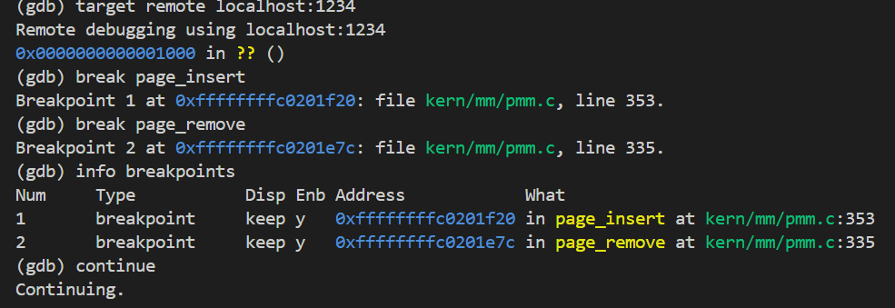

#### （2）page_insert() 函数调试

首先观察 `page_insert()` 首次建立虚拟地址映射的过程。

通过 `info args` 查看函数参数，首次进入时：

- `la = 0`，表示待映射的虚拟地址为 0。
- `perm = 0`，表示本次映射没有额外设置权限标志。
- `page->ref = 0`，表示该物理页面当前尚未建立页表映射。

随后使用 `next` 逐步执行，观察 `get_pte()` 获取页表项、`page_ref_inc()` 增加引用计数以及 `pte_create()` 创建页表项的过程。

执行完成后，得到：

```text
page->ref = 1
*ptep = 0x20103801
```

说明物理页面引用计数成功增加，页表项也成功建立。

随后继续执行程序，观察已有映射的替换过程。当再次调用 `page_insert()` 时，目标虚拟地址为 `4096`，但本次传入的物理页面与原映射不同。

通过 GDB 查看得到：

```text
la = 4096
perm = 0
*ptep = 0x20104415
page->ref = 1
```

说明目标地址已经存在有效映射，且待插入的物理页面仍被另一虚拟地址引用一次。程序将进入旧映射删除流程，调用 `page_remove()` 释放原有映射所占用的引用。

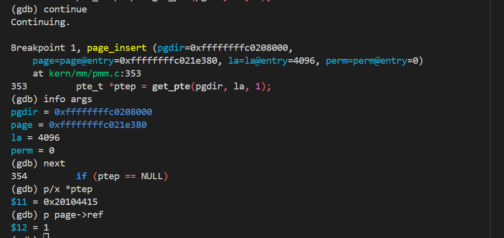

#### （3）page_remove() 函数调试

在 `page_remove()` 处命中断点后，首先通过 `info args` 和 `bt` 查看函数参数及调用栈。

调试结果表明：

```text
page_remove(pgdir=0xffffffffc0208000, la=4096)

调用关系：
page_remove()
    <- page_insert()
        <- check_pgdir()
            <- pmm_init()
```

由此确认，`page_remove()` 是在 `page_insert()` 替换已有映射时被调用的。

随后逐步执行函数，观察原有页表项及物理页面引用计数的变化：

```text
原始 PTE：
*ptep = 0x20104415

原物理页面引用计数：
page->ref = 1
```

执行：

```c
*ptep = 0;
tlb_invalidate(pgdir, la);
```

之后，原有页表项被清零，完成旧虚拟地址映射的解除。

继续执行引用计数递减操作：

```c
if (page_ref_dec(page) == 0)
{
    free_page(page);
}
```

GDB 观察到：

```text
page->ref = 0
*ptep = 0x0
```

说明旧映射已经清除，物理页面引用计数正确递减至 0，程序随后进入 `free_page()`，将页面归还给 Best-Fit 物理内存分配器。

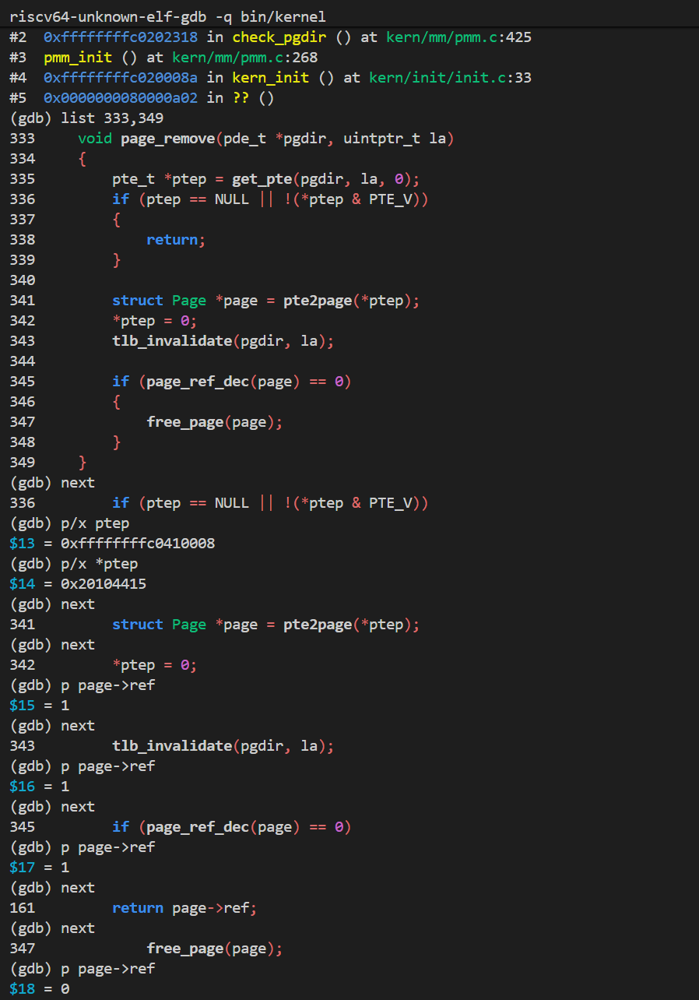

#### （4）调试结果分析

通过上述 GDB 单步调试，验证了两个函数的关键执行过程：

1. `page_insert()` 能够通过 `get_pte()` 查找或创建页表项，并正确建立新的虚拟地址映射。
2. 新建映射时，物理页面引用计数能够正确增加。
3. 当目标虚拟地址已经映射到其他物理页面时，能够调用 `page_remove()` 清除原有映射。
4. `page_remove()` 能够正确清零页表项，并在修改页表后执行 TLB 失效操作。
5. 删除映射时，物理页面引用计数能够正确递减；当引用计数归零时，调用 `free_page()` 释放物理页面。

调试过程中，在单步执行 `free_page()` 时，GDB 进一步进入了 Best-Fit 分配器的 `best_free_pages()` 函数，调试上下文随之发生变化，因此原函数的部分局部变量不再能够直接查看。这属于正常的函数调用与调试上下文切换现象。

结合后续 `check_pgdir()` 断言检查以及 `make grade` 自动评分结果，虚拟内存页操作模块的相关测试全部通过。

**最终验证结果：** `page_insert()` 和 `page_remove()` 的核心执行逻辑符合预期，PMM 自动测试通过。

### 5.2 2号成员测试与验证

**负责人：** 张祎然（2412419）

本节记录本人在 2026-11-14 完成的模块二手动调试与全组自动评分。以下环境属于本人本次测试，与 2.1 节其他成员的环境记录分别列出。

#### 5.2.1 本人测试环境与构建结果

| 项目 | 实际环境 |
|---|---|
| 宿主与实验环境 | Windows + WSL，Ubuntu-22.04 |
| 原仓库 | `D:/HuaweiMoveData/Users/zhangyiran/Desktop/lab4/OS-Lab-lab4` |
| WSL 构建目录 | `/mnt/d/HuaweiMoveData/Users/zhangyiran/Desktop/lab4/OS-Lab-lab4/code` |
| RISC-V GCC | 15.1.0，前缀为 `/home/zhangyiran/riscv-elf-toolchains/bin/riscv64-unknown-elf-` |
| RISC-V GDB | 16.3.90.20250610-git |
| QEMU | 4.1.1，路径为 `/home/zhangyiran/lab1-tools/qemu-4.1.1-install/bin/qemu-system-riscv64` |

实验原先要求使用 QEMU 4.0.0，本机实际使用的是已有的 4.1.1，报告按实际版本记录。本次没有用 QEMU 7.0.0 替代，也没有安装或更换工具链。

六个函数先分别完成源码检查，并通过 `proc.c` 的单文件编译。完整构建时遇到两处已有代码的类型诊断：

| 位置 | 原有代码与原因 | 本次处理 |
|---|---|---|
| `kern/mm/kmalloc.c` 的 `__slob_free_pages()`，第 92 行 | `kva2page(kva)` 将 `unsigned long` 传给接受 `void *` 的接口 | 编译命令增加 `-Wno-error=int-conversion` |
| `tools/test_lab4.c` 第 68、90～91 行 | `test_lab4_thread()` 返回 `void`，而 `kernel_thread()` 要求 `int (*)(void *)` | 评分编译命令增加 `-Wno-error=incompatible-pointer-types` |

GCC 15.1.0 默认将这两类诊断作为错误。上述参数将它们降为警告，教师源码及测试函数保持原样；这不代表两个类型问题已经被修复，也不能把默认参数下的构建失败归因于模块二。

正常内核的构建命令为：

```bash
cd /mnt/d/HuaweiMoveData/Users/zhangyiran/Desktop/lab4/OS-Lab-lab4/code

make \
  GCCPREFIX=/home/zhangyiran/riscv-elf-toolchains/bin/riscv64-unknown-elf- \
  CC="/home/zhangyiran/riscv-elf-toolchains/bin/riscv64-unknown-elf-gcc -Wno-error=int-conversion"
```

| 验证层次 | 实际结果 | 能说明的问题 |
|---|---|---|
| `proc.c` 单文件编译 | 通过 | 本模块代码通过当前编译器的语法、类型及目标文件生成检查 |
| 默认完整构建 | 被 `kmalloc.c` 的类型诊断阻断 | 尚不能据此判断内核能否链接或运行 |
| 使用兼容参数完整编译与链接 | 通过，生成 `bin/kernel`、`bin/ucore.img` | 各模块能够共同链接成内核镜像 |
| QEMU 4.1.1 + GDB 手动调试 | 通过创建、首次运行和返回检查 | 验证模块二与调度、Trap 恢复路径的衔接 |
| 全组 `make grade` | 三项均为 `OK`，30/30，退出码 0 | 通过仓库提供的页操作、进程创建和调度测试 |

#### 5.2.2 启动调试与初始化前检查

在第一个 WSL 终端执行：

```bash
cd /mnt/d/HuaweiMoveData/Users/zhangyiran/Desktop/lab4/OS-Lab-lab4/code

make debug \
  GCCPREFIX=/home/zhangyiran/riscv-elf-toolchains/bin/riscv64-unknown-elf- \
  CC="/home/zhangyiran/riscv-elf-toolchains/bin/riscv64-unknown-elf-gcc -Wno-error=int-conversion" \
  QEMU=/home/zhangyiran/lab1-tools/qemu-4.1.1-install/bin/qemu-system-riscv64
```

`make debug` 使用 `-s -S`，由 GDB 连接 1234 端口后控制内核运行。在第二个 WSL 终端执行：

```bash
cd /mnt/d/HuaweiMoveData/Users/zhangyiran/Desktop/lab4/OS-Lab-lab4/code
/home/zhangyiran/riscv-elf-toolchains/bin/riscv64-unknown-elf-gdb bin/kernel
```

随后在 GDB 中输入：

```gdb
set pagination off
set architecture riscv:rv64
target remote localhost:1234
break proc_init
break init_main
continue
```

实际首先命中 `proc_init()`。断点位置显示为 `libs/list.h:42`，因为 `-O2` 优化把 `list_init()` 内联到了初始化函数中；这不是进入了错误函数。

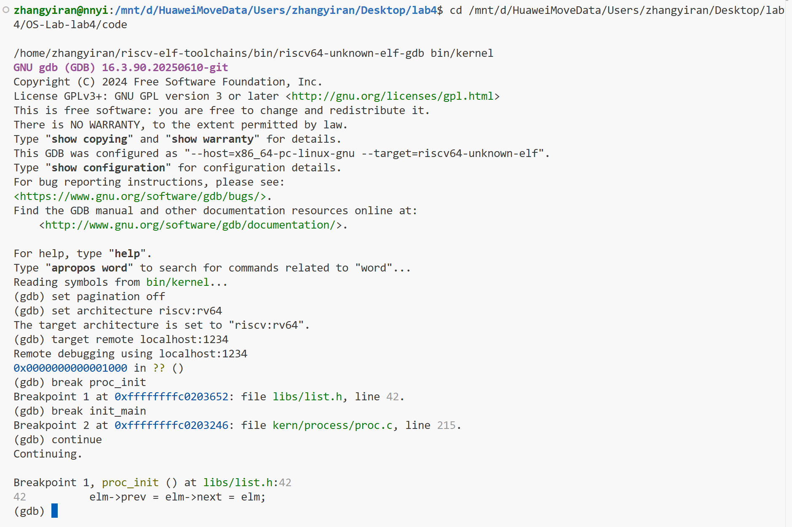

图 5-2-1：连接目标并停在 `proc_init()` 的初始化入口。

此时 QEMU 已输出物理页分配、页表、SLOB 分配器和 VMA 等初始化检查成功的信息，说明执行流已经经过内存管理初始化，准备进入进程管理部分。

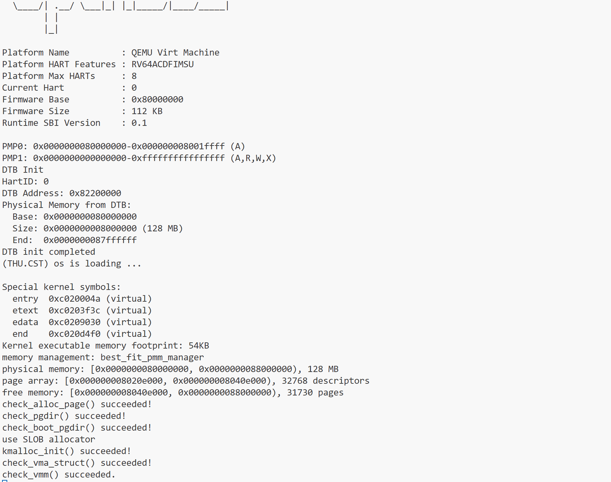

图 5-2-2：进程初始化之前的内核启动与内存管理检查。

#### 5.2.3 验证 idleproc 与 initproc 创建结果

在 `proc_init()` 入口停下后，输入 `finish`，让该函数执行完成并返回 `kern_init()`，再检查：

```gdb
finish
p current == idleproc
p nr_process
p idleproc->pid
p idleproc->state
p idleproc->kstack == (uintptr_t)bootstack
p idleproc->need_resched
p initproc->pid
p initproc->state
p initproc->parent == idleproc
p initproc->mm
x/s idleproc->name
x/s initproc->name
```

| 检查项 | 实际输出 | 结论 |
|---|---|---|
| `current == idleproc` | `1` | 初始化完成时仍由启动执行流运行 |
| `nr_process` | `2` | idle 和 init 均计入进程数量 |
| idle 的 PID、状态 | `0`、`PROC_RUNNABLE` | 空闲线程身份与状态正确 |
| idle 内核栈、调度请求 | 栈地址比较为 `1`，`need_resched = 1` | 复用启动栈，并准备触发首次调度 |
| init 的 PID、状态 | `1`、`PROC_RUNNABLE` | 新线程已完成创建并被唤醒 |
| init 的父进程、`mm` | 父进程比较为 `1`，`mm = 0x0` | 父子关系和内核线程地址空间约定正确 |
| 两个名称 | `idle`、`init` | 命名及字符串结束正常 |

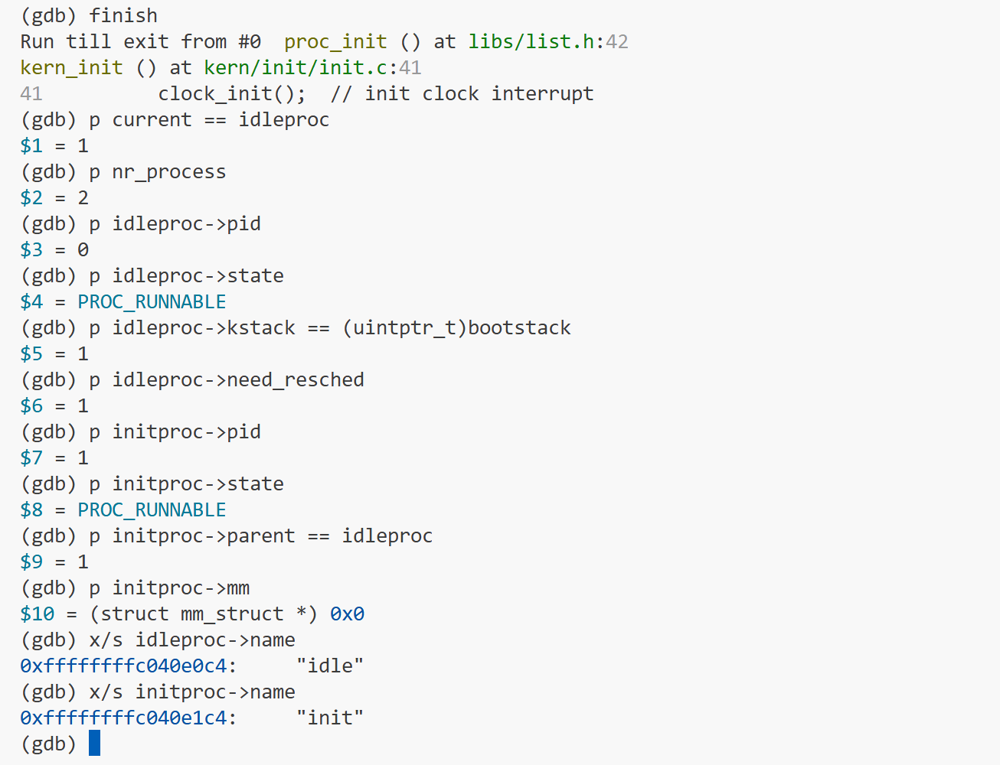

图 5-2-3：两个 PCB 的状态与进程管理全局变量检查。

该阶段验证了创建结果，但尚不能仅据此说明新线程已经真正执行。

#### 5.2.4 验证首次运行与函数返回

继续执行到已设置的 `init_main()` 断点：

```gdb
continue
p current == initproc
p current->pid
p current->runs
x/s current->name
x/s arg
```

实际输出依次为 `1`、`1`、`1`、`"init"`、`"Hello world!!"`。这表明 `initproc` 已首次获得 CPU，且 `kernel_thread()` 中保存的函数参数成功传到了 `init_main()`。

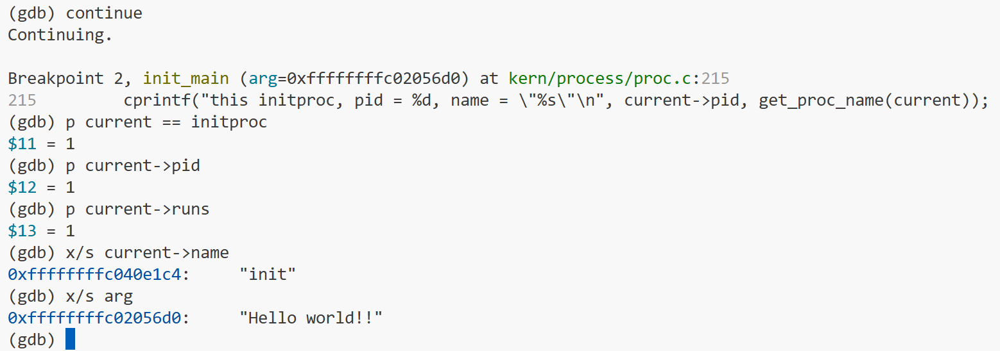

图 5-2-4：首次调度进入 `init_main()`，运行次数与参数符合预期。

然后设置退出入口断点：

```gdb
break do_exit
continue
```

GDB 实际停在 `do_exit(error_code=0)`，说明 `init_main()` 返回的 `0` 经 `entry.S` 传给了退出接口。

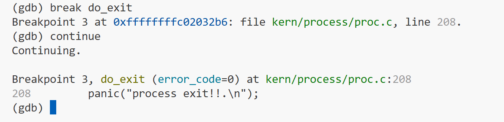

图 5-2-5：线程入口函数正常返回，并到达现有退出接口。

QEMU 的实际输出如下图所示：

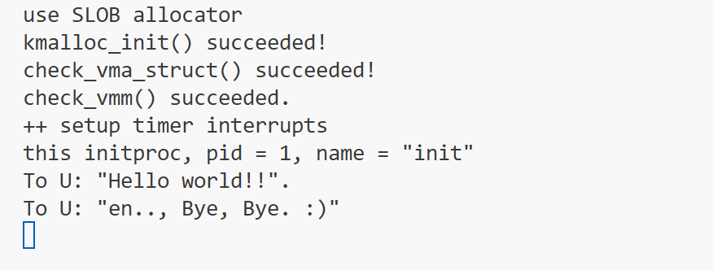

图 5-2-6：内核线程的实际输出与 `init_main()` 一致。

这组结果验证了 `context → forkret → forkrets → __trapret → kernel_thread_entry → init_main` 的衔接。当前 `do_exit()` 函数体是 `panic("process exit!!.\n")`，截图停在该调用之前；继续执行出现这条退出提示是现有框架的行为。

#### 5.2.5 从原仓库执行全组自动评分

手动调试结束后，先退出旧的 QEMU 和 GDB，释放 1234 端口。随后在原仓库 `code` 目录执行以下命令：

```bash
cd /mnt/d/HuaweiMoveData/Users/zhangyiran/Desktop/lab4/OS-Lab-lab4/code

make grade \
  GCCPREFIX=/home/zhangyiran/riscv-elf-toolchains/bin/riscv64-unknown-elf- \
  CC="/home/zhangyiran/riscv-elf-toolchains/bin/riscv64-unknown-elf-gcc -Wno-error=int-conversion -Wno-error=incompatible-pointer-types" \
  QEMU=/home/zhangyiran/lab1-tools/qemu-4.1.1-install/bin/qemu-system-riscv64

printf '评分退出码：%s\n' "$?"
```

本次明确采用仓库原有评分流程：`make grade` 先清理普通构建产物，再在 `/tmp/lab4_grade` 创建临时副本；`inject.py` 将测试调用分别插入 `pmm_init()` 尾部、`proc_init()` 尾部和 `init_main()` 入口，在该副本中构建和评分。测试源文件与内核源码均来自本次原仓库，测试注入不会改写原仓库的源码。

依据 [`test_lab4.c`](../code/tools/test_lab4.c) 和 [`grade.sh`](../code/tools/grade.sh)，评分覆盖如下：

| 项目 | 测试内容 | 实际结果 |
|---|---|---|
| PMM | 新建和替换映射、共享页引用计数、同页重复插入、权限更新及重复删除 | `OK`，10/10 |
| Process Create | idle/init 的身份、状态、内核栈、父子关系、`mm` 和初始上下文等断言 | `OK`，10/10 |
| Schedule | 创建两个测试线程并进行多次主动调度，确认两个线程均运行，核对 init 输出 | `OK`，10/10 |

本次总分为 **30/30**，评分退出码为 **0**，实际结果见下图。

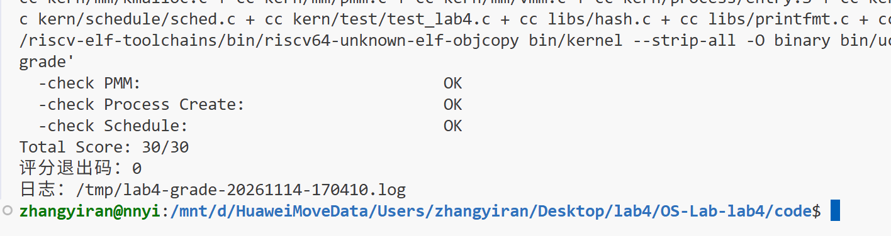

图 5-2-7：QEMU 4.1.1 下的全组自动评分结果。

评分后核对确认 `/tmp/lab4_grade` 已删除；原仓库的源码差异仍只有本人完成的六个函数及学号注释，`proc.c` 校验值未变，`git diff --check` 通过。

本次结果表明当前实现通过了仓库提供的自动测试。进程数量上限、各次内存分配失败等路径进行了源码审查，但未开展专项故障注入或压力测试；Challenge 的文字分析也不属于自动评分范围。

### 5.3 3号成员测试与验证

**张旗庭 2413788 3号**

#### 5.3.1 编译与代码检查

完成四个核心函数的实现后，首先在项目的 `code` 目录下执行 `make` 命令，对整个内核进行编译。编译过程中，`proc.c`、`sched.c` 和 `switch.S` 等文件均成功完成编译，并最终通过链接生成内核文件 `bin/kernel`，说明本次修改的代码能够正常参与项目整体编译。

<div align="center">
    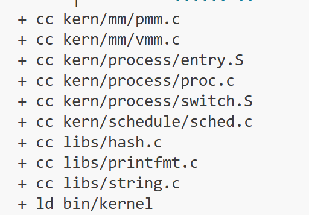
    <p>内核整体编译与链接结果</p>
</div>

此外，为单独验证底层上下文切换函数，对 `switch.S` 使用 RISC-V 交叉编译器进行汇编编译，并通过 `readelf` 查看生成的目标文件符号表。结果显示，`switch_to` 被正确识别为全局函数符号，说明汇编函数成功生成。

<div align="center">
    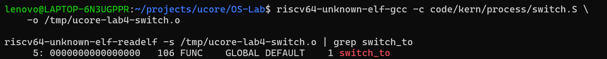
    <p>switch_to 汇编编译及符号检查结果</p>
</div>

最后，使用 `git diff --check` 检查代码修改，未发现空白字符及格式问题。至此，完成了本模块的编译与基本代码检查。

#### 5.3.2 运行与功能验证

完成编译检查后，进一步通过自动评分和 QEMU 运行验证进程管理功能。

首先，执行 `make grade` 进行自动化测试，结果显示，PMM、Process Create 和 Schedule 三项检查均通过，最终得分为 30/30。其中，Schedule 测试通过，说明本次实现的进程调度功能满足实验测试要求。

<div align="center">
    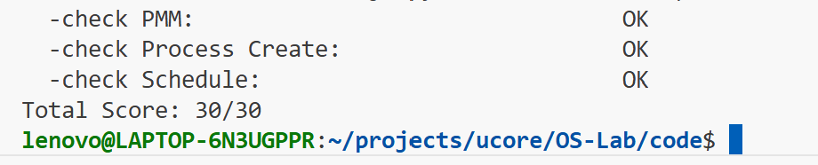
    <p>Lab4 自动评分结果</p>
</div>

随后，执行 `make qemu` 启动 QEMU 虚拟机。OpenSBI 正常启动，识别出 QEMU Virt Machine 平台及当前 Hart，并完成设备树和物理内存初始化，随后成功加载 uCore 内核。

<div align="center">
    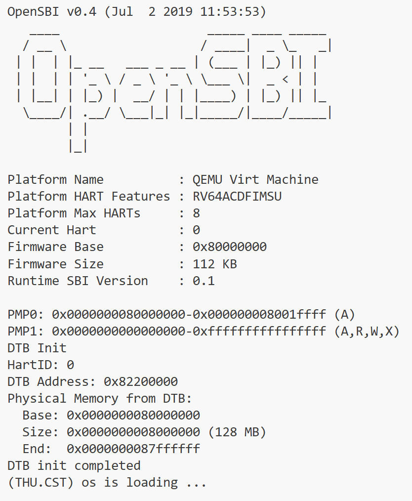
    <p>QEMU 启动及 OpenSBI 初始化信息</p>
</div>

内核完成内存管理等初始化工作后，输出 `this initproc, pid = 1, name = "init"`，随后执行并输出 Hello world 和 Bye Bye 信息。这表明 `idleproc` 成功让出 CPU，调度器选中 `initproc`，并通过上下文切换使其开始执行。

<div align="center">
    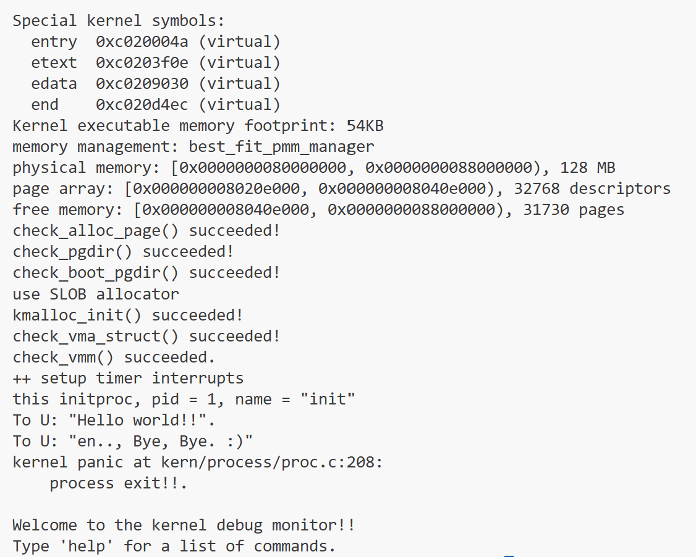
    <p>initproc 调度与执行结果</p>
</div>

最后，程序在 `do_exit()` 处触发 kernel panic。该函数目前仍为实验框架中的占位实现，因此这是线程退出路径尚未实现所导致的现象，不影响此前对 initproc 调度和执行过程的验证。

---

## 六、实验总结与收获：

### 6.1 对操作系统的理解

#### 1号成员：张懿鸾 2413669

**（1）本实验涉及的重要知识点及其与 OS 原理的联系**

1. **虚拟内存与多级页表：** 操作系统通过页表建立虚拟地址到物理地址的映射。本实验使用 RISC-V 的 Sv39 三级页表，通过逐级查找页表项实现地址转换，与 OS 原理中的分页存储管理相对应。实验进一步涉及页表项的创建、映射和删除，使理论上的地址转换机制落实到了具体代码中。

2. **物理内存管理与页面映射：** 通过 `alloc_page()`、`page_insert()` 和 `page_remove()` 等函数实现物理页的分配、映射和回收，对应 OS 原理中的内存分配与回收机制。本实验还涉及页面引用计数和 TLB 刷新，使我们认识到内存管理不仅需要维护页表，还需要保证相关状态的一致性。

3. **进程与线程管理：** 通过进程控制块（PCB）描述进程状态、内核栈和上下文等信息，对应 OS 原理中的进程控制与管理。本实验通过 `alloc_proc()`、`do_fork()` 等函数完成内核线程的创建与初始化，使抽象的进程管理概念有了具体实现。

4. **进程调度与上下文切换：** 本实验使用 FIFO 调度策略，通过 `schedule()` 选择可运行线程，并通过 `switch_to()` 保存和恢复寄存器上下文，对应 OS 原理中的处理机调度和进程切换机制。

**（2）与本实验相关的拓展知识**

1. **请求分页与页面置换：** 本实验主要采用预映射方式建立页表。相关拓展知识包括按需分页、页面换入换出、缺页异常处理和页面置换算法。

2. **用户进程与地址空间隔离：** 本实验主要实现内核线程，多个内核线程共享内核地址空间。用户进程的独立地址空间及用户态、内核态之间的完整切换是相关拓展内容。

3. **进程同步与死锁：** 本实验涉及中断屏蔽和临界区保护。相关拓展内容包括完整的进程同步机制，以及死锁的预防、避免和检测。

通过本次实验，我对虚拟内存管理、进程创建以及进程调度之间的联系有了更加完整的认识，也理解了操作系统如何通过这些机制实现多个执行流的管理。

#### 2号成员：张祎然 2412419

**（1）本实验涉及的重要知识点及其与 OS 原理的联系**

| 知识点 | OS 原理中的含义 | 本实验中的具体体现 |
|---|---|---|
| PCB 与进程状态 | 用数据结构记录进程身份、资源和生命周期 | `proc_struct` 保存 PID、内核栈、父进程、执行现场等；先为 `PROC_UNINIT`，资源准备完后才变为 `PROC_RUNNABLE` |
| 进程与线程 | 资源归属和执行流可以分别管理 | Lab4 用同一类 PCB 管理内核线程；它们共享内核页表，但内核栈和切换现场独立 |
| 进程创建 | 创建可运行实体需要准备资源并登记 | `do_fork()` 把分配、现场构造、PID、链表和唤醒串联起来，单独分配 PCB 并不等于线程已可执行 |
| 上下文切换 | 保存旧执行流、恢复新执行流的寄存器状态 | `context` 服务于 `switch_to()`；`trapframe` 服务于 Trap 恢复，新线程通过预先构造现场进入指定函数 |
| 资源生命周期 | 分配失败时必须恢复到一致状态 | 内核栈分配失败只释放 PCB；后续失败先释放栈再释放 PCB，登记前失败不修改全局计数 |
| 临界区保护 | 共享管理结构更新不能被中途观察为不一致状态 | `do_fork()` 在保存并关闭本地中断后分配 PID、登记和唤醒，结束时恢复原中断状态 |

本次调试让我区分了“创建成功”和“已经运行”：`proc_init()` 返回时两个线程都是 `PROC_RUNNABLE`，但 `current` 仍是 `idleproc`；直到命中 `init_main()` 且观察到 `current == initproc`、`runs == 1`，才能确认新线程真正执行。这里的 `PROC_RUNNABLE` 同时覆盖就绪和运行，不能直接套用课本中完全分开的五状态表示。

**（2）与进程管理相关的拓展知识**

- 用户进程的独立地址空间、用户程序装载、系统调用以及用户态与内核态之间的完整切换。
- 用户地址空间复制、写时复制、请求分页和页面置换；当前 `copy_mm()` 只支持内核线程的空 `mm` 情况。
- 完整的 `exit/wait`、僵尸进程及资源回收。
- 多核下的锁和跨核同步，以及复杂抢占调度策略；关闭本地中断不能替代这些机制。

通过本模块，我理解了线程第一次运行并不是简单地“调用一个函数”，而是先构造符合汇编恢复约定的栈、寄存器和返回入口，再让调度器使用与普通切换相同的路径启动它。

#### 3号成员：张旗庭 2413788

**（1）本实验涉及的重要知识点及其与 OS 原理的联系**

通过本次实验，我对操作系统中的内存管理、中断与异常处理、进程管理有了更加具体的认识。我理解了进程控制块（PCB）如何记录进程状态、内存空间和执行上下文，也理解了调度器如何根据进程状态选择可运行的进程，并通过上下文切换将 CPU 的执行权交给目标进程。同时，页表切换、寄存器现场保存和中断保护等机制也让我认识到，进程切换并不只是改变当前进程指针，而是涉及 CPU 执行状态和内存地址空间的协同变化。这些知识与 OS 原理中进程管理、虚拟内存和中断处理等内容相对应，使我对各个模块之间的联系有了更深入的理解。

**（2）与本实验相关的拓展知识**

通过实验，我也了解到实际操作系统中的进程调度远比本实验复杂。本实验主要通过链表查找可运行进程实现简单调度，而实际系统还会考虑进程优先级、时间片和调度公平性等因素。此外，关闭本地中断可以保护单核环境下的关键操作，但在多核系统中，仅依靠关闭中断并不能解决多个处理器核心之间的并发访问问题，还需要结合自旋锁等同步机制。这让我认识到，实验中的实现是对操作系统基本原理的简化，而实际操作系统还需要考虑更多复杂的运行场景。

### 6.2 AI 协作开发的经验

#### 1号成员：张懿鸾 2413669

本次实验让我认识到，AI 可以有效辅助理解复杂的操作系统代码，并帮助梳理函数之间的调用关系、分析实现思路和定位程序错误。但是，AI 生成的代码并不一定完全符合当前实验环境和 RISC-V 架构要求，不能直接照搬。

在实际开发过程中，我逐渐形成了先理解功能需求和接口，再借助 AI 分析实现方案，最后通过代码阅读、编译和运行测试验证结果的工作方式。尤其是在多级页表和上下文切换等涉及底层硬件机制的部分，需要结合 RISC-V 规范和实验代码进行核对。

我认为，AI 更适合作为辅助学习和开发的工具，而不是替代开发者进行思考。只有真正理解代码的实现原理，才能在出现问题时独立分析和解决，也才能在答辩中清楚地解释自己的实现。

#### 2号成员：张祎然 2412419

在进程创建模块中，我主要借助 Codex 理解现有源码和接口。遇到不熟悉的部分时，我会请它解释相关数据结构、提供带 TODO 的基础框架，具体代码由我在 VS Code 中编写。写好后再让 AI 帮忙检查，编译、GDB 调试和自动评分都由我在终端执行。

写提示词时，我先说明自己负责的六个函数，以及需要保留的结构体、函数签名和已有接口，再列出希望确认的问题。例如，分析 `do_fork()` 时，我重点关注资源准备与进程登记的顺序，以及失败后应该释放哪些资源。带着这些问题阅读代码，比只看一段实现更容易理解各条分支的作用。

检查代码也要先确认版本。有一次我没有保存 VS Code 中的修改，AI 读到的还是旧文件，保存后才重新完成核对。之后我会先保存文件、查看 Git diff，再检查和编译。遇到类型诊断时，我也会结合实际编译输出区分工具链兼容问题和自己代码中的问题。

最后，我通过 GDB 检查了 `idleproc`、`initproc` 的状态和父子关系，并跟踪首次调度及线程返回过程，再运行 `make grade`，三项测试均通过，总分为 30/30。把 AI 的解释和实际变量、调用路径对照起来后，我对线程从创建到运行的过程理解得更清楚了。提示词的详细记录见 [`prompt.md`](prompt.md)。

#### 3号成员：张旗庭 2413788

本次实验中，我主要结合 ChatGPT 和 Codex 完成开发。ChatGPT 帮助我梳理实验要求、分析函数之间的关系、理解代码逻辑，并协助设计适合交给 Codex 的提示词；Codex 则负责阅读项目源码并根据要求实现代码。这种协作方式提高了开发效率，也让我能够在编写代码的过程中及时了解相关知识点，加深对函数功能和底层实现的理解。

通过本次实验，我也认识到 AI 生成的代码不能直接照搬。实验要求、成员分工、已有接口和数据结构，以及代码修改范围，都需要由我自己确认。对于中断状态恢复、页表切换和寄存器保存等关键实现，也需要结合源码进行检查，并通过编译、自动评分和运行测试验证结果。我认为，AI 可以帮助我减少重复性的编码工作，但不能代替自己理解需求、判断实现是否合理以及承担最终的正确性责任。
