# 操作系统实验报告

## 实验基本信息

| 项目 | 内容 |
|------|------|
| **实验名称** | 操作系统实验二：物理内存和页表 |
| **小组成员** | 2413669-张懿鸾（1号）、2412419—张祎然（2号）、2413788-张旗庭（3号）|
| **完成日期** | 2026-10-24 |

### 小组分工

| 成员 | 负责的练习/模块 | 实际完成情况 |
|------|----------------|--------------|
| 2413669-张懿鸾（1号） | `page_init()`、Best-Fit、First-Fit 与 Best-Fit 对比分析、模块接入检查、个人 GDB 调试及报告整合 | 已完成 `page_init()` 与 Best-Fit 的实现及管理器注册，完成 QEMU 源码中的地址翻译调试，合并团队代码并进行完整验证|
| 2412419—张祎然（2号） |  First-Fit 源码分析、Buddy System Challenge、个人 GDB 调试 | 负责分析 First-Fit 的初始化、分配、释放与合并机制，完成 Buddy System 的实现和测试，并整理对应报告、提示词及调试记录。 |
| 2413788-张旗庭（3号） |SLUB Challenge、个人 GDB 调试 | 负责实现基于底层页面分配接口的 SLUB 内存对象分配器，测试不同对象尺寸、分配与释放复用、对象数据隔离和资源回收，并整理对应报告、提示词及调试记录。 |


### 实验报告分工

- **1号（2413669-张懿鸾）：** 负责实验整体逻辑与环境说明、物理内存初始化 `page_init()`、Best-Fit 分配器的设计与实现、个人 GDB 调试记录，以及最终代码集成、整体构建和测试结果的汇总。负责统一整合 `report.md` 与 `prompt.md`，检查报告结构、术语和格式的一致性。

- **2号（2412419—张祎然）：** 负责 First-Fit 分配算法的源码分析，以及 Buddy System 的设计、实现和测试部分的报告。结合实际代码解释空闲块的组织、拆分、释放与伙伴合并，并记录对应的提示词、测试结果和问题解决过程。

- **3号（2413788-张旗庭）：** 负责 SLUB 内存对象分配器的设计、实现和测试部分的报告。结合实际代码说明对象分配、释放复用、不同尺寸对象的管理及底层页面的使用，并记录对应的提示词、测试结果和问题解决过程。

- **三人共同完成：** 每个人独立整理自己的 QEMU 双 GDB 调试过程，包括关键断点、调用路径、虚拟地址到物理地址的翻译过程、TLB 相关观察、关键截图、AI 辅助调试记录和个人理解。

---

## 一、实验目的

本实验的主要目的是：

1. 理解设备树中的物理内存信息、Page 描述符布局和空闲页面初始化过程。
2. 理解 First-Fit，并实现、接入和测试 Best-Fit、Buddy System 等物理页面分配算法。
3. 理解 SLUB 的基本思想，尝试实现面向不同大小内存对象的分配与释放。
4. 使用 GDB 调试 QEMU，观察 RISC-V 虚拟地址翻译、页表遍历和 TLB 查找过程。
5. 记录使用 AI 辅助需求分析、代码实现、调试和测试的过程，并对生成结果进行实际验证。

---

## 二、实验环境

### 2.1 软硬件环境

| 项目 | 版本或配置 |
|------|------------|
| 操作系统/WSL 环境 | Windows + WSL2，Ubuntu 24.04.5 LTS |
| RISC-V 交叉编译器 | `riscv64-unknown-elf-gcc` 13.2.0 |
| 常规 QEMU | QEMU 4.1.1，路径：`/home/win/opt/qemu-4.1.1-install/bin/qemu-system-riscv64` |
| 带调试信息的 QEMU | QEMU 4.1.1，路径：`/home/win/opt/qemu-4.1.1/riscv64-softmmu/qemu-system-riscv64`；已确认包含 `.debug_info` 等调试信息，且未剥离符号 |
| 普通 GDB | GNU GDB 15.1，x86-64 宿主机调试器，用于附加并调试 QEMU 进程 |
| RISC-V GDB | `riscv64-unknown-elf-gdb` 15.1；通过 QEMU GDB stub 调试模拟 RISC-V CPU，目标架构设置为 `riscv:rv64` |
| 其他工具 | GNU Make 4.3、Git 2.43.0、RISC-V GNU Binutils 2.42、QEMU 源码及 GDB 调试工具 |

### 2.2 AI 工具使用情况

| 成员 | AI 编程工具/使用入口 | 底层模型及版本 | 主要用途 |
|------|--------------------|----------------|----------|
| 2413669-张懿鸾 | Codex（VS Code）+ ChatGPT | Codex 使用 DeepSeek 后端（Deepseek-Flash） | 辅助分析实验要求与项目源码，完成物理内存初始化和 Best-Fit 分配算法的设计与实现；辅助代码审查、编译验证、QEMU/GDB 调试及页表查询和 TLB 机制分析|
|2412419-张祎然 | Codex 桌面应用 | `gpt-6.1-sol` | 分步讲解 First-Fit 与 Buddy，辅助实现纠错和测试，并协助双 GDB 页表/TLB 调试、Bare 模式对照及记录整理。|
| 2413788-张旗庭| Codex（VS Code）+ ChatGPT| ChatGPT：GPT-6  |SLUB 内存对象分配模块的设计与代码生成、测试模块编写及排错；辅助理解 QEMU 源码，制定双 GDB 调试步骤，分析 Sv39 页表遍历、物理地址计算和软件 TLB 填充过程，并整理实验报告。 |

---

## 三、实验整体逻辑分析

### 3.1 本章节的逻辑主线

我对本实验的理解是：先弄清楚哪些物理页可以使用，再决定如何分配和回收这些页，最后观察程序访问地址时如何找到对应的物理内存。

内核中与物理页管理有关的主要调用顺序是：

```text
kern_init
  → pmm_init
    → init_pmm_manager
    → page_init
      → init_memmap
    → check_alloc_page
```

`page_init` 建立物理页描述符，并划出可用内存；`init_memmap` 把可用页交给具体分配器；`alloc_pages` 和 `free_pages` 负责申请与回收。First-Fit、Best-Fit 和 Buddy 都通过 `pmm_manager` 接入，因此可以在相同接口下切换算法。

页表解决的是另一个问题：一次虚拟地址访问最终对应哪个物理地址。分配器管理物理页是否可用，页表负责地址映射，TLB 则缓存已经得到的翻译结果。

### 3.2 功能的逐步实现
### 2.2 功能的逐步实现

1. 首先分析实验框架，检查编译环境和原有物理内存管理机制。通过阅读 `pmm.c`、`default_pmm.c` 等文件，了解物理内存管理器的接口、Page 描述符的作用，以及现有 First-Fit 分配器的初始化、页面分配和释放流程。同时检查 RISC-V 交叉编译器、QEMU 和 GDB 等工具是否能够正常使用。这一步为后续功能开发建立基础，也有助于明确已有代码与需要补充的部分，避免重复实现已有功能。

2. 接着完成物理内存探测与 `page_init()` 的实现。内核需要首先确定哪些物理页面可以使用，才能在此基础上进行页面分配。该部分根据设备树（DTB）提供的物理内存信息，确定可管理的物理内存范围，初始化对应的 Page 描述符，并排除 OpenSBI、内核镜像以及 Page 描述符数组自身占用的内存区域，最终将可用页面交给物理内存管理器。物理页面初始化是后续 Best-Fit、Buddy System 等页面分配功能正常工作的基础，因此需要优先完成并验证。

3. 然后分析 First-Fit 算法，并实现 Best-Fit 页面分配器。First-Fit 是实验框架中已有的页面分配实现，通过分析 `default_init()`、`default_init_memmap()`、`default_alloc_pages()` 和 `default_free_pages()` 等函数，可以理解空闲页面链表的组织方式、连续页面的分配过程，以及释放时相邻空闲块的合并机制。在此基础上，实现 Best-Fit 分配器，使其按照满足申请条件的最小空闲块进行选择，并完成分配器注册及相关检查。

4. 随后实现 Buddy System 页面分配器及相应测试。与 Best-Fit 直接选择合适的空闲块不同，Buddy System 按照 \(2^k\) 个页面组织不同阶的空闲块，并通过拆分较大的空闲块满足较小的分配请求，在释放时尝试合并满足条件的伙伴块。该部分建立在物理页面初始化和底层页面管理接口的基础上，通过测试不同阶的分配、空闲块拆分、释放与伙伴合并、空间不足以及空闲页面数量恢复等情况，验证算法的正确性。

5. 接下来实现 SLUB 内存对象分配器及相应测试。页面分配器主要管理以页面为单位的内存，而内核中的某些数据结构只需要较小的内存对象，直接为每个对象分配整页可能造成空间浪费。因此，SLUB 在底层页面分配接口的基础上，将页面空间进一步组织为可供对象使用的区域，通过 `alloc_pages()` 和 `free_pages()` 获取或归还底层物理页面，并在页面内部完成对象的分配与释放。测试重点包括不同尺寸对象的分配、连续分配、释放后的空间复用、单页空间不足时的后续分配、对象数据互不覆盖，以及底层页面的回收，从而验证小对象分配与页面管理之间的衔接。

6. 在内存管理功能分析与实现的同时，三名组员分别开展 QEMU 双 GDB 调试，观察 RISC-V 虚拟地址翻译过程。

---

## 四、实验内容与实现

### 4.1 功能模块一：物理内存初始化功能

**负责人：** 2413669-张懿鸾

#### 4.1.1 模块功能描述

**需要实现的函数：**

```c
static void page_init(void);
```

**功能说明：**

物理内存初始化模块负责在 uCore 内核启动过程中，根据设备树（DTB）提供的物理内存信息，建立内核可管理的物理页面描述符数组，并将符合条件的空闲物理页面交给现有的物理内存管理器。该模块是后续页面分配算法运行的基础，其初始化结果直接影响页面分配、释放以及虚拟内存管理等功能。

本模块主要完成以下工作：

1. **建立地址映射关系。** 根据当前工程的地址映射约定设置 `va_pa_offset`，确保内核虚拟地址与物理地址之间的转换正确。
2. **获取并检查物理内存范围。** 通过 `get_memory_base()` 和 `get_memory_size()` 获取 DTB 解析得到的内存起始地址和大小，检查内存范围是否有效、地址计算是否溢出，以及内存是否超出当前工程支持的物理地址上界。
3. **计算物理页面管理范围。** 根据物理内存结束地址计算 `npage`，并结合 `nbase` 确定需要建立的 Page 描述符数量。
4. **建立 Page 描述符数组。** 利用内核链接脚本提供的 `end` 符号确定内核镜像结束位置，将 `pages` 数组安排在内核镜像之后，并初始化描述符的引用计数、状态标志、页面属性和链表节点。
5. **确定初始空闲物理页区域。** 排除内核镜像及描述符数组占用的空间，并对空闲区域的起止地址进行页面对齐，避免将不完整的页面纳入空闲区域。
6. **注册空闲物理页。** 通过现有的 `init_memmap()` 接口，将合法的连续空闲物理页交给当前选定的物理内存管理器。

本模块主要与 `kern/driver/dtb.c`、`kern/mm/pmm.h`、`kern/mm/memlayout.h` 以及 `kern/mm/default_pmm.c` 等文件中的接口和数据结构交互。其中，DTB 解析模块提供物理内存范围，地址转换接口负责在物理地址与 Page 描述符之间建立对应关系，而 `init_memmap()` 则负责将可用页面登记到当前内存管理器中。


#### 4.1.2 最终提示词

以下为本模块的第一次提示词，即用于指导 AI 阅读工程源码并直接实现 `page_init()` 的完整提示词。后续的独立代码审查与编译验证提示词记录在本节的实现迭代过程中。

**提示词一：实现 `page_init()`**

```markdown
[PROMPT]

任务说明：

请在当前操作系统lab2的这个uCore 项目中，完成`kern/mm/pmm.c`里的 `page_init()` 函数。任务目标是根据 OpenSBI 传递的DTB信息，获取当前机器的物理内存范围，结合内核自身的内存布局，为物理内存建立 `Page`描述符数组，并将真正可以使用的连续物理内存区域交给现有物理内存管理器。实现应当符合实验指导书对物理内存探测和初始化的要求，并与当前工程已有的地址映射方式、数据结构和初始化流程保持一致。

操作要求：

先阅读当前工程的实际源码，确认相关函数、宏、类型和调用关系，再进行实现。直接修改项目中的 `kern/mm/pmm.c`，不能只在对话框中展示代码。只修改完成本任务所必需的内容，不得顺带重构其他模块或重写其他区域的代码，也不得修改测试区域代码。如果存在不理解的问题，先暂停修改说明问题，我们讨论框定之后再说。

输出要求：

完成后，`page_init()` 应当能够正确完成物理内存探测、页面描述符布局和初始空闲物理页区域的建立。

1. 正确设置 `va_pa_offset`，与工程现有的虚拟地址和物理地址转换约定一致。
2. 正确获取、检查并记录物理内存的起始地址和大小。
3. 正确计算 `npage`，并保证它符合当前工程对物理页号上界的定义。
4. 在内核镜像结束位置之后正确安排 `pages` 数组，并为数组自身占用的内存保留空间。
5. 所有不能被分配的页面均不得进入初始空闲页区域。
6. 初始空闲区域只能包含合法范围内的完整物理页。
7. 通过现有 `init_memmap()` 接口将初始空闲区域交给当前物理内存管理器。
8. 对无效的内存信息、地址越界和没有可用完整物理页等异常情况进行合理处理。

## [RELY]

- `kern/driver/dtb.c` 及对应头文件。
- `get_memory_base()`：获取 DTB 解析出的物理内存起始地址。
- `get_memory_size()`：获取 DTB 解析出的物理内存大小。
- `dtb_init()`：了解内存信息何时被解析和保存。需要确认 `dtb_init()` 与 `pmm_init()` 的调用顺序，以及内存信息未能正确获取时的现有处理方式。

###

- `kern/mm/pmm.c` 中已有的 `va_pa_offset`、`nbase`、`npage`、`pages`。
- `kern/mm/pmm.h` 中的 `PADDR()`、`pa2page()` 等地址转换接口。
- `kern/mm/memlayout.h` 中的 `struct Page`、`DRAM_BASE` 和相关页面状态定义。
- 工程实际提供的 `PGSIZE`、`PGSHIFT`、`PPN()`、地址对齐宏及物理地址范围限制。
- 内核链接脚本中的 `end` 符号。

(`base` 表示 DRAM 起始地址对应的物理页号。

- `npage` 表示可管理物理页号的上界，不应直接当作物理页总数。
- `pages` 是 Page 描述符数组的起始地址。
- 描述符数组需要覆盖 `[nbase, npage)` 对应的物理页，因此数组所需的描述符数量为 `npage - nbase`。
- `end` 是链接脚本提供的符号，需要根据现有地址映射约定区分其虚拟地址与对应的物理地址。

###

- `kern/mm/pmm.c` 中的 `init_memmap()`。
- `kern/mm/pmm.h` 中的 `struct pmm_manager`。
- `kern/mm/default_pmm.c` 中的 `default_init_memmap()`。

`init_memmap()` 负责将一段连续的空闲物理页交给当前物理内存管理器。请根据现有实现确认传入参数的含义、描述符初始化要求和空闲页数量维护规则。

本任务只需要正确调用已有接口，不需要重新实现 First-Fit 或 Best-Fit 分配算法。

## [GUARANTEE]

### 1. 必须完成的实现

必须完成现有接口：
```
static void page_init(void);
```

该函数应当负责：

- 初始化地址映射相关变量。
- 获取并验证物理内存范围。
- 确定内核可以管理的物理页号范围。
- 建立并初始化 `Page` 描述符数组。
- 确定不与已有占用区域重叠的初始空闲物理页区域。
- 通过 `init_memmap()` 将合法的空闲页区域交给现有物理内存管理器。

## 保持不变的内容

- `struct Page` 和 `struct pmm_manager` 的定义。
- `PADDR()`、`pa2page()`、`init_memmap()` 等现有接口的语义。
- `get_memory_base()`、`get_memory_size()` 的现有职责。
- 当前工程的内核链接布局和物理内存映射约定。
- 其他模块和测试代码中已经存在的接口及断言。

允许在 `page_init()` 内进行必要的局部变量计算，但不要新增不必要的跨文件接口或全局状态。

## [SPECIFICATION]

·`page_init()`函数：

pre-condition:

- 内核已经完成进入 C 语言阶段所需的启动初始化。
- DTB 解析已经按照现有启动流程执行，或者函数能够识别并处理内存信息不可用的情况。
- `pmm_manager` 已经按照现有初始化流程完成设置。
- 链接符号 `end` 及相关地址转换接口可以按照当前工程的约定使用。

## 有效物理内存信息的处理

**case 1：内存信息有效。**

当物理内存起始地址和大小有效时，应当根据它们确定实际可管理的物理内存范围，并输出必要的内存探测信息。

计算时需要考虑：

- 物理内存结束地址采用不包含末尾地址的区间表示。
- 物理内存范围必须符合当前内核支持的地址上界。
- 内存起始地址、结束地址与 `nbase`、`npage` 的关系必须符合当前工程的定义。
- 计算过程中不能发生整数溢出或无效的地址换算。

**case 2：内存信息无效或无法获取。**

如果内存起始地址或大小无效、结束地址计算溢出，或者内存范围超出内核支持的范围，应当按照当前工程已有的错误处理约定处理，例如使用适当的 `panic()` 终止初始化。

不能在没有可靠内存范围的情况下继续建立错误的页面描述符数组或空闲页区域。

### ·`npage` 与 `pages` 的初始化

**pre -condition：** 已经确定合法的物理内存范围。

**post-condition：**

- `npage` 正确表示可管理物理页号的上界。
- `npage - nbase` 与需要建立的 Page 描述符数量一致。
- `pages` 位于内核镜像结束位置之后，并满足工程要求的对齐条件。
- `pages` 数组具有足够的空间容纳所有需要管理的物理页描述符。
- 数组自身占用的物理内存不会被当作空闲物理页交给分配器。

请根据现有宏的真实语义确定页号计算和对齐方式，不要直接将未经对齐的内存字节数当作页面数量。

## ·页面描述符的初始化

在建立初始空闲页区域之前，必须确保页面描述符处于符合现有内存管理器约定的初始状态。

**要求：**

- 不得将 OpenSBI 占用的内存交给分配器。
- 不得将内核镜像占用的内存交给分配器。
- 不得将 Page 描述符数组自身占用的内存交给分配器。
- 不得将不在当前可管理范围内的页面交给分配器。
- 描述符的状态标志、引用计数和其他字段必须符合 `default_init_memmap()` 的实际要求。

请根据 `struct Page` 的定义及现有初始化代码选择正确的字段初始化方式，不要自行改变字段语义。

### ·初始空闲物理页区域的确定

**pre -condition：** 已经确定可管理的物理内存范围，并完成 Page 描述符数组的布局。

**post-condition：**

- 初始空闲区域位于内核镜像及 Page 描述符数组所占用区域之后。
- 起始地址和结束地址满足完整物理页的对齐要求。
- 空闲区域不与任何保留区域重叠。
- 空闲页数量与实际可分配的完整物理页数量一致。

**case 1：存在可用的完整物理页。**

将有效的连续空闲区域转换为对应的 Page 描述符起始位置，并通过现有 `init_memmap()` 接口完成初始化。

**case 2：没有可用的完整物理页。**

如果内核镜像和描述符数组占用空间后已没有可分配的完整物理页，不得将无效的地址范围或零页数量传入不接受该参数的接口。应当按照当前工程的约定明确处理这种异常情况。

**case 3：地址边界不满足页对齐要求。**

计算时必须保证不会将不完整的起始页或末尾页纳入空闲区域，也不能通过错误的整数运算使区域边界越界。

### ·最终必须满足的要求

1. 地址映射关系与 `PADDR()`、`pa2page()` 等接口保持一致。
2. `nbase`、`npage` 和 `pages` 的含义及相互关系正确。
3. 描述符数组不会覆盖内核已有内容。
4. 所有保留页面都不会被加入初始空闲区域。
5. `init_memmap()` 接收到的地址和页数符合其接口约定。
6. 不引入与本任务无关的算法、接口或文件修改。
7. 保留必要的内存布局说明和关键计算注释。

请根据上述功能规格自主设计实现，不必拘泥于某一种固定的代码组织方式，但所有行为都必须符合当前工程的真实语义。完成后，请直接修改 `kern/mm/pmm.c` 中的 `page_init()`，并简要汇报修改范围、关键设计选择以及发现的待确认问题。不要执行编译、自动测试、QEMU 启动或 Git 提交，等待我进行下一阶段的人工审查。
```

#### 实现迭代过程

本模块的工作分为三轮：实现代码、独立代码审查和独立编译验证。

---

##### 第一次迭代：实现 `page_init()`

**使用提示词：** 本节 4.1.2 中的“提示词一：实现 `page_init()`”。

**实现结果：**

AI 阅读了相关源码，并直接修改 `kern/mm/pmm.c` 中的 `page_init()`。实现主要包括：

1. 设置 `va_pa_offset`，并通过 DTB 解析接口获取物理内存的起始地址和大小。
2. 检查物理内存范围、结束地址计算、支持的物理地址上界及页面数量。
3. 通过 `npage - nbase` 计算 Page 描述符数量，将 `pages` 数组安排在内核镜像结束位置之后。
4. 初始化 Page 描述符的引用计数、状态标志、页面属性和链表节点。
5. 对初始空闲区域的起始地址向上对齐、结束地址向下对齐，避免将不完整的物理页纳入空闲区。
6. 通过 `pa2page()` 获取空闲区域对应的描述符起始位置，再调用 `init_memmap()` 完成空闲页面登记。

**遇到的问题：**

第一次生成的代码尚未经过独立编译和运行验证，不能仅凭代码生成结果判断其正确性。此外，物理地址转换、描述符数量和空闲区域边界均依赖工程中已有宏与函数的实际定义，需要进一步核对。

**问题解决策略：**

下一轮使用独立代码审查提示词，要求 AI 阅读当前工作区的真实源码和 Git 差异，核实地址转换、描述符初始化、页面状态、异常处理和现有测试条件。

---

##### 第二次迭代：独立代码审查

**使用的提示词：**

```markdown
[PROMPT]

**任务：** 对 `code/kern/mm/pmm.c` 中刚刚实现的 `page_init()` 进行独立代码审查，判断实现是否满足实验二的功能要求、当前项目的接口约定和现有测试代码的检查条件。

本次任务只进行代码审查，不进行代码修改。

请直接检查当前工作区中的真实源码和 Git 差异，不要仅根据先前对话中的代码片段作出结论。

**操作要求：**

1. 阅读 `kern/mm/pmm.c` 中的 `page_init()` 及其调用上下文。
2. 根据需要检查 `kern/mm/pmm.h`、`kern/mm/memlayout.h`、`kern/mm/mmu.h`、`libs/defs.h`、`kern/driver/dtb.c`、`kern/driver/dtb.h`、`kern/mm/default_pmm.c` 和 `tools/test_lab2.c`。
3. 通过实际定义核实相关宏、地址转换函数、页面状态标志、内存管理器接口和测试条件，不得根据函数名称自行假设其语义。
4. 检查当前 Git diff，确认本次修改的文件范围，并识别是否存在与任务无关的改动。
5. 不得修改任何源码、测试代码、配置文件或 Git 状态。
6. 本阶段不执行编译、测试、QEMU 启动或 Git 提交。

## [RELY]

审查需要依据以下现有接口与约定：

- `get_memory_base()`、`get_memory_size()`：获取 DTB 解析出的物理内存范围。
- `PHYSICAL_MEMORY_OFFSET`、`PHYSICAL_MEMORY_END`、`DRAM_BASE`、`PGSIZE`：地址映射、物理内存上界和页面大小。
- `PADDR()`、`pa2page()`、`page2pa()`：虚拟地址、物理地址与 Page 描述符之间的转换。
- `nbase`、`npage`、`pages`：物理页号范围与 Page 描述符数组。
- `SetPageReserved()`、`PageReserved()`、`list_init()`：页面初始状态和链表节点初始化。
- `init_memmap()` 及其底层 `default_init_memmap()`：空闲页面的注册要求。
- `tools/test_lab2.c` 中现有的 `test_page_init()`：页面初始化的检查条件。

请根据实际源码确认上述接口的具体语义，并检查相关调用顺序。

## [GUARANTEE]

本次审查必须做到：

1. 不修改任何文件，不自动修复发现的问题。
2. 对每个问题指出具体文件、函数或代码位置，并说明对应的源码依据。
3. 区分确定存在的问题、潜在风险和仅需确认的设计选择。
4. 对没有发现问题的部分，也应说明核实依据，而不是只给出笼统的“代码正确”。
5. 如果缺少必要的源码或证据，应明确指出，不得假定已经验证。
6. 不得声称代码已经编译通过、测试通过或能够正常启动，因为本阶段不执行这些操作。

## [SPECIFICATION]

### 1. 地址与内存范围

检查：

- `va_pa_offset` 是否在使用 `PADDR()` 前正确设置。
- `get_memory_base()` 和 `get_memory_size()` 的返回值是否得到充分验证。
- 内存结束地址计算是否可能溢出。
- `npage = PPN(mem_end)` 是否符合当前项目的物理页号定义和测试要求。
- `npage - nbase` 是否与描述符数组所需的数量一致。
- `end` 的虚拟地址转物理地址过程是否正确。
- `pages` 的起始地址、对齐方式、数组大小和结束地址是否正确。

### 2. 页面状态与空闲区域

检查：

- 每个 Page 描述符的初始字段和链表节点是否正确初始化。
- 保留状态是否符合 `default_init_memmap()` 的断言要求。
- OpenSBI、内核镜像和 Page 描述符数组占用的页面是否被排除在初始空闲区之外。
- 空闲区起止地址是否正确对齐。
- 空闲页面数量是否与实际完整页面范围一致。
- `pa2page()` 得到的起始描述符是否正确对应 `free_start_pa`。
- `init_memmap()` 是否只在参数有效且页数大于零时调用。
- 空闲区域是否可能与任何已占用区域重叠。

### 3. 异常情况与整数运算

检查：

- DTB 内存信息无效或缺失时的处理。
- 物理内存超出支持范围时的处理。
- 描述符数组超出物理内存范围时的处理。
- 页面对齐运算和地址加法是否存在未覆盖的溢出风险。
- 没有可用完整物理页时的处理是否符合现有接口约定。

### 4. 测试条件与最终报告

逐项核对 `test_page_init()` 中的检查条件，说明当前实现从静态代码层面是否满足这些条件，以及哪些条件仍需通过实际运行才能确认。

最后按以下格式输出：

**A. 总体结论：** 暂无明显问题 / 存在需要修改的问题 / 证据不足，无法判断。

**B. 确定存在的问题：** 按严重程度列出；如果没有，明确说明。

**C. 潜在风险与待确认事项：** 说明触发条件、可能影响和判断依据。

**D. 与测试条件的对应关系：** 逐项列出测试检查点及静态审查结果，不得将静态审查结果描述为测试通过。

**E. 下一步建议：** 明确指出是否可以进入编译阶段，以及编译前必须修复的阻塞问题。

完成审查后停止，等待人工决定下一步操作。
```

**审查结果：**

独立审查认为，`page_init()` 的核心地址计算、描述符布局及空闲区划分与当前接口和测试条件在静态层面基本一致，未发现必须立即修复的确定性错误。

审查同时指出以下待确认事项：

- DTB 自身及设备树保留内存表没有被单独排除。如果后续代码仍需要这些区域，或者这些区域不应参与分配，则需要进一步处理。
- 当前 DTB 解析接口只返回一个内存起始地址和大小，不支持表达多个不连续 RAM 区域。
- DTB 解析代码本身的异常边界检查仍有限。
- 当时的 Best-Fit 骨架存在与 `page_init()` 无关的构建阻塞，后续需要在 Best-Fit 模块中处理。

**问题解决策略：**

本轮没有修改源码，而是将问题区分为页面初始化的静态检查结果、潜在风险，以及其他模块的构建问题。随后进入独立编译阶段，先验证 `pmm.c` 本身是否能够通过项目的编译配置。

---

##### 第三次迭代：独立编译验证

**使用的提示词：**

```markdown
[PROMPT]

**任务：** 对 `code/kern/mm/pmm.c` 进行独立编译验证，确认刚刚实现的 `page_init()` 能否通过项目现有的编译配置。

**操作要求：**

先检查项目根目录的 Makefile 和相关编译规则，确认 `pmm.c` 对应的实际目标文件及其编译命令。优先使用项目原有的构建规则，仅编译 `pmm.c` 对应的目标文件，无需执行完整 `make`、`make grade`、QEMU 启动或运行测试。如果单独编译目标无法避免触发整个工程的构建，或者存在其他依赖阻塞，立即停止并说明原因。

## [RELY]

- 当前工作区的 `code/kern/mm/pmm.c`。
- 项目现有 Makefile、编译规则、交叉编译器配置和头文件依赖。
- 上一步独立代码审查的结果

## [GUARANTEE]

实际执行可行的独立编译命令，并提供真实的终端输出。区分编译成功、编译失败和因依赖问题无法单独编译三种情况。如果失败，提供完整的首个有效错误信息、文件位置和错误原因分析。

## [SPECIFICATION]

### 最终输出

请按以下格式报告：

**A. 编译目标：** 实际目标文件及其路径。

**B. 执行命令：** 使用的真实编译命令。

**C. 编译结果：** 成功、失败或无法单独编译。

**D. 错误分析：** 如果失败，列出错误位置、原因和是否与 `page_init()` 有关。

**E. 下一步建议：** 明确说明是否可以继续完成 Best-Fit 实现，以及何时适合进行完整工程测试。

完成后停止
```

**编译结果：**

根据实际终端输出，本轮成功完成 `pmm.c` 的独立编译验证。

- **编译目标：** `obj/kern/mm/pmm.o`
- **执行命令：** `make obj/kern/mm/pmm.o`
- **交叉编译器：** `riscv64-unknown-elf-gcc 13.2.0`
- **关键终端输出：**

```text
+ cc kern/mm/pmm.c
```

- **生成文件：** `obj/kern/mm/pmm.o`
- **记录的文件大小：** 58080 bytes
- **编译结果：** 成功，未出现编译错误或警告。

本轮只验证了 `pmm.c` 的编译，不代表整个内核已经完成链接，也不代表评分测试或 QEMU 运行已经通过。

**关键改进点总结：**

1. 通过独立代码审查核实了地址转换、页面数量和描述符初始化等关键逻辑，而不是直接接受代码生成结果。
2. 通过单独编译 `pmm.o`，将 `page_init()` 的编译验证与其他模块的实现进度分开。
3. 将静态审查中的潜在风险和其他模块的构建问题单独记录，避免将未验证事项描述为已解决。

---

#### 后续集成验证结果

在完成物理内存初始化和 Best-Fit 实现后，对整个工程进行了集成验证。这里仅放page_init()所在文件独立编译成功的截图：


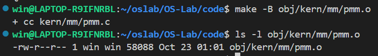


### 4.2 功能模块二：物理内存分配功能的任务一——First-Fit 分配算法分析

**负责人：** 2412419—张祎然。

#### 模块功能描述

First-Fit 用一个按地址排序的空闲链表管理连续物理页。分配时找到第一个足够大的空闲块，释放时检查前后相邻块能否合并。本部分主要分析以下函数：

```c
static void default_init(void);
static void default_init_memmap(struct Page *base, size_t n);
static struct Page *default_alloc_pages(size_t n);
static void default_free_pages(struct Page *base, size_t n);
```

空闲链表中只挂每个空闲块的首页，首页的 `property` 保存块长度。`nr_free` 则是所有空闲块的总页数。

#### 最终提示词

下面是根据阅读过程整理的提示词：

```text
请结合 memlayout.h、pmm.h、list.h 和 default_pmm.c，按初始化、分配、释放的顺序教我阅读 First-Fit。每次只解释一小段，重点说明 base、property、空闲标志和链表节点的区别，再用具体页数让我判断拆分和合并的结果。
```

#### 源码分析与问题修正

**1. 初始化及有序插入。**

`default_init` 把链表初始化成带哨兵的循环双向链表，并将空闲页数设为0。空表不是 `NULL`，而是哨兵的后继仍指向自己，所以要使用 `list_empty` 判断。

`default_init_memmap(base, n)` 先清理每页的状态、块长度和引用计数，再把 `base` 标成空闲块首页，记录长度 n，最后按地址顺序插入链表。

刚开始我对 `base` 的理解不够清楚。它是一个 `struct Page *`，指向首页的描述符。`base + 1` 表示下一个描述符，对应下一个物理页，不是物理地址只加了1字节。

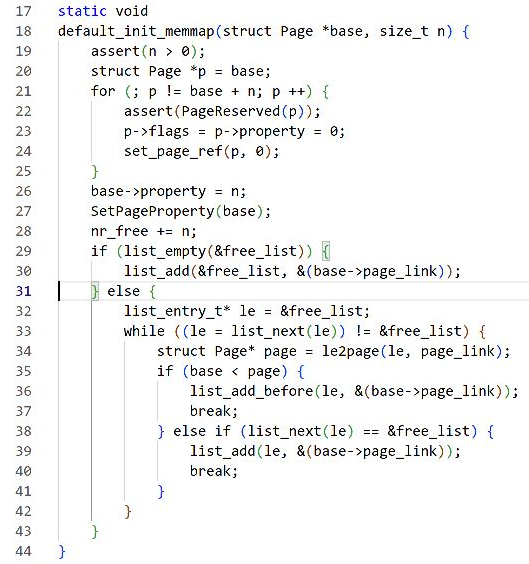

图4-1 `default_init_memmap` 中的页面初始化与空闲块登记。

**2. 分配及剩余块处理。**

分配前先检查总空闲页数，再沿链表查找第一个 `property >= n` 的块。找到后将其摘下；如果块还有剩余，就以 `page + n` 为新首页，把剩余部分重新加入链表。最后扣除 n 页，并清除已分配首页的空闲标志。

例如从8页块中申请3页，前3页返回给调用者，后5页成为新的空闲块。总空闲页数足够只是必要条件；如果空闲页分散在多个小块中，仍可能找不到足够大的连续块。

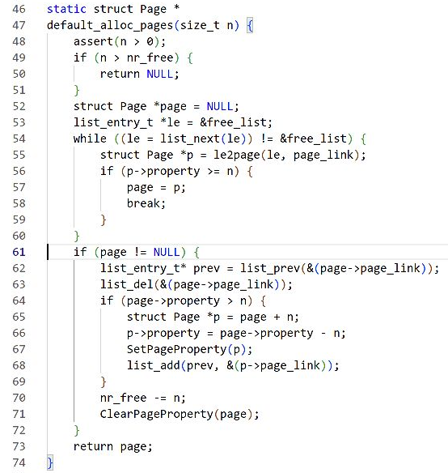

图4-2 找到第一个满足请求的块，并登记剩余页。

`ClearPageProperty(page)` 只清除 `flags` 中的标志位，不会自动把 `property` 清零。因此不能看到 `property` 大于0，就认为这个页面一定是空闲块首页。

**3. 释放及两侧合并。**

释放时先清理页面状态，把新空闲块按地址插入链表，再检查前后块是否与它连续。前块满足 `p + p->property == base` 时先向前合并，更新首页后再检查后块。

例如原有 `[10,13)` 和 `[15,19)` 两个空闲区间，归还 `[13,15)` 后可以合成9页块。空闲总页数只增加这次归还的2页，合并本身不增加页面。

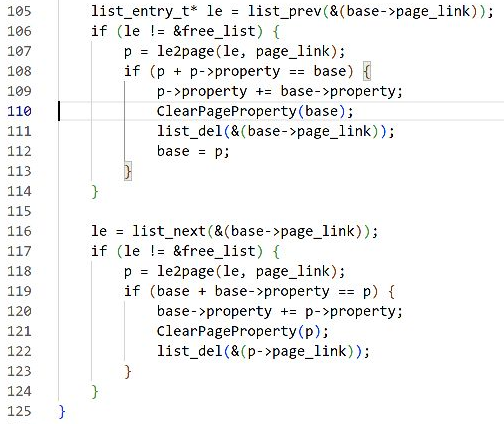

图4-3 先检查前驱，再检查后继，合并时摘下旧节点并清除旧首页标志。

阅读中发现，初始化和释放函数在链表尾部插入后都缺少 `break;`。插入完成后继续循环，可能再次访问新插入的节点。两处都补上退出语句后，再通过原检查验证链表操作。

#### 改进思考

First-Fit 最坏需要扫描全部 k 个空闲块，查找时间为 O(k)。每次都从头开始，还可能重复扫描前面一些无法满足请求的小块。

可以考虑 Next-Fit，保存上次搜索位置，走到末尾后从头继续，并在回到起点时停止。但这只能减少部分重复扫描，最坏时间仍然是 O(k)。Buddy 则按块大小分阶管理，让拆分和合并更有规律，代价是请求向上取整带来的内部碎片。

### 4.3 功能模块二：物理内存分配功能的任务二——Best-Fit 分配算法

**负责人：** 2413669-张懿鸾

#### 4.3.1 模块功能描述

**涉及文件/函数：**

- `kern/mm/best_fit_pmm.c`
  - `best_init()`：初始化 Best-Fit 分配器的空闲链表和空闲页计数。
  - `best_init_memmap()`：将连续的可用物理页面登记为空闲内存块。
  - `best_alloc_pages()`：按照 Best-Fit 策略分配连续物理页面。
  - `best_free_pages()`：释放连续物理页面，并合并相邻的空闲块。
  - `best_nr_free_pages()`：返回当前空闲物理页总数。
  - `best_fit_pmm_manager`：注册 Best-Fit 分配器的各项操作接口。
  - `best_fit_check()`：检查 Best-Fit 分配器的分配、释放及空闲链表维护是否符合预期。该函数为项目已有的检查函数，本次实现保留其原有内容。
- `kern/mm/pmm.c`
  - `init_pmm_manager()`：选择并初始化当前使用的物理内存管理器。
  - `pmm_init()`：完成物理内存管理器的初始化，并进入后续的内存初始化和检查流程。
- `kern/mm/default_pmm.c`
  - 作为 First-Fit 分配器的参考实现，用于理解空闲块登记、页面分配、页面释放和相邻空闲块合并等操作。本次不修改该文件。

**功能说明：**

本模块的主要任务是在 uCore 中实现 Best-Fit 连续物理内存分配算法，并将其正式接入现有物理内存管理框架，使内核实际使用 Best-Fit 分配器，而不是原有的 First-Fit 分配器。

在前一个模块完成物理内存初始化后，系统已经能够通过 `Page` 描述符表示物理页面，并将可用的连续物理页面交给内存管理器。本模块在此基础上，进一步实现对空闲物理内存的组织、分配和释放。

Best-Fit 的基本策略是：当系统需要分配连续的 `n` 个物理页面时，遍历当前空闲链表，寻找所有容量不小于 `n` 的空闲块，并选择其中容量最小的一个。如果多个候选块的容量相同，则选择空闲链表中地址靠前的块。

分配过程中，如果选中的空闲块大于实际需求，就需要将其拆分为已分配区域和剩余空闲区域，并正确维护剩余块的大小、状态标志、链表位置和空闲页总数。如果没有足够大的连续空闲块，则应返回 `NULL`，不能仅因为系统的空闲页总数足够就认定分配一定成功。

释放页面时，需要恢复相应 `Page` 描述符的状态，将释放区域重新加入空闲链表，并检查其与前后相邻空闲块是否连续。如果连续，则合并空闲块，避免链表中保留不必要的碎片。

在接口设计上，Best-Fit 分配器遵循现有 `struct pmm_manager` 的约定，通过 `best_fit_pmm_manager` 提供初始化、内存登记、分配、释放、空闲页统计和检查等操作。随后，在 `pmm.c` 的 `init_pmm_manager()` 中选择该管理器，使原有的 `page_init()`、`alloc_pages()`、`free_pages()` 及检查流程能够继续使用统一的接口。

与 First-Fit 相比，Best-Fit 不再选择第一个满足要求的空闲块，而是尽可能选择容量最接近申请需求的空闲块。该策略有助于减少单次分配时产生的剩余空间，但也需要遍历候选块寻找最合适的区域，因此会产生额外的查找开销。

#### 4.3.2 最终提示词

以下是本模块实际使用的提示词。本次通过一次完整提示词明确了实现范围、算法选择规则、数据结构维护要求及测试约束，完成了 Best-Fit 分配器的实现与接入。

```markdown
[PROMPT]
任务目标：
在 kern/mm/best_fit_pmm.c 中完成 Best-Fit 连续物理内存分配器，并在 kern/mm/pmm.c 中完成管理器切换，使内核初始化和页面分配检查实际使用 best_fit_pmm_manager，而不是现有的default_pmm_manager。
Best-Fit是从当前所有能够满足分配页数要求的空闲连续内存块中，选择容量最小的一个；如果多个块的容量相同，则选择空闲链表中地址靠前的块。
请结合项目现有代码、First-Fit 参考实现及已有测试函数，理解模块的完整职责后完成实现。
操作要求：
1. 必须直接修改项目中的实际源码文件。
2. 仅允许修改 kern/mm/best_fit_pmm.c 和 kern/mm/pmm.c。
3. 不得修改 basic_check()、best_fit_check() 的函数内容、断言或测试逻辑，也不得删除、绕过或弱化已有测试。
4. 不得修改 struct pmm_manager、struct Page、free_area_t 等既有数据结构，不得随意修改已有宏定义、头文件接口或 First-Fit 实现。
5. pmm.c 中的 page_init()已经完成 ，本次只需修改 init_pmm_manager() 中的管理器选择。
6. 保留原有注释及文件结构。可以增加模块内部的辅助函数，但不得增加不必要的跨文件接口。
输出要求：
- 实际完成源码修改。必须符合 pmm.h 中的 struct pmm_manager 接口约定。
- best_fit_pmm_manager 必须具有正确的名称，且其各成员指向对应的 Best-Fit 实现。
- init_pmm_manager() 必须选择 &best_fit_pmm_manager。
- 现有 basic_check() 和 best_fit_check() 必须能够继续检验分配、释放、空闲页计数和 Best-Fit 选择语义。
[RELY]
请优先使用实现本模块所必需的以下现有代码和接口：
1. kern/mm/pmm.h
   - struct pmm_manager
   - struct Page
   - alloc_pages()、free_pages()、nr_free_pages()
   - page2pa()、pa2page() 等页面地址转换接口。
2. kern/mm/memlayout.h
   - struct Page
   - free_area_t
   - PageReserved()、PageProperty()、SetPageProperty()、ClearPageProperty() 等页面状态宏。
3. kern/libs/list.h
   - list_entry_t
   - list_init()、list_add()、list_add_before()、list_del()
   - list_empty()、list_next()、list_prev()。
4. kern/mm/default_pmm.c
   - 作为初始化、空闲块登记、链表维护、分配、释放及相邻块合并的参考实现可以借鉴其数据结构维护方式，但不能直接复制 First-Fit 的分配选择策略。
   5.kern/mm/best_fit_pmm.c
- 保留已有的 basic_check() 和 best_fit_check()。
- 这两个函数使用 free_list、nr_free 检查管理器内部状态，因此需要提供正确的模块内部状态及对应宏定义。
   6.kern/mm/pmm.c
- init_pmm_manager() 负责选择管理器并初始化其内部状态。
- pmm_init() 后续通过 page_init() 登记可用内存，再调用 check_alloc_page() 执行管理器检查。
以当前工作区的真实接口为准，并在输出中说明差异，不要自行修改公共接口来绕过问题。
[GUARANTEE]
必须提供以下实现：
static void best_init(void);

static void best_init_memmap(struct Page *base, size_t n);

static struct Page *best_alloc_pages(size_t n);

static void best_free_pages(struct Page *base, size_t n);

static size_t best_nr_free_pages(void);

const struct pmm_manager best_fit_pmm_manager;
可以增加仅供本模块内部使用的辅助函数和静态状态。
best_fit_pmm_manager 应正确初始化以下成员：
- name
- init
- init_memmap
- alloc_pages
- free_pages
- nr_free_pages
- check
其中 check 必须指向已有的 best_fit_check()，不得改用 First-Fit 的检查函数。
[SPECIFICATION]
1. best_init()
前置条件：
- 管理器内部的空闲链表和计数尚未初始化。
后置条件：
- 空闲链表处于合法的空状态。
- 空闲页计数初始化为零。
- 后续内存区登记可以安全地使用这些状态。
2. best_init_memmap(struct Page *base, size_t n)
前置条件：
- n > 0。
- [base, base + n) 中的页面均处于保留状态，且尚未登记为空闲内存。
后置条件：
- 合法登记这段连续物理内存。
- 空闲块的起始页正确记录块大小，并设置 PageProperty。
- 其余页面不被误标记为空闲块头。
- 空闲链表按照物理页面地址顺序维护。
- nr_free 正确增加 n。
不得将尚未登记或仍被保留的页面错误地加入可分配区域。
3. best_alloc_pages(size_t n)
前置条件：
- n > 0。
- 空闲链表、各块的 property 和 nr_free 已被正确维护。
情况一：分配成功。
当存在一个或多个容量不小于 n 的空闲块时：
- 选择其中 property 最小的块。
- 容量相同时，选择链表中地址靠前的块。
- 返回所选块的起始页描述符。
- 将被分配的页面从空闲链表中移除。
- 如果原块大于 n，剩余页面必须形成一个合法的空闲块，并正确维护其大小、标志和链表位置。
- nr_free 必须减少 n。
情况二：分配失败。
当 n > nr_free，或者不存在任何容量不小于 n 的连续空闲块时：
- 返回 NULL。
- 不得改变空闲链表、空闲块属性或 nr_free。
情况三：非法请求。
当 n == 0 时，沿用项目现有的断言约定进行处理。
特别注意：仅检查 nr_free >= n 并不足以保证分配成功，因为空闲页面总数足够时，也可能不存在足够大的连续空闲块。
4. best_free_pages(struct Page *base, size_t n)
前置条件：
- n > 0。
- 待释放的页面属于合法的已分配区域，不是保留页面，也没有重复释放。
后置条件：
- 待释放页面的引用计数、标志和块属性得到正确维护。
- 新释放的连续页面形成合法空闲块，并按照物理地址顺序插入空闲链表。
- nr_free 正确增加 n。
- 如果新块与前一个空闲块物理地址连续，应合并。
- 如果新块与后一个空闲块物理地址连续，也应合并。
- 合并后只有真正的空闲块头保留有效的块大小及 PageProperty 标记。
相邻块合并不得重复增加空闲页计数，也不得破坏链表结构。
5. best_nr_free_pages()
返回当前真实的空闲物理页总数，结果必须与空闲链表中各空闲块容量之和一致。
6. best_fit_pmm_manager 与管理器接入
- .name 必须为 "best_fit_pmm_manager"。
- 每个接口成员均指向对应的 Best-Fit 实现。
- .check 指向已有的 best_fit_check()。
- kern/mm/pmm.c 中的 init_pmm_manager() 必须将 pmm_manager 设置为 &best_fit_pmm_manager，并通过现有输出语句显示当前管理器名称。
- 不得修改 page_init() 的实现。
- 不得修改已有测试函数来使检查通过。
完成后请输出：
1. 实际修改的文件及对应位置。
2. 各函数的实现摘要，并简要对比 Best-Fit 与 First-Fit 。
3. 管理器注册与切换的实际修改内容。
4. 尚未验证的事项和下一步建议。
```

#### 4.3.3 实现迭代过程

本模块使用一次完整的提示词完成了 Best-Fit 分配器的实现及管理器接入，没有记录到需要重新编写提示词才能解决的中间问题。

---

##### 第一次迭代

**任务目标：**

在不改变现有公共接口和测试代码的前提下，实现 Best-Fit 的初始化、空闲内存登记、连续页面分配、页面释放、相邻块合并和空闲页统计，并将该分配器接入 uCore 的物理内存管理流程。

**实现内容：**

1. 在 `kern/mm/best_fit_pmm.c` 中完成 Best-Fit 分配器的各项操作，并使用现有 `struct pmm_manager` 接口统一管理。
2. 根据 Best-Fit 的选择规则，在满足申请页数要求的候选空闲块中选择容量最小的块；容量相同时，优先选择地址靠前的块。
3. 在分配时正确处理空闲块的拆分，并维护页面状态、块大小、链表关系和空闲页计数。
4. 在释放时将页面重新登记为空闲区域，并合并前后相邻的空闲块。
5. 在 `kern/mm/pmm.c` 的 `init_pmm_manager()` 中选择 `&best_fit_pmm_manager`，使后续内存管理操作实际调用 Best-Fit 实现。
6. 保留原有检查函数及其断言，使用项目现有测试验证实现结果。


**问题解决策略：**

提示词中预先明确了关键约束，包括：

- 明确区分 Best-Fit 与 First-Fit 的候选块选择策略。
- 要求空闲链表按照物理页面地址顺序维护，以支持相邻空闲块合并。
- 明确区分空闲页总数与最大连续空闲块容量，避免将 `nr_free >= n` 错当作分配成功的充分条件。
- 要求正确维护空闲块的 `property`、页面状态、链表位置及 `nr_free`。
- 明确要求保留原有测试函数，不得通过修改断言或绕过检查来使测试通过。
- 限定修改范围，避免影响已经完成的 `page_init()` 和 First-Fit 参考实现。


**最终结果与验证：**

**1. 完整构建**

执行 `make` 后，内核各模块编译成功，链接器生成 `bin/kernel`，并通过 `objcopy` 生成 `bin/ucore.img`。

**2. 官方评分测试**

实现完成后，使用项目现有的 `make grade` 进行评分测试，终端输出显示：

- `check page init: OK`
- `check best fit: OK`
- `Total Score: 20/20`

其中 `check page init: OK` 表明页面初始化通过了本次实验的对应评分检查；`check best fit: OK` 则表明 Best-Fit 检查也通过。

**3. QEMU 运行验证**

执行 `make qemu` 后，内核成功进入物理内存初始化流程。关键运行信息如下：

```text
DTB Init
DTB Address: 0x82200000

Physical Memory from DTB:
  Base: 0x0000000080000000
  Size: 0x0000000008000000 (128 MB)
  End:  0x0000000087ffffff

memory management: best_fit_pmm_manager

physical memory: [0x0000000080000000, 0x0000000088000000), 128 MB
page array: [0x0000000080207000, 0x0000000080347000), 32768 descriptors
free memory: [0x0000000080347000, 0x0000000088000000), 31929 pages

check_alloc_page() succeeded!
```

运行结果表明，当前 QEMU 环境识别到 128 MiB 物理内存，建立了 32768 个 Page 描述符，并将 31929 个完整页面交给当前物理内存管理器。后续的 `check_alloc_page()` 检查也成功完成。

**集成验证截图：**


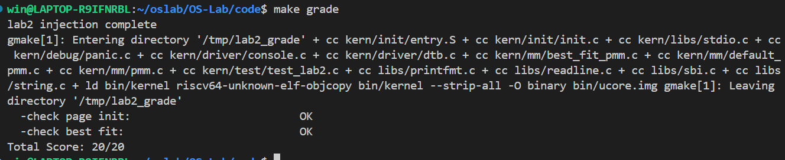

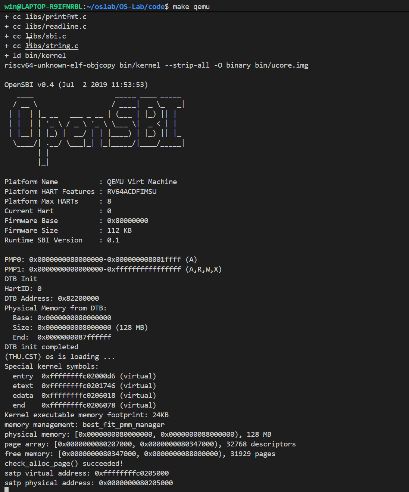

#### 4.3.4 思考题：Best-Fit 是否还有改进空间？

Best-Fit 仍有进一步优化的空间，主要体现在查找效率、空闲块组织方式和内存碎片控制三个方面。

**（1）优化候选空闲块的查找方式**

按照本次实现的设计要求，空闲链表按照物理页面地址顺序维护。分配时需要遍历空闲块，筛选出容量不小于申请页数的候选块，再从中选择容量最小的一个。

假设当前有 \(m\) 个空闲块，那么一次 Best-Fit 查找在最坏情况下需要检查全部空闲块，时间复杂度为 \(O(m)\)。当系统运行时间较长、空闲内存被分割成大量小块时，这种线性遍历会增加分配开销。

一种改进方法是按照空闲块大小建立有序索引，使查找能够更快地定位满足需求的最小空闲块。例如，可以使用以块大小为主要排序键的平衡搜索树，并以物理地址作为次级排序键处理容量相同的情况，从而将候选块查找、插入和删除的时间复杂度降低到 \(O(log m)\)。

不过，按照大小组织空闲块后，查找物理地址相邻的空闲块会变得不够直接。若要高效完成相邻块合并，可以同时维护按地址组织的链表和按大小组织的索引，并在分配、释放和合并时同步更新两者。这样可以提升查找效率，但也会增加数据结构维护的复杂度。

**（2）改进空闲块组织方式**

除了简单的地址有序链表，还可以考虑分级空闲链表、大小分类表或其他适合连续内存分配的数据结构。

例如，分级空闲链表可以将不同大小范围的空闲块分别组织，减少每次分配时需要检查的候选块数量。不过，分级方式需要设计合理的块大小划分，并处理不同等级之间的查找和合并问题。

另一种方案是平衡搜索树，同时按照空闲块大小和地址维护索引，兼顾 Best-Fit 查找和相邻块合并的需求。其代价是实现复杂度、额外的索引空间和状态同步成本都会上升。

**（3）进一步分析内存碎片问题**

Best-Fit 每次优先选择最接近申请大小的空闲块，能够减少单次分配后留下的剩余空间，但这并不意味着它一定能够减少整个系统生命周期内的外部碎片。

例如，一个较大的空闲块可能被拆分成多个较小的剩余块。这些剩余块虽然仍然可以被分配，但如果后续申请需要更大的一段连续物理内存，即使系统的空闲页总数足够，也可能因为缺少足够大的连续块而分配失败。

因此，评价 Best-Fit 不能只看剩余块的大小，还需要考虑分配请求的分布、空闲块数量、连续可用空间以及后续合并的机会。我们可以通过构造不同的分配与释放序列，记录分配成功率、候选块查找次数、空闲块数量和最大连续空闲块容量，对不同构造的实际效果进行比较。

**（4）结合实验目标选择优化方案**

本次实验的重点是理解连续物理内存管理器的接口、Best-Fit 的选择规则、空闲块拆分与合并机制，以及管理器在 uCore 中的注册和调用流程。因此，采用相对简单的链表结构有利于理解和验证算法。

如果进一步面向实际系统优化，可以考虑引入大小索引、分级空闲链表或其他更高效的数据结构，但任何改进都需要同时考虑查找性能、内存碎片、相邻块合并、额外存储开销和实现复杂度。


### 4.4 Buddy System 分配算法

**负责人：** 2412419—张祎然。

#### 模块功能描述

Buddy 把空闲块大小限制为2的幂。0阶对应1页，1阶对应2页，依次递增。本实现最大阶为15，每阶使用一个空闲链表。

主要接口如下，完整实现见 [buddy_pmm.c](../code/kern/mm/buddy_pmm.c)：

```c
static void buddy_init(void);
static void buddy_init_memmap(struct Page *base, size_t n);
static struct Page *buddy_alloc_pages(size_t n);
static void buddy_free_pages(struct Page *base, size_t n);
static size_t buddy_nr_free_pages(void);
static void buddy_check(void);
```

请求 n 页时，分配最小的、能够容纳 n 页的整幂块。例如申请5页实际占用8页，目标阶为3。空闲首页设置 `PG_property`，`property` 保存页数；分配后清除空闲标志，但保留实际占用页数，供释放时检查。

这里采用**整块释放**：申请时保存返回的首页和原请求 n，释放时用 `free_pages(base, n)` 归还整个实际分配块。申请5页得到8页，释放时也归还8页，不支持单独归还块中间的一部分。

#### 最终提示词

实现和测试要求最终整理为：

```text
阅读现有 Page 结构、链表接口和 pmm_manager，在 buddy_pmm.c 中实现并注册 Buddy 物理页分配器。

每阶使用带哨兵的循环双向链表，最大阶为15；申请向上取整到2的幂，采用整块释放。空闲标志与块长度分别维护。

初始化支持非对齐起点和非整幂长度。对齐和伙伴查找统一使用绝对物理页号，伙伴为 ppn ^ (1UL << order)。先检查边界，再访问伙伴描述符；只合并空闲、同阶的真正伙伴，合并后保留低地址首页。

拆分和合并只改变块的组织方式，分配、释放分别按实际页数更新一次总空闲数。补齐管理器接入和运行依赖，保留原测试及断言。

测试应覆盖取整、非对齐区间、相邻但非伙伴、越界和释放后恢复，并在真实QEMU内存中检查数据、不重叠和页数守恒。保存实际命令与输出。
```

#### 实现迭代过程

下面按实现过程中的三个主要阶段整理。

##### 第一次迭代：建立各阶链表，完成初始化

开始时我把 `buddy_free_lists[order]` 当成指针，写过赋值 `nullptr` 和与 `NULL` 比较的代码。查看 `list.h` 后才弄清楚，数组元素本身就是链表哨兵，应该使用：

```c
list_init(&buddy_free_lists[order]);
```

判断某一阶有没有空闲块时使用 `!list_empty(&buddy_free_lists[order])`。

求目标阶时，`buddy_get_order` 对 `n - 1` 连续除2并计数，得到向上取整后的阶数。块页数可以写成 `1UL << order`，不用逐次乘2。

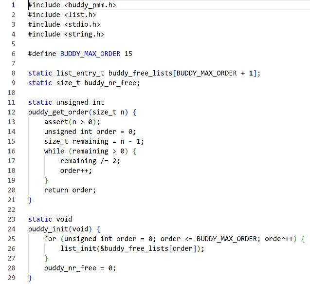

图4-4 阶数计算、链表初始化和空闲块登记。

初始化一段内存时，不能直接把13页向上登记成16页，否则会把不属于这个区间的页也加入空闲链表。处理方法是从当前首页出发，选择同时满足以下条件的最大块：块页数不超过剩余页数，首页物理页号能被块页数整除。

登记后让 `p` 前进 `block_pages` 个描述符，减少剩余页数，继续处理，直到这段内存全部登记完成。

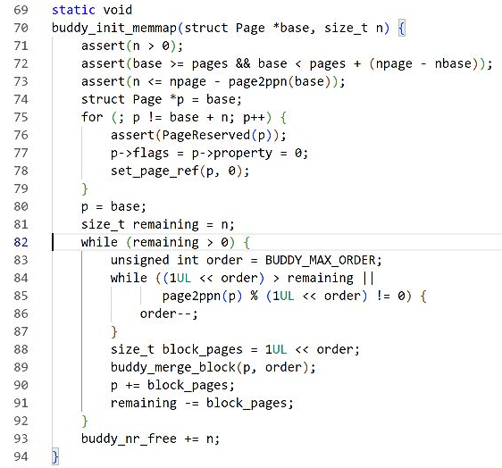

图4-5 根据剩余长度和对齐条件切分初始内存。

清理描述符时，我还把“引用计数设为0”误写成了 `base = 0`。这会改变指针，正确操作是 `set_page_ref(p, 0)`。这个错误让我分清了指针变量和指针所指向对象的字段。

##### 第二次迭代：完成分配、拆分和释放合并

分配时先求目标阶，再调用 `buddy_find_free_order(target_order)` 向上查找非空链表。这个函数返回 `int`，因为找不到时需要返回 `-1`。

选中块后先摘链并清除空闲标志。如果块太大，就逐级减小阶数，把右半块放回对应链表，保留左半块继续拆分。达到目标阶后，记录实际占用页数并扣减空闲总数。

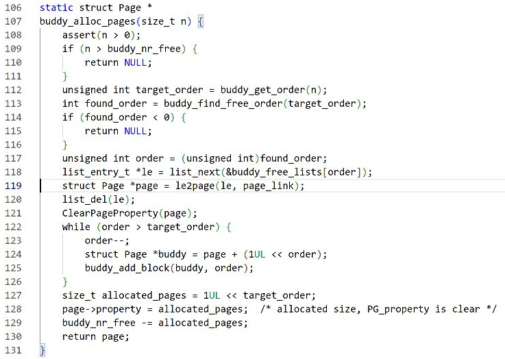

图4-6 查找目标块、拆分以及分配后的页数更新。

例如申请5页而当前只有16页块，就拆成两个8页块，返回其中一个，另一个保留在3阶链表。拆分没有产生新的页面，所以 `buddy_add_block` 只登记块，不增加 `buddy_nr_free`。

释放时，先由原请求 n 求出实际块长，再检查范围、对齐和首页状态。随后清理本块描述符，利用异或寻找伙伴：

```c
size_t block_pages = 1UL << order;
size_t base_ppn = page2ppn(base);
size_t buddy_ppn = base_ppn ^ block_pages;
```

我曾把释放页数写成 `buddy_find_free_order(order)`，但这个函数返回的是“哪个阶的链表非空”，不是页数。这里应使用 `1UL << order`。

找到伙伴页号后，先检查它是否在可管理范围内，再取对应描述符。伙伴必须是空闲块首页，且 `property` 与当前块长相同，才能摘链合并。

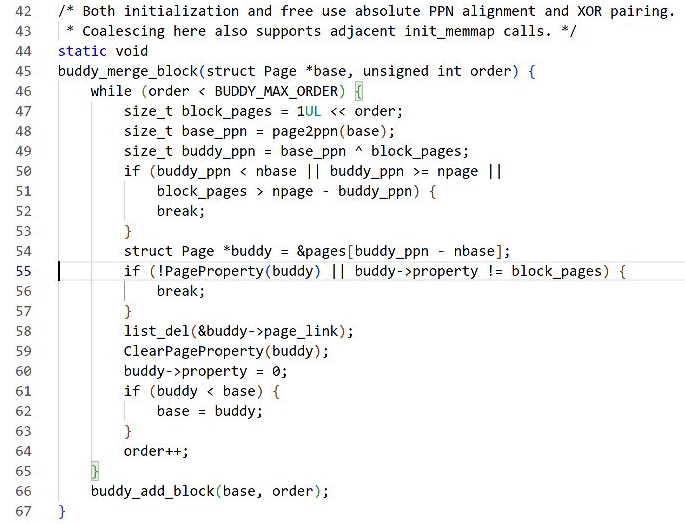

图4-7 伙伴计算、边界检查，以及合并后首页和阶数的更新。

这一部分容易漏掉两步：合并后把较低地址作为新首页，以及执行 `order++` 后继续寻找更高阶伙伴。最终只把合并后的块加入链表一次。

摘链时我也写错过参数。`list_del` 需要的是链表节点地址，正确写法为 `list_del(&buddy->page_link)`；`ClearPageProperty` 接收 Page 指针，应写 `ClearPageProperty(buddy)`。

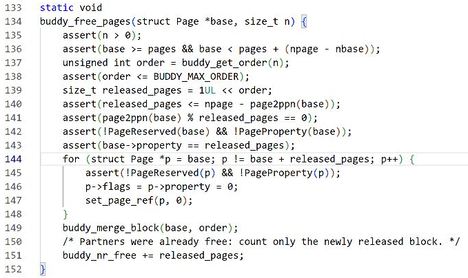

图4-8 释放前检查描述符，合并后仅增加本次归还的页数。

这里的计数只增加 `released_pages`。伙伴原本就是空闲的，已经计入总数，不能把合并后的整个块长再加一遍。

##### 第三次迭代：接入系统并补充边界测试

完成函数后，通过 `buddy_pmm_manager` 注册初始化、内存登记、分配、释放、计数和检查接口，再由 `pmm.c` 根据编译选项选择管理器。`make PMM=buddy` 使用 Buddy，默认构建仍使用 Best-Fit。

后续把合并过程提取为 `buddy_merge_block`，让初始化也能使用它。这样分两次登记相邻的伙伴块时，可以合成更大的块，避免空闲页已连续却无法分配大块的问题。

联调时补齐了 `page_init` 和 Best-Fit。`page_init` 从 DTB 读取内存范围，建立描述符并登记内核、描述符之后的可用完整页；Best-Fit 则在所有足够大的块中选择最小块，仍按地址维护链表以便回收合并。原有检查函数和断言保持不变。

**最终结果：** Buddy 能够编译运行，8组自测通过，原有两种分配器的检查也通过。具体结果见第五部分。

**关键改进：** 页面状态和块长度分开判断；初始化考虑绝对物理页号对齐；合并同时检查伙伴关系与边界；页数只在分配和释放时记账。

### 4.5 SLUB 内存对象分配器

**负责人：** [2413788-张旗庭]

#### 4.5.1 模块目标与设计思路

**（1）设计背景**

在本实验中，物理内存管理器（PMM）通过 alloc_pages() 和 free_pages() 提供物理页的分配与回收。由于一个物理页大小是4 KiB，如果申请较小的内存空间，比如16字节，仍会分配4 KiB，会造成大量的空间浪费。

因此，本次扩展任务在已有PMM的基础上实现简化版SLUB内存对象分配器，将内存分配划分为两个层次：

- 第一层：物理页分配。 使用PMM提供的 alloc_pages() 和 free_pages() 管理4 KiB物理页。

- 第二层：小对象分配。 SLUB从PMM获取物理页后，将页面划分为若干固定大小的对象槽，使用位图（bitmap）记录槽的分配状态，对外提供小对象分配和释放接口。


**（2）总体架构**

在SLUB内部，采用`cache`、`slab`和`object`的组织关系：cache管理特定大小类别的slab，每个slab由一个4 KiB物理页构成，并划分为多个固定大小的对象存储单元。本实现通过bitmap记录对象的分配状态，以简化真实Linux SLUB中的空闲对象管理机制。

分配器设置8种对象槽大小：16、32、64、128、256、512、1024和2048字节。申请时选择能够容纳请求的最小类别。例如，申请50字节时使用64字节对象槽。

本实现支持1～2048字节的申请，并保证返回的对象地址按16字节对齐。对于超出支持范围的请求，返回 NULL。


#### 4.5.2 数据结构与核心算法实现

**（1）数据结构设计**

本实现主要定义两个数据结构：`struct slub_cache` 和 `struct slub_page`。

```c
struct slub_cache {
    size_t object_size; // 管理的对象槽大小
    list_entry_t slabs;
};
struct slub_page {
    list_entry_t link;  // 把当前 slab 加入 cache 链表
    struct slub_cache *cache;
    struct Page *page;
    size_t capacity; // 最多可以分配多少个对象槽
    size_t inuse;
    uint8_t bitmap[SLUB_BITMAP_BYTES];  // 记录哪些对象槽被占用 32个字节，256位，因为最多256个对象槽。
};
```

struct slub_cache 包含对象槽大小 object_size 和slab链表头 slabs，用于管理同一大小类别的全部slab。

struct slub_page 则保存单个slab的管理信息，包括：

| 成员 | 作用 |
|----------|----------------|
| link | 将slab连接到所属cache的双向链表 |
| cache | 指向所属大小类别的cache |
| page | 保存PMM返回的 struct Page 描述符 |
| capacity | 当前slab可容纳的对象槽总数 |
| inuse | 当前已分配的对象槽数量 |
| bitmap | 逐位记录对象槽是否被占用 |

其中，struct Page 与 struct slub_page 属于不同管理层次。前者由PMM维护，描述整个物理页的状态；后者由SLUB维护，描述该页面内部的小对象分配情况。

本实现将 struct slub_page 管理头放置在已分配页面的起始位置，其后为对齐后的对象槽区域。位图中，0表示对象槽空闲，1表示对象槽已分配。

**（2）初始化：void slub_init(void)**

初始化函数首先检查分配器是否已经初始化，避免重复重置cache链表。

```c
void
slub_init(void) {
    if (initialized) {// 是否初始化，初始为false
        return;
    }
    assert(slub_object_offset() + 2048 <= PGSIZE);
    for (size_t i = 0; i < SLUB_CACHE_COUNT; i++) {
        caches[i].object_size = (size_t)SLUB_ALIGNMENT << i;
        list_init(&caches[i].slabs); // 此时链表是空的，表示这个 cache 暂时没有管理任何 slab
    }
    initialized = 1;
}
```

随后建立8个静态cache管理结构，为每个cache设置相应的对象槽大小，并调用 list_init() 初始化slab链表。

需要注意的是，`slub_init()` 只建立管理结构，并没有申请物理页。只有实际分配对象时，才根据需要创建slab，实现按需分配，从而避免预先占用不必要的物理内存。

**（3）创建slab：slub_new_page()**

当某个cache没有可用slab时，调用 slub_new_page() 创建新slab。cache管理结构初始化后首次分配内存就会调用该函数。

```c
static struct slub_page *
slub_new_page(struct slub_cache *cache) {
    struct Page *page = alloc_pages(1);// 申请一个页，返回页描述符地址
    if (page == NULL) {
        return NULL;
    }

    uintptr_t pa = page2pa(page);  // 被分配物理页的起始物理地址
    if (pa < KERNEL_BEGIN_PADDR ||
        pa >= PHYSICAL_MEMORY_END ||
        (pa & (PGSIZE - 1)) != 0) {
        free_pages(page, 1);        // 与0xfff，4KB对齐
        return NULL;
    }
    struct slub_page *slab =
        (struct slub_page *)(pa + (uintptr_t)PHYSICAL_MEMORY_OFFSET); // 把这个得到的物理地址转换为虚拟地址，然后slub_page从这里开始
    memset(slab, 0, sizeof(*slab));  // 把管理头部清零
    slab->cache = cache;
    slab->page = page;
    slab->capacity = (PGSIZE - slub_object_offset()) / cache->object_size;
    list_add(&cache->slabs, &slab->link); // 把新slab加入当前cache的链表，方便后续分配器查找
    return slab;
}
```

实现过程为：

1. 使用 `alloc_pages(1)` 向PMM申请一个4 KiB物理页。

2. 通过 `page2pa()` 获得被分配的物理页起始地址，检查地址范围与页面对齐。

3. 利用内核已有的物理内存映射关系，将物理地址转换为对应的内核虚拟地址。

4. 在页面起始位置初始化 slub_page 管理头部。

5. 根据管理头部所占空间和对象槽大小计算 capacity。

6. 将新slab加入所属cache的双向链表。

其中，slab的对象槽capability计算公式为：

$$
\mathrm{capacity} = \left\lfloor \frac{\mathrm{PGSIZE} - \mathrm{start}}{\mathrm{object\_size}} \right\rfloor
$$

其中，`PGSIZE` 表示物理页大小（4096 字节），`start` 表示管理头部经过 16 字节对齐后的起始偏移，`object_size` 表示当前 cache 的对象大小。

**（4）对象分配：void \*slub_alloc(size_t size)**

源码如下：
```c
void *
slub_alloc(size_t size) {
    if (!initialized || size == 0 ||
        size > caches[SLUB_CACHE_COUNT - 1].object_size) {
        return NULL;
    }

    struct slub_cache *cache = &caches[0];
    while (cache->object_size < size) {
        cache++;
    }// 从最小的逐个往上找

    struct slub_page *slab = NULL;
    list_entry_t *le;
    for (le = list_next(&cache->slabs); le != &cache->slabs;
         le = list_next(le)) {
        struct slub_page *candidate = to_struct(le, struct slub_page, link);  // 通过链表节点，找回它所属的 slub_page 结构体
        if (candidate->inuse < candidate->capacity) {
            slab = candidate;
            break;
        }
    }
    if (slab == NULL) {
        slab = slub_new_page(cache);
        if (slab == NULL) {
            return NULL;
        }
    }

    for (size_t i = 0; i < slab->capacity; i++) { // i表示对象槽的编号 一个 bitmap 字节可以记录8个槽
        uint8_t mask = (uint8_t)(1U << (i % 8)); // bitmap字节索引 i/8,字节内部位编号 i%8
        if ((slab->bitmap[i / 8] & mask) == 0) {
            slab->bitmap[i / 8] |= mask;
            slab->inuse++;
            return (char *)slab + slub_object_offset() +
                   i * cache->object_size; // 计算并返回对象槽的虚拟地址
        }
    }
    panic("slub_alloc: inconsistent slab bitmap");
    return NULL;
}
```

slub_alloc(size) 首先检查请求大小是否合法，并选择能够容纳该请求的最小cache。这里选择大小是从16字节逐个往上比较，选到第一个比需要内存大的为止。

随后遍历该cache的slab链表，通过 inuse < capacity 判断是否还有空闲对象槽。如果所有slab均已满，或者链表为空，则调用 slub_new_page() 申请新页面。

确定可用slab后，从低编号开始扫描位图，寻找第一个为0的对象槽。找到后将对应位设置为1，增加 inuse，并计算返回地址：

$$
\mathrm{object\_address} = \mathrm{slab\_base} + \mathrm{start} + i \times \mathrm{object\_size}
$$

其中，`slab_base` 表示 slab 所在页面的起始虚拟地址，`start` 表示对象区域的起始偏移，i 表示对象槽编号，`object_size` 表示当前 cache 的对象大小。

这一过程体现了SLUB的两级分配方式：只有现有slab无法满足请求时，才需要调用底层PMM申请新页。

**（5）对象释放：void slub_free(void \*ptr)**

源码如下：
```c
void
slub_free(void *ptr) {
    if (ptr == NULL) {
        return;
    }
    if (!initialized) {// SLUB尚未初始化，却试图释放一个非空指针。这属于错误使用，因此触发 panic。
        panic("slub_free: allocator not initialized");
        return;
    }

    uintptr_t address = (uintptr_t)ptr;
    uintptr_t base = address & ~((uintptr_t)PGSIZE - 1); // 掩码与运算，得到页对齐的基地址，即该对象所在的页的起始地址（虚拟
    struct slub_page *slab = NULL;

    for (size_t i = 0; i < SLUB_CACHE_COUNT && slab == NULL; i++) {// 遍历所有cache，确认页面属于SLUB
        list_entry_t *head = &caches[i].slabs;
        for (list_entry_t *le = list_next(head); le != head;
             le = list_next(le)) {// 内层循环遍历每个cache管理的slab链表
            struct slub_page *candidate =
                to_struct(le, struct slub_page, link);
            if ((uintptr_t)candidate == base) {// 检查它的起始地址是否等于刚才计算出的页面起始地址，相等说明找到
                slab = candidate;
                break;
            }
        }
    }
    if (slab == NULL) {
        panic("slub_free: pointer does not belong to a live slab");
        return;
    }

    size_t offset = address - base;
    size_t start = slub_object_offset();
    size_t object_size = slab->cache->object_size;
    if (offset < start || (offset - start) % object_size != 0) {
        panic("slub_free: pointer is not an object start");
        return;
    }
    size_t index = (offset - start) / object_size; // 第几个
    if (index >= slab->capacity) {
        panic("slub_free: pointer outside object area");
        return;
    }
    uint8_t mask = (uint8_t)(1U << (index % 8)); // 是不是已经释放过
    if ((slab->bitmap[index / 8] & mask) == 0) {
        panic("slub_free: object already free");
        return;
    }
    assert(slab->inuse > 0);
    slab->bitmap[index / 8] &= (uint8_t)~mask;
    slab->inuse--;

    if (slab->inuse == 0) {
        struct Page *page = slab->page;
        list_del(&slab->link);
        free_pages(page, 1); // 先保存Page指针、移除cache链表，再释放页面
    }
}
```

该函数接收对象指针，首先验证该指针的合法性，包括：是否为空指针，SLUB是否初始化，然后遍历所有cache，确认页面属于SLUB。

找到对应slab后，函数进一步检查：

1. 指针是否位于对象槽区域。

2. 指针是否指向某个对象槽的起始位置。

3. 对象槽编号是否超出容量。

4. 位图是否表明该对象当前处于已分配状态。

检查通过后，将对应位图位清零，inuse 减1。

当 inuse 变为0时，说明该slab已无活跃对象。此时先将slab从cache链表中移除，再使用 `free_pages(page, 1)` 将整个物理页归还PMM。

这种设计实现了对象槽的重复利用和空闲物理页的及时回收。


#### 4.5.3 AI提示词设计

本次SLUB Challenge未提供现成的代码框架与测试函数，因此需要在理解已有物理内存管理机制的基础上，自行确定模块功能、对外接口及验证方案。

按照实验要求：第一份提示词从零生成 SLUB 内存对象分配模块并接入现有内核，第二份提示词用于让 AI 针对第一份提示词生成的分配算法设计相应的测试函数，以检验不同大小内存对象的分配和释放是否正确。

两份提示词均采用 [PROMPT]、[RELY]、[GUARANTEE]、[SPECIFICATION] 四段式组织。

**4.5.3.1 第一份提示词：SLUB内存对象分配模块**

**[PROMPT]**

**任务**：在当前uCore Lab2项目中，从零设计并实现一个简化版SLUB内存对象分配模块，在已有物理页分配器的基础上提供小对象内存分配和释放能力。

本模块应体现两层内存分配思想：底层负责物理页的申请与归还，上层负责将已有页面空间组织成可供不同大小对象使用的内存区域。允许对真实Linux SLUB进行简化，不要求实现其完整并发与性能优化机制。

目标文件为：

kern/mm/slub.h：声明分配器的公开接口。

kern/mm/slub.c：实现内存对象管理及分配、释放功能。


**操作要求**：
1. 首先依据之前的工程分析结果，核实PMM接口、相关宏定义和内核地址映射规则。

2. 必须在项目中新增真实源码文件，不得仅输出代码片段。

3. 只允许新增 slub.h 和 slub.c，不得修改其他文件。

4. 本阶段不创建测试文件，不执行编译或启动QEMU。

**输出要求**：生成符合当前uCore编译规范的SLUB模块，保证公开接口一致。

**[RELY]**

本模块依赖现有工程的以下资源，具体语义应以真实源码为准。

（1）物理内存管理接口

文件：**code/kern/mm/pmm.h**

（2）页面与地址映射定义

文件：**code/kern/mm/pmm.h** 及相关头文件。

（3）内核基础接口

可以使用工程已经提供的：

- list_entry_t 及相关双向链表操作。

- assert()、panic()。

- size_t、uintptr_t、uint8_t 等基础类型。

**[GUARANTEE]**

必须新增并实现以下公开接口：

- **void slub_init(void);**
- **void \*slub_alloc(size_t size);**
- **void slub_free(void \*ptr);**

允许新增模块内部使用
struct slub_cache、struct slub_page 等私有数据结构，以及必要的宏定义等。

**[SPECIFICATION]**

**1.slub_init()：初始化分配器**

**Pre-Condition：**

- 当前内核的静态数据区和基本运行环境已经可用。

- 在实际申请物理页面之前，PMM必须已经完成初始化。

**Post-Condition：**

- 建立8种固定对象大小类别，分别管理16、32、64、128、256、512、1024和2048字节对象。

- 所有cache的管理状态均已正确初始化。

- 初始化本身不要求预先分配物理页。


**Case 1：首次初始化**。

完成必要的数据结构和状态初始化。


**Case 2：重复初始化。**

不得破坏已经创建的cache、slab或活跃对象。应避免重复初始化。

**2.slub_alloc(size_t size)：对象分配**

**Pre-Condition：**

- SLUB已经初始化。


**Post-Condition：**

- 合法分配成功时，返回可访问的内核虚拟地址。

- 返回的内存空间不得小于实际请求大小。

- 对象地址满足16字节对齐。

- 同时存活的对象不能相互重叠。

**Case 1：正常对象申请。**

- 按照请求大小选择能够容纳对象的最小大小类别。

- 当现有slab没有可用对象空间时，允许通过底层PMM申请新的4 KiB页面。

- 成功分配对象后，不得破坏其他活跃对象的数据。

**Case 2：非法申请。**

请求大小为0、超过2048字节，或分配器尚未初始化时，返回 NULL。


**Requirements：**

- 使用单页slab，每个slab对应一个4 KiB物理页。

- 通过位图记录对象占用状态。

- 不要求返回的多个对象地址连续。

**3.slub_free(void \*ptr)：对象释放**

**Pre-Condition：**

传入的指针是合法的，要求非空、是当前SLUB返回的、是尚未释放的对象的起始地址。

**Post-Condition：**

- 合法释放后，相关对象空间变为可用。

- 当所属slab没有活跃对象时，能够将整页归还PMM。

**Case 1：空指针释放。**

ptr == NULL 时直接返回，不修改管理状态。

**Case 2：合法对象释放。**

- 将该对象记录为未占用，使后续分配能够复用空间。

- 若所属slab已无活跃对象，则解除其管理关系并通过 free_pages(page, 1) 归还页面。

**Case 3：非法指针或重复释放。**

- 对不属于当前有效slab的指针、对象内部指针和可检测的重复释放进行明确错误处理。

- 不得破坏其他仍然有效的slab或对象。


**4.5.3.2 第二份提示词：SLUB测试模块**

**[PROMPT]**

**任务：**

针对已经实现的简化版SLUB内存对象分配器，设计并实现测试模块，验证其对不同大小内存对象的分配、连续申请、释放复用、跨页面分配、对象数据完整性以及物理页回收等行为正确。

**目标文件为：**

code/kern/mm/slub_test.c：新增测试函数及必要的辅助函数。

code/kern/mm/slub.h：仅在需要新增测试函数声明时允许修改。

**操作要求：**

- 首先阅读现有的 slub.c、slub.h 及其依赖接口，确认当前实现的功能范围。

- 在真实工程中新增测试文件，不得只展示测试代码。

- 不得修改 slub.c 的实现，也不得修改其他成员代码。

- 完成后使用已确认的RISC-V交叉编译器进行独立编译检查，不执行完整 make，不启动QEMU。

**输出要求：**

生成可由内核调用的测试模块，并明确说明各测试覆盖的功能、预期行为以及验证方式。

**[RELY]**

主要依赖现有SLUB模块接口：

**void slub_init(void);**
**void \*slub_alloc(size_t size);**
**void slub_free(void \*ptr);**

以及PMM提供的：**size_t nr_free_pages(void);**

其他可用资源包括：

- PGSIZE：页面大小。

- assert()：检查测试条件。

- cprintf()：输出测试信息。

- size_t、uintptr_t、uint8_t 等基本类型。

**[GUARANTEE]**

必须新增统一测试入口：**void slub_check(void);** 测试入口应依次执行相关测试，全部断言通过后才能输出成功信息。

**[SPECIFICATION]**

**1.slub_check()：测试入口**

**Pre-Condition：**

PMM已经初始化。

**Post-Condition：**

- 完成全部正常测试场景。

- 测试结束后的PMM空闲页数量与测试开始时保持一致。

- 只有测试全部通过，才能输出最终成功提示。

**2.不同大小与边界测试**

**Pre-Condition：**

SLUB已经初始化。

**Post-Condition：**

- 不同合法大小的对象能够成功分配。

- 返回地址满足16字节对齐。

**Case 1：典型大小与边界值。**

重点覆盖16、32、64、128、256、512、1024、2048字节及其相邻边界。

**Case 2：非法大小。**

检查0字节、2049字节和其他超出范围的申请能否返回 NULL。


#### 4.5.4 AI辅助开发与实现迭代

**1.第一阶段：分析工程与设计SLUB方案**

最初没有直接要求AI生成SLUB代码，而是先要求其只读分析 code/kern/mm/、code/kern/init/init.c 和 code/Makefile等文件，明确当前uCore可用的物理页分配接口和模块接入条件。

**2.第二阶段：生成SLUB分配模块**

在明确实现方案与地址映射条件后，要求AI仅新增 slub.h 和 slub.c，实现 slub_init()、slub_alloc() 和 slub_free()。

生成模块后，对核心数据结构、分配与释放流程进行了逐步阅读和分析，重点理解了物理页描述符、slab管理头部、对象地址计算及位图状态维护之间的关系。

**3.第三阶段：生成SLUB测试模块**

在已有实现基础上，要求AI新增 slub_test.c，实现统一测试入口 slub_check()。测试设计重点覆盖不同对象大小和边界值、16字节地址对齐、多个对象同时存活、数据完整性、释放复用、跨页面分配及页面回收等行为。

**4.第四阶段：整合底层PMM及其他分配器代码，完整内核中的SLUB运行测试**

该部分不依赖大模型写代码，主要是在终端中手动完成。该部分仅说明流程，具体测试结果在**4.5.6**中展示。

在小组完成Best-Fit和Buddy物理页分配器的整合后，将最新代码同步到本地，并在独立的测试分支中加入SLUB模块。

首先检查Makefile，确认 `kern/mm/` 目录中的新增源文件能够自动参与编译。随后在 `kern/init/init.c` 中添加SLUB测试入口，在 `pmm_init()` 完成后调用 `slub_check()`，保证测试运行时底层物理页分配器已经初始化。

分别使用Best-Fit和Buddy两种物理页分配器进行完整内核编译，并通过QEMU实际运行测试。两种模式均成功编译、链接和启动内核，三组SLUB测试全部通过，最终均输出 `slub_check() succeeded!`。

通过这一阶段的集成验证，确认SLUB模块能够基于统一的 `alloc_pages()` 和 `free_pages()` 接口，在两种不同的底层物理页分配算法上正常工作。


#### 4.5.5 测试设计与有效性分析

我设计了统一测试入口 slub_check()，并通过 check_sizes()、check_reuse() 和 check_multiple_pages() 三组函数分别测试对象分配、释放复用、跨页面分配及资源回收等行为。这四个函数定义都在slub_test.c中，slub_check()声明在slub.h中。

**1.申请大小与合法性测试-check_sizes()**

check_sizes() 选择24种具有代表性的申请大小，包括1、15、16、17、31、32、33等数值，重点覆盖不同大小类别的边界。

```c
static const size_t sizes[] = {// 看边界是否正确
    1, 15, 16, 17, 31, 32, 33, 63, 64, 65,
    127, 128, 129, 255, 256, 257, 511, 512, 513,
    1023, 1024, 1025, 2047, 2048
};
```

例如申请16字节时使用16字节cache，申请17字节时则需要使用32字节cache。通过选择不同大小类别的相邻边界值，可以检查这些申请能否正常完成，以及分配后的对象是否满足地址对齐和数据完整性要求。但当前测试没有直接检查对象实际所属的cache大小，因此对大小类别选择策略的验证仍不够充分，这可以作为后续重点改进方向。

每次申请成功后，测试还会使用断言检查返回地址是否满足16字节对齐，并确认不同活跃对象没有重复的起始地址。

```c
assert(((uintptr_t)objects[i] & 15) == 0);// 满足16字节对齐
for (size_t j = 0; j < i; j++) {// 申请的对象不能重复
    assert(objects[i] != objects[j]);
}
```

此外，测试通过 fill_object() 向对象写入可预测的数据，再通过 check_object() 检查数据内容。验证向一个对象写入数据，是否会破坏其他对象的数据。

```c
fill_object(objects[i], sizes[i], i);
for (size_t j = 0; j <= i; j++) {
    check_object(objects[j], sizes[j], j);
}
```


**2.对象释放与复用测试-check_reuse()**

check_reuse() 首先连续分配三个64字节对象，确认它们的地址不同且位于同一个slab中。

```c
void *a = slub_alloc(64);
void *b = slub_alloc(64);
void *c = slub_alloc(64);
assert(a != NULL && b != NULL && c != NULL);
assert(a != b && a != c && b != c);
assert(object_page(a) == object_page(b));
assert(object_page(b) == object_page(c));
```

随后释放中间对象，同时保留另外两个对象。

由于当前slab仍存在活跃对象，因此不能将整个物理页归还PMM。测试通过比较 nr_free_pages() 确认空闲页数量没有变化。

```c
slub_free(b);
assert(nr_free_pages() == allocated);
```

再次申请64字节对象时，测试要求重新分配到刚才释放的位置，以验证位图清零后对应对象空间能够得到复用。

```c
void *replacement = slub_alloc(64);// 再次申请
assert(replacement == b);
```

最后检查其他活跃对象的数据是否完整，并在全部对象释放后检查物理页是否归还。

**3.跨页面分配与页面回收测试-check_multiple_pages()**

check_multiple_pages() 连续申请300个16字节对象。

由于一个4 KiB页面需要存放SLUB管理头部，剩余空间无法同时容纳300个16字节对象，因此分配器必须申请新的物理页。

测试通过 nr_free_pages() 检查物理页数量的变化，如果分配后比初始少了至少两页，就说明进行了跨页分配。

```c
assert(first_other > 0 && first_other < SLUB_TEST_COUNT);
size_t allocated = nr_free_pages();
assert(allocated < baseline && baseline - allocated >= 2);
```

随后仅释放第一个slab中的全部对象，同时保留其他slab中的对象。
此时测试要求PMM空闲页数量恰好增加1，说明已清空的slab能够独立回收，而仍然存活的对象不会受到影响。

```c
for (size_t i = 0; i < SLUB_TEST_COUNT; i++) {
    if (object_page(objects[i]) == first_page) {
        check_object(objects[i], 16, i);
        slub_free(objects[i]);
        objects[i] = NULL;
    }
}
```

最后释放剩余对象，确认空闲页数量恢复到初始值。

**4.接口边界及资源回收-slub_check()**

slub_check() 还测试了0字节、2049字节、4096字节以及超大申请是否返回 NULL，并验证 slub_free(NULL) 能够正常返回。

```c
assert(slub_alloc(0) == NULL);
assert(slub_alloc(2049) == NULL);
assert(slub_alloc(PGSIZE) == NULL);
assert(slub_alloc((size_t)-1) == NULL);
slub_free(NULL);
```

各组测试均记录执行前的PMM空闲页数量，并在全部对象释放后检查是否恢复，以发现测试过程中可能存在的物理页未回收问题。


#### 4.5.6 测试结果

在完成SLUB模块与内核初始化流程后，分别基于Best-Fit和Buddy两种底层物理页分配器进行完整编译和QEMU运行测试。

**1.修改init.C**

作出以下修改，使最终内核能够自动运行SLUB测试：

头文件添加 **#include <slub.h>**，在pmm_init() 后面调用 **slub_check()**

**2.Best-Fit模式**

我先是基于Best-fit执行一次**make -j2**，结果如下，之后将SLUB有关代码放入分支后，再次**make -j2**。

<p align="center">
  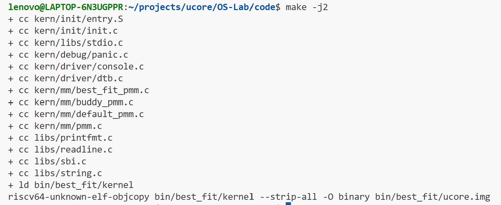
</p>

再次**make -j2**可以看到SLUB模块成功参与内核编译，并生成了可供QEMU加载的内核镜像。

<p align="center">
  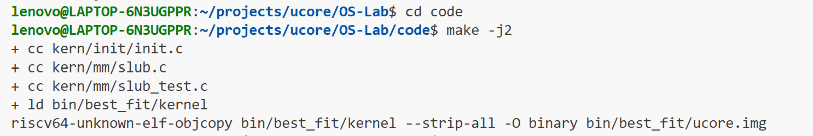
</p>

然后执行make qemu。结果如下：

<p align="center">
  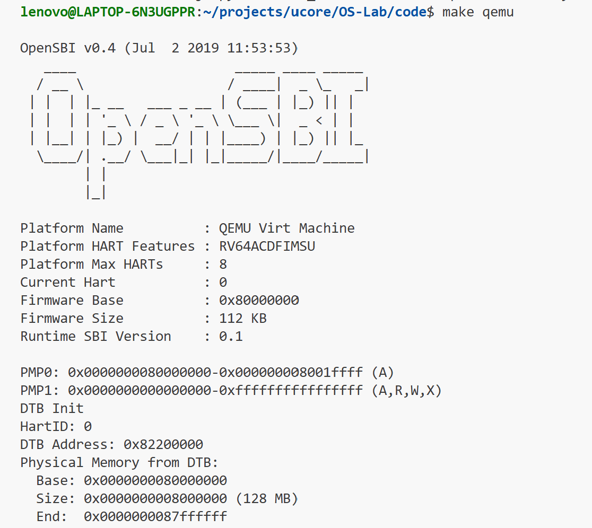
</p>

<p align="center">
  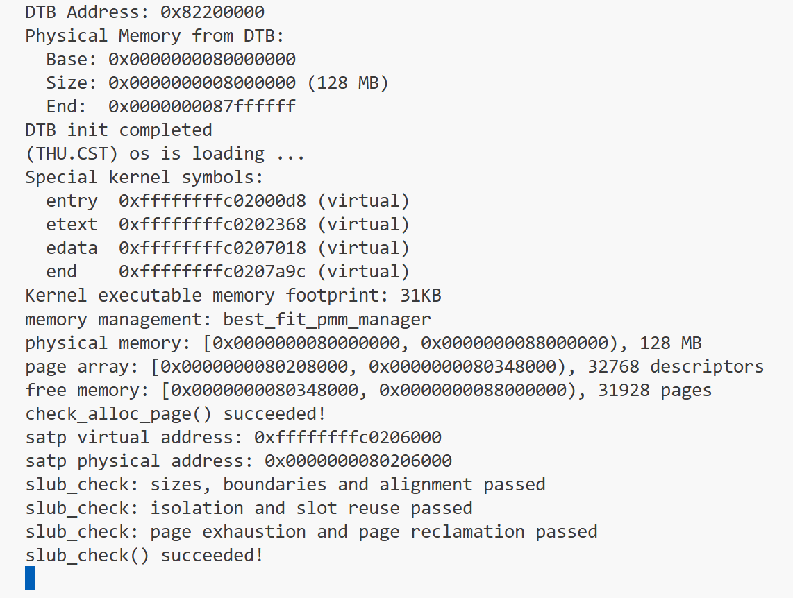
</p>

QEMU运行输出表明，当前使用的物理页管理器为 `best_fit_pmm_manager`，底层物理页分配检查正常通过。随后三组SLUB测试全部通过，最终输出：

```text
slub_check: sizes, boundaries and alignment passed
slub_check: isolation and slot reuse passed
slub_check: page exhaustion and page reclamation passed
slub_check() succeeded!
```

**3.Buddy模式**

为了进一步验证SLUB与不同底层页分配算法的兼容性，执行：

```bash
make PMM=buddy -j2
make PMM=buddy qemu
```

<p align="center">
  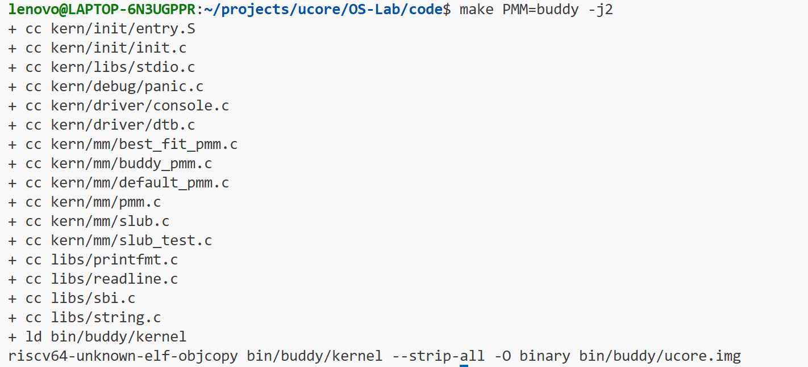
</p>

SLUB模块参与内核编译并生成镜像。

<p align="center">
  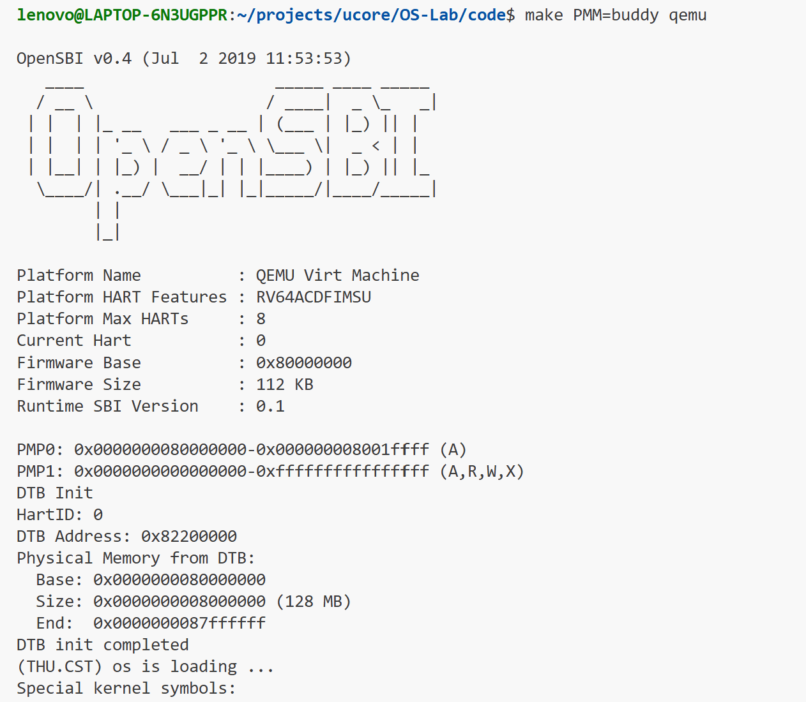
</p>

<p align="center">
  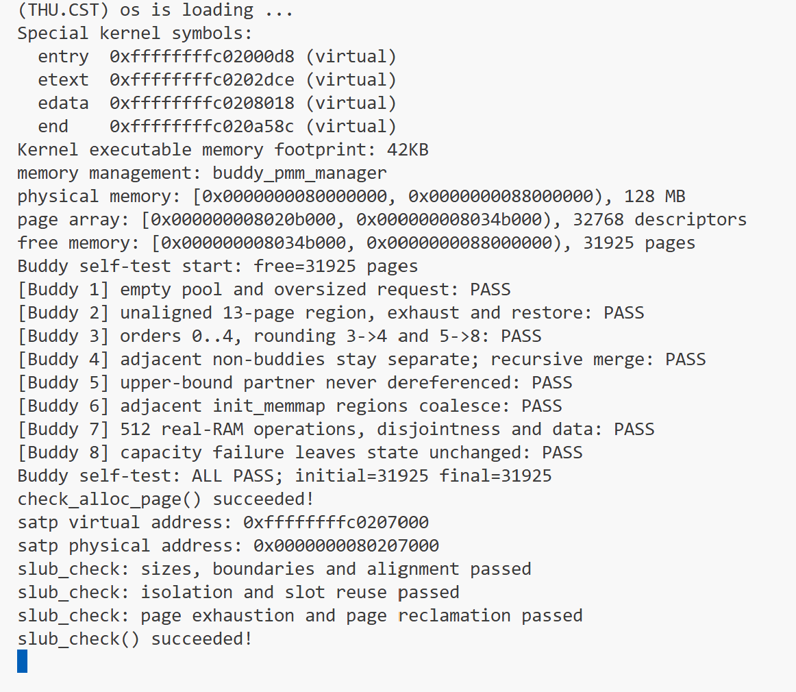
</p>

Buddy模式下，运行输出确认使用 `buddy_pmm_manager`，随后SLUB的三组测试同样全部通过，最终输出 `slub_check() succeeded!`。

**4.结果分析**

两种物理页分配器下，SLUB均通过不同大小对象分配、地址对齐、对象复用、跨页分配和物理页回收等测试。

这表明本次简化SLUB能够在测试中正常利用PMM提供的统一物理页分配接口，而不依赖于某一种特定的底层分配算法。

#### 4.5.7 实现总结与局限性

本次实验只实现了一个简化版的SLUB，有很大的局限性，同时也可以有更多的改进和更多功能的实现，这里列举几个比较明显的局限点和可能的优化方案。

**1.大小类别过于简单**

本次实验中对于对象大小，我们只设置了16,32,64,128,256,512,1024,2048，都是2的幂次，遇到任意大小，比如50字节，就去寻找能容纳它的最小类别64。而真正的LinuxSLUB实现中，使用多个大小类别，部分配置还有96字节、192字节等非2的幂大小类别，以降低内部碎片。

**2.只支持1～2048字节，不支持大对象**

要分配任意大小的内存，必然包括较大的对象。本实验设计的初心是对于以页为单位的对象已经能够分配，但是小对象分配整页太过浪费。对于未来的改进，需要关注大对象调用底层页分配器，小对象使用slub分配，这是我目前是实现中没有做到的部分。

还有对于整页加小对象的情况，比如4096+32字节，必然需要两个4KiB的页，仍需考虑计算溢出、分配失败、回收时的问题。

**3.每个slab只有一页，且slab信息在首部**

我的SLUB实现规定了每个slab用一页，但是Linux SLUB能够根据对象大小和分配布局，采用多个物理页构成的slab，而不局限于每个slab固定一页。

目前问题是，对于2048字节的slab，实际一个slab里面只能放下一个对象，因为还需要考虑首部的占用。

**4.总结**

总体而言，本次实现完成了简化SLUB的核心教学目标，展示了在底层物理页分配器上进一步管理小对象内存的基本方法。实验结果证明，在既定测试范围内，该模块能够正确执行分配、释放复用和页面回收。

不过，该实现主要强调基本结构和算法正确性，在大对象支持、大小类别优化、查找效率、并发处理以及测试完整性方面仍有进一步完善的空间。


## 五、分支任务：GDB 调试页表查询过程

### 5.1 1号成员测试与验证

**负责人：2413669-张懿鸾**

本部分主要完成对 QEMU 4.1.1 源码的动态调试，观察模拟的 RISC-V CPU 在访问虚拟地址时，QEMU 如何处理地址翻译、查询页表以及使用软件 TLB 缓存地址映射。通过对比 M 模式下的地址直通路径与 S 模式下的虚拟地址翻译路径，并进一步观察 TLB 未命中和命中时的控制流，加深对 RISC-V Sv39 地址转换机制以及 QEMU 软件模拟实现的理解。

#### 5.1.1 测试环境与调试方案

QEMU 本身是运行在宿主机上的 x86-64 程序，而 uCore 是运行在 QEMU 模拟出的 RISC-V 计算机中的操作系统。因此，本实验需要使用两种不同的 GDB：普通 GDB 用于调试 QEMU 自身的 C 语言源码，RISC-V 专用 GDB 用于调试模拟 CPU 执行的 uCore 内核。

本次调试采用三个终端协同工作的方式。

1. **终端1：启动 QEMU。** 在 `code` 目录下执行 `make QEMU=/home/win/opt/qemu-4.1.1/riscv64-softmmu/qemu-system-riscv64 debug`，编译并启动带调试信息的 QEMU。`-s -S` 参数使 QEMU 开启 GDB 调试接口，并在模拟 CPU 执行前暂停。
2. **终端2：调试 QEMU 源码。** 使用普通 GDB 附加到实际运行的 QEMU 进程，通过 `break`、`condition`、`continue`、`next`、`info args`、`bt` 等命令观察 QEMU 的函数调用、变量值和控制流。
3. **终端3：调试 uCore。** 执行 `make gdb`，使用 `riscv64-unknown-elf-gdb` 加载内核 ELF 文件，并通过 `target remote localhost:1234` 连接 QEMU。该终端可以用于观察 uCore 的执行状态，也可以让模拟 CPU 继续运行，使终端2中的 QEMU 源码断点得到触发。

本次主要采用在 QEMU 源码中预先设置条件断点的方式，让 uCore 自行运行到目标地址附近，再由 QEMU 内部的断点捕获地址翻译过程。这种方法比在 uCore 中逐条单步执行、再寻找访存指令的方式更加高效。

在连接调试器时，如果遇到 `Ignoring packet error` 等远程调试通信问题，可以在 RISC-V GDB 中尝试设置 `set remotetimeout unlimited`，以避免因远程调试响应超时而中断操作。

#### 5.1.2 QEMU 地址翻译相关源码定位

为了观察虚拟地址翻译过程，首先需要从 QEMU 源码中找到与 TLB 查询和物理地址计算有关的关键函数。

本次调试主要关注以下函数。

| 函数 | 所在文件 | 主要作用 |
|---|---|---|
| `get_page_addr_code()` | `accel/tcg/cputlb.c` | 查询取指路径使用的软件 TLB 项，未命中时进入后续翻译流程 |
| `tlb_fill()` | `accel/tcg/cputlb.c` | 在需要翻译地址时进入相应的地址翻译处理流程 |
| `riscv_cpu_tlb_fill()` | `target/riscv/cpu_helper.c` | 执行 RISC-V 地址翻译处理，并在翻译成功时填充 TLB |
| `get_physical_address()` | `target/riscv/cpu_helper.c` | 根据当前特权级、SATP 和页表项完成地址转换与访问权限检查 |
| `tlb_set_page()` | `target/riscv/cpu_helper.c` 调用的 TLB 接口 | 将翻译得到的虚拟页与物理页映射写入软件 TLB |

首先查看 `get_page_addr_code()`，可以看到 QEMU 会先调用 `tlb_hit()` 检查当前地址对应的 TLB 项。如果常规 TLB 未命中，还会检查 Victim TLB；如果仍然没有命中，则调用 `tlb_fill()` 进入地址翻译流程。

相关源码如下：

```c
tb_page_addr_t get_page_addr_code(CPUArchState *env, target_ulong addr)
{
    uintptr_t mmu_idx = cpu_mmu_index(env, true);
    uintptr_t index = tlb_index(env, mmu_idx, addr);
    CPUTLBEntry *entry = tlb_entry(env, mmu_idx, addr);
    void *p;

    if (unlikely(!tlb_hit(entry->addr_code, addr))) {
        if (!VICTIM_TLB_HIT(addr_code, addr)) {
            tlb_fill(env_cpu(env), addr, 0, MMU_INST_FETCH, mmu_idx, 0);
            index = tlb_index(env, mmu_idx, addr);
            entry = tlb_entry(env, mmu_idx, addr);
        }
        assert(tlb_hit(entry->addr_code, addr));
    }
    // 后续继续检查 TLB 项并取得代码访问地址
}
```

图5-1展示了 QEMU 中 TLB 查询相关源码的位置。

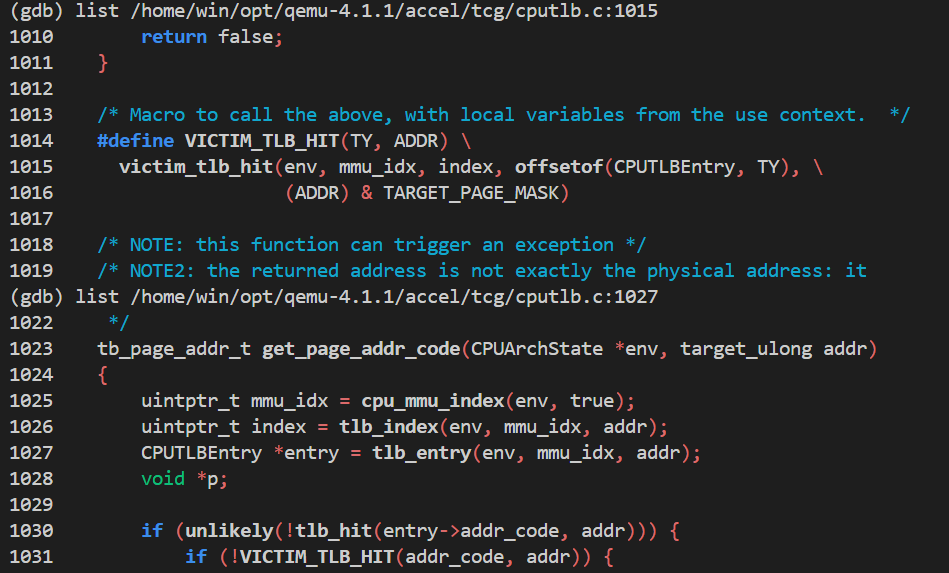

图5-1 QEMU 中的 TLB 查询源码

随后，在 `target/riscv/cpu_helper.c` 中定位 `riscv_cpu_tlb_fill()` 和 `get_physical_address()`。其中，`riscv_cpu_tlb_fill()` 调用 `get_physical_address()` 获取翻译结果，并根据返回值判断地址翻译是否成功；当翻译成功时，通过 `tlb_set_page()` 建立对应的 TLB 映射。

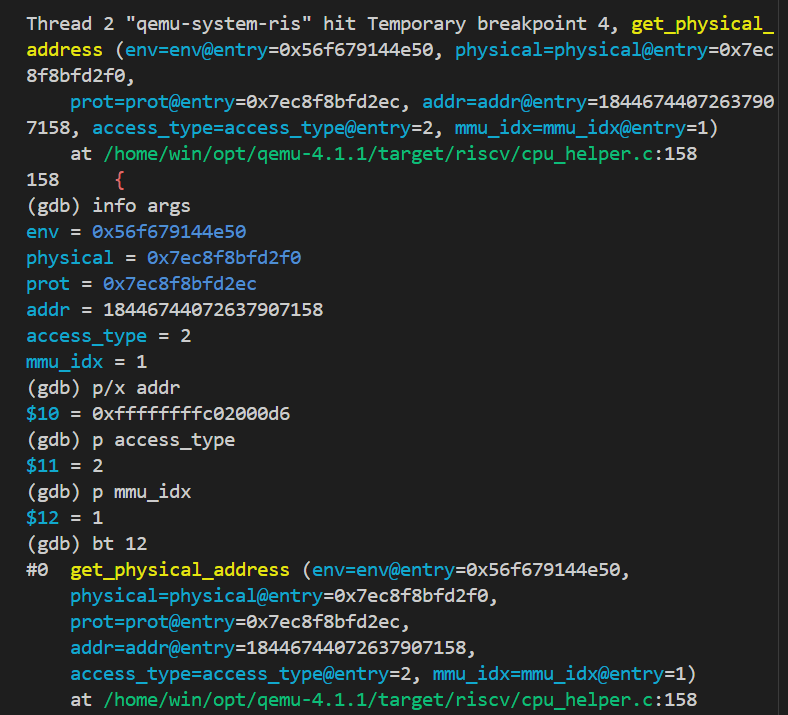

图5-2 QEMU 地址翻译函数源码

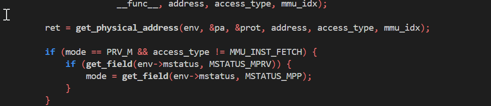

图5-3 QEMU TLB 填充相关源码

通过源码阅读，初步建立了如下调用关系：

- 取指路径：`get_page_addr_code()` → TLB 查询 → `tlb_fill()`。
- 地址翻译路径：`tlb_fill()` → `riscv_cpu_tlb_fill()` → `get_physical_address()`。
- 翻译成功后：`riscv_cpu_tlb_fill()` 调用 `tlb_set_page()`，建立相应的 TLB 映射。

需要注意，数据访存和指令取指的调用入口并不完全相同。后续调试分别观察了 S 模式下的数据存储翻译，以及取指路径中的 TLB 未命中和命中过程。

#### 5.1.3 M 模式下的地址直通路径

首先观察模拟 CPU 在 M 模式下的地址翻译行为，以便与开启虚拟地址转换后的 S 模式进行比较。

在终端2中设置条件断点，使程序在 `get_physical_address()` 中满足 `mmu_idx == 3` 且 `access_type == 2` 时暂停。该次调试观察到以下参数：

```text
addr = 4096
access_type = 2
mmu_idx = 3
mode = 3
satp = 0x0
mstatus = 0x0
```

其中，`addr = 0x1000` 是本次访问的地址；`mmu_idx = 3` 对应 M 模式的地址翻译上下文，`access_type = 2` 对应指令取指。

继续单步执行，可以看到程序进入以下分支：

```c
if (mode == PRV_M || !riscv_feature(env, RISCV_FEATURE_MMU)) {
    *physical = addr;
    *prot = PAGE_READ | PAGE_WRITE | PAGE_EXEC;
    return TRANSLATE_SUCCESS;
}
```

该分支判断当前模式是否为 M 模式，或者 CPU 是否未启用 MMU。如果满足条件，就直接将输入地址赋给物理地址，不再执行后续的页表遍历。

单步执行后得到：

```text
*physical = 0x1000
*prot = 0x7
```

这说明本次访问走的是 M 模式的地址直通路径，输入地址与输出物理地址相同。`prot = 0x7` 表示该路径返回的权限标志包含读、写、执行权限。

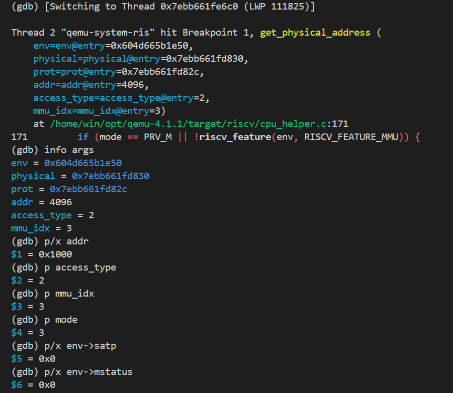

图5-4 M 模式下地址翻译函数的入口参数

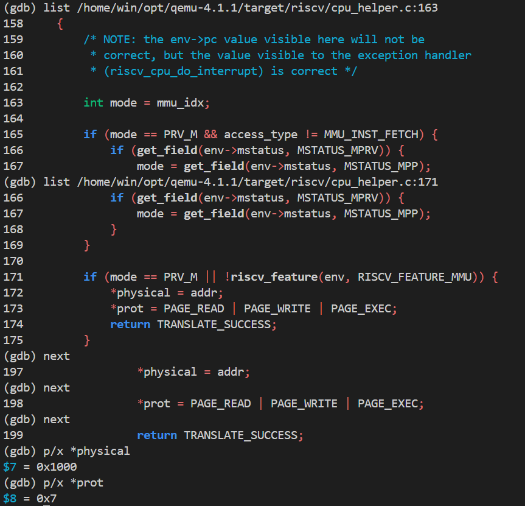

图5-5 M 模式下直接返回物理地址

该结果表明，QEMU 的地址翻译函数会根据当前特权级选择不同的处理路径。M 模式下的本次访问没有进入 Sv39 页表遍历流程，与后续 S 模式下的虚拟地址翻译形成了对比。

#### 5.1.4 S 模式下的 Sv39 页表查询与地址翻译

接下来观察 S 模式下的数据存储访问，分析 QEMU 如何通过 SATP 和页表项将虚拟地址转换为物理地址。

##### （1）捕获数据存储访问

在 `get_physical_address()` 中设置条件断点，筛选 S 模式下内核高地址范围内的数据访问。随后，QEMU 在处理以下虚拟地址时触发断点：

```text
addr = 0xffffffffc0204ff8
access_type = 1
mmu_idx = 1
```

其中，`access_type = 1` 对应数据存储访问，`mmu_idx = 1` 对应 S 模式的地址翻译上下文。

通过 `bt 12` 查看调用栈，可以看到本次访问来自 QEMU 的数据存储处理路径，依次经过 `store_helper()`、`tlb_fill()`、`riscv_cpu_tlb_fill()`，最终进入 `get_physical_address()`。

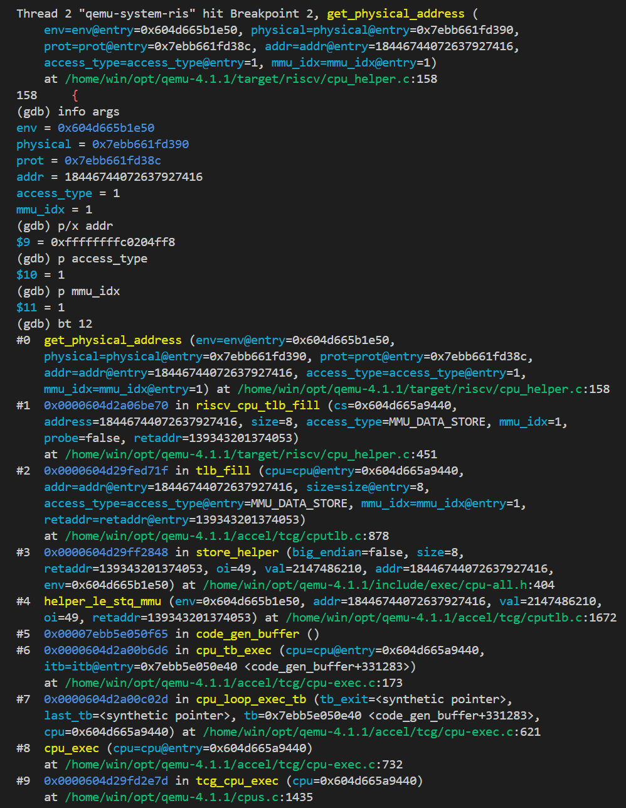

图5-6 S 模式下的数据存储访问与调用栈

这说明本次调试捕获的是模拟 CPU 执行数据存储操作时，QEMU 为该访问执行的地址翻译过程。

##### （2）读取 SATP，确定 Sv39 页表结构

随后查看 CPU 的 SATP 寄存器：

```gdb
p/x env->satp
```

得到：

```text
0x8000000000080205
```

该值的高位模式字段为 `8`，对应 Sv39 地址转换模式；低位的物理页号字段为 `0x80205`。将该页号左移 12 位，可得到根页表的物理地址：

```text
0x80205000
```

在 `get_physical_address()` 中，还观察到：

```text
levels = 3
ptidxbits = 9
va_bits = 39
base = 0x80205000
```

这与 Sv39 的结构一致：虚拟地址使用 39 位有效地址，页表最多有三级，每一级索引使用 9 位，页内偏移为 12 位。

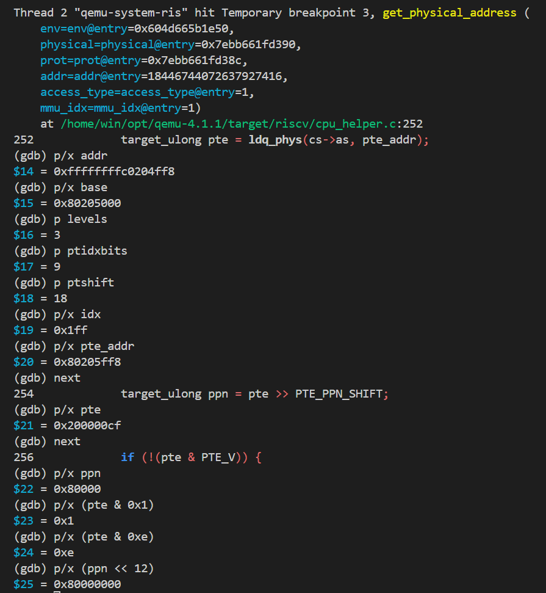

图5-7 S 模式下 SATP 与 Sv39 页表查询参数

##### （3）计算索引并读取页表项

在 `get_physical_address()` 中，QEMU 根据当前虚拟地址和 `ptshift` 计算当前级页表索引：

```c
target_ulong idx = (addr >> (PGSHIFT + ptshift)) &
                   ((1 << ptidxbits) - 1);
target_ulong pte_addr = base + idx * ptesize;
```

调试中观察到：

```text
addr = 0xffffffffc0204ff8
base = 0x80205000
ptshift = 18
ptidxbits = 9
idx = 0x1ff
pte_addr = 0x80205ff8
```

因此，本次访问所读取的页表项位于物理地址 `0x80205ff8`。

随后，程序执行：

```c
target_ulong pte = ldq_phys(cs->as, pte_addr);
target_ulong ppn = pte >> PTE_PPN_SHIFT;
```

其中，`ldq_phys()` 用于从物理地址读取一个 64 位页表项。实际观察到：

```text
pte = 0x200000cf
ppn = 0x80000
```

继续检查页表项标志：

```text
pte & 0x1 = 0x1
pte & 0xe = 0xe
ppn << 12 = 0x80000000
```

`pte & 0x1` 的结果为 1，说明页表项的有效位 PTE_V 已设置；`pte & 0xe` 的结果为 `0xe`，说明 R、W、X 权限位均已设置。

同时，该页表项的 PPN 满足当前级大页映射所要求的对齐条件，因此 QEMU 将其识别为叶子页表项，可以在当前层级结束遍历，而不必继续查询更低级的页表。

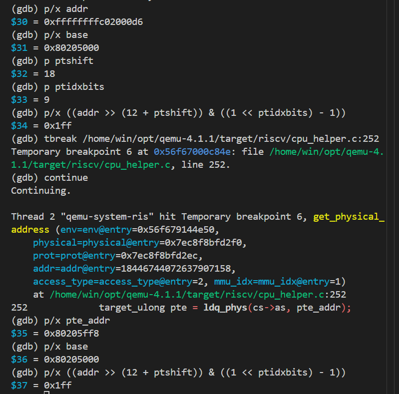

图5-8 页表项的物理地址与索引计算

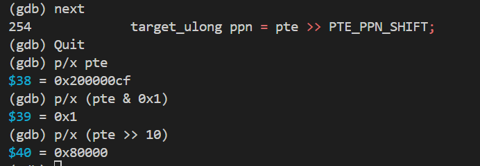

图5-9 读取页表项并检查标志位

需要注意，本次观察到的并不是依次读取三级页表项的完整遍历过程，而是当前根页表项本身就是叶子项的情况。这说明 Sv39 支持不同层级的叶子映射，实际遍历层数取决于页表项的类型和内容。

##### （4）得到物理地址并填充 TLB

完成页表项检查后，QEMU 根据页表项中的物理页号以及虚拟地址中相应的偏移部分，计算最终物理地址。

在 `riscv_cpu_tlb_fill()` 中，观察到：

```text
address = 0xffffffffc0204ff8
pa = 0x80204000
prot = 0x7
mmu_idx = 1
```

这里的 `pa = 0x80204000` 是传递给 TLB 填充逻辑的页对齐物理地址。本次原始数据存储访问对应的物理地址为 `0x80204ff8`。

随后，程序执行：

```c
if (ret == TRANSLATE_SUCCESS) {
    tlb_set_page(cs, address & TARGET_PAGE_MASK,
                 pa & TARGET_PAGE_MASK, prot, mmu_idx,
                 TARGET_PAGE_SIZE);
    return true;
}
```

该分支说明地址翻译成功后，QEMU 将虚拟页地址、物理页地址、访问权限以及 MMU 上下文交给 `tlb_set_page()`，建立相应的 TLB 映射。

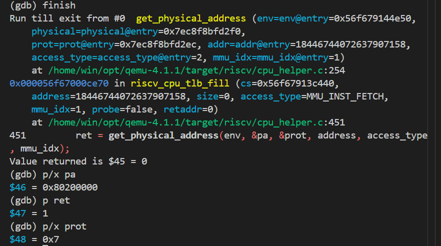

图5-10 地址翻译成功后得到的物理地址

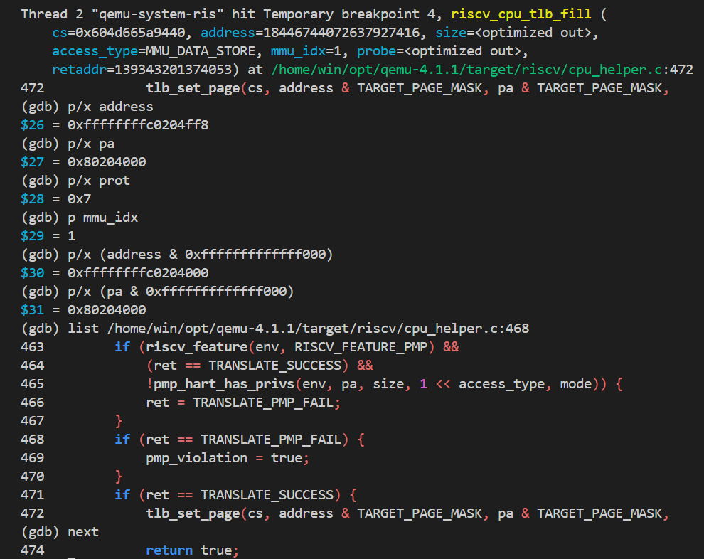

图5-11 调用 tlb_set_page 填充软件 TLB

通过上述步骤，完成了对一次 S 模式数据存储访问的动态观察，确认 QEMU 能够根据 SATP 中的页表基址读取页表项，检查访问权限，并在翻译成功后将映射交给 TLB 填充逻辑。

#### 5.1.5 TLB 未命中与命中过程验证

前面的实验观察了地址翻译和 TLB 填充流程。为了进一步确认 QEMU 会先检查 TLB，再决定是否进行地址翻译，本次实验还针对取指路径进行了补充调试。

##### （1）定位取指路径中的 TLB 查询

在 `accel/tcg/cputlb.c` 的 `get_page_addr_code()` 中，可以看到：

```c
if (unlikely(!tlb_hit(entry->addr_code, addr))) {
    if (!VICTIM_TLB_HIT(addr_code, addr)) {
        tlb_fill(env_cpu(env), addr, 0, MMU_INST_FETCH, mmu_idx, 0);
        index = tlb_index(env, mmu_idx, addr);
        entry = tlb_entry(env, mmu_idx, addr);
    }
    assert(tlb_hit(entry->addr_code, addr));
}
```

其中，`tlb_hit()` 用于检查常规 TLB 项是否与当前取指地址匹配；如果没有命中，QEMU 还会检查 Victim TLB。如果两者都没有命中，则调用 `tlb_fill()` 进入地址翻译流程。

##### （2）观察 TLB 未命中

在第 1030 行设置断点，并将条件限制在目标虚拟页 `0xffffffffc0201000`，以避免其他内核地址频繁触发断点。

首次捕获到的取指地址为：

```text
addr = 0xffffffffc0201734
```

其所在的虚拟页为：

```text
0xffffffffc0201000
```

此时观察到：

```text
entry->addr_code = 0xffffffffffffffff
```

该值是当前常规取指 TLB 项的无效地址标记，因此这次访问没有命中常规 TLB。继续执行后，程序进入第 1031 行的 Victim TLB 检查，并最终执行到：

```c
tlb_fill(env_cpu(env), addr, 0, MMU_INST_FETCH, mmu_idx, 0);
```

这表明常规 TLB 和 Victim TLB 都没有提供可用的映射，QEMU 需要通过 `tlb_fill()` 进行后续地址翻译。

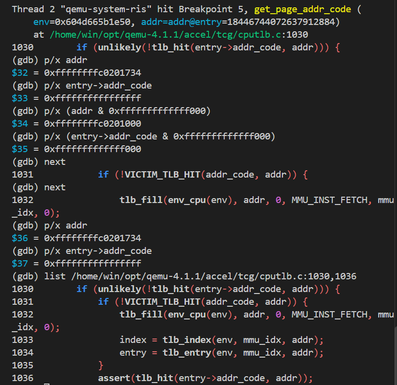

图5-12 get_page_addr_code 中的 TLB 未命中分支

##### （3）观察 TLB 填充后的重新查询

执行 `tlb_fill()` 后，源码会重新计算 TLB 索引，并重新取得当前地址对应的 TLB 项：

```c
index = tlb_index(env, mmu_idx, addr);
entry = tlb_entry(env, mmu_idx, addr);
```

随后，代码通过 `assert(tlb_hit(entry->addr_code, addr))` 检查填充后的取指 TLB 项是否有效。

在调试过程中，GDB 可以继续观察到第 1033、1034 行附近的重新查询流程，但部分局部变量显示 `value has been optimized out`。这表示当前编译出的 QEMU 代码经过了优化，GDB 无法在该位置直接读取相应变量，并不等于地址翻译失败。

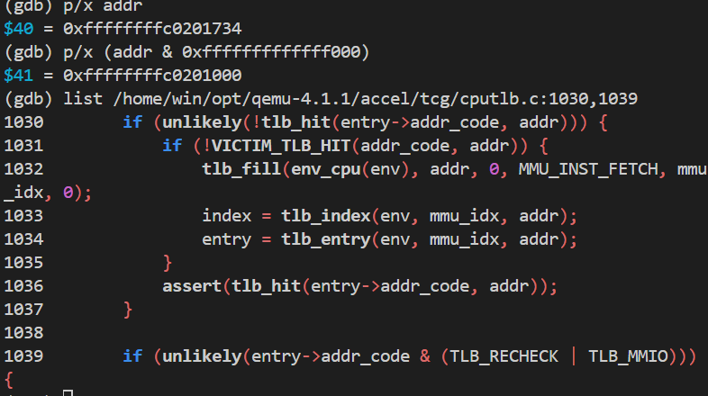

图5-13 TLB 填充后重新获取 TLB 项

因此，该截图主要用于记录 `tlb_fill()` 返回后的重新查询控制流；不能仅凭该截图单独断言某个变量的值已经发生了什么变化。

##### （4）再次访问同一虚拟页，观察 TLB 命中

为了观察 TLB 命中，本次调试继续使用第 1030 行的断点，并将条件限定为：

```gdb
condition 5 (addr & 0xfffffffffffff000) == 0xffffffffc0201000
```

这样，程序只会在当前取指地址属于目标虚拟页 `0xffffffffc0201000` 时停下。

再次捕获到的地址仍然为：

```text
addr = 0xffffffffc0201734
```

在 `get_page_addr_code()` 第 1030 行执行：

```c
if (unlikely(!tlb_hit(entry->addr_code, addr))) {
```

随后执行一次 `next`，GDB 直接跳转到了第 1039 行：

```c
if (unlikely(entry->addr_code & (TLB_RECHECK | TLB_MMIO))) {
```

中间没有进入第 1031～1034 行的未命中处理分支。

这说明本次执行中，`!tlb_hit(entry->addr_code, addr)` 的判断结果为假，即 `tlb_hit(entry->addr_code, addr)` 为真，QEMU 在当前取指路径中命中了常规 TLB 项。

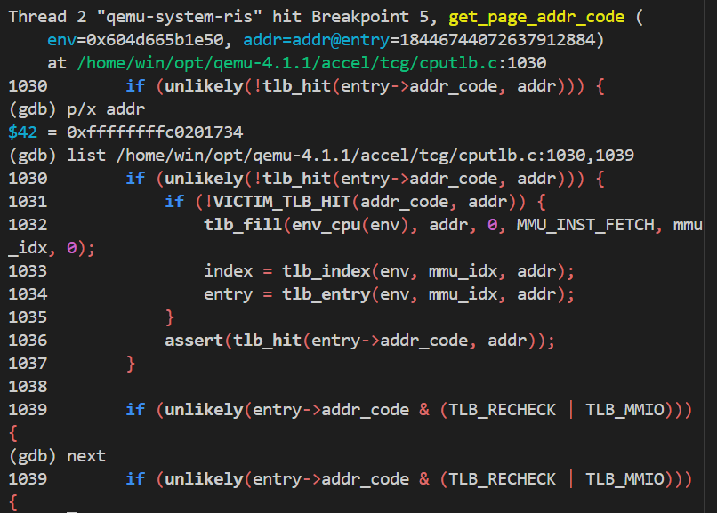

图5-14 再次访问同一虚拟页时命中 TLB

该结果与前一次未命中的现象形成了对比：第一次访问时，QEMU 进入未命中分支并调用 `tlb_fill()`；再次访问同一虚拟页时，QEMU 直接跳过该分支，说明当前 TLB 中已经存在匹配的映射。

需要说明的是，这组 TLB 未命中和命中的观察针对虚拟地址 `0xffffffffc0201734` 的取指路径，而前一节详细检查页表项的访问地址是 `0xffffffffc0204ff8`，属于数据存储路径。这两组记录分别验证了不同访问路径中的地址翻译行为，不能将它们描述成同一次访存的连续执行记录。

#### 5.1.6 关键调用路径与实验结果分析

综合本次调试观察，可以将 QEMU 的地址翻译过程概括为以下两条路径。

**（1）S 模式下的数据存储翻译路径**

```text
store_helper()
    ↓
tlb_fill()
    ↓
riscv_cpu_tlb_fill()
    ↓
get_physical_address()
    ↓
读取 SATP，确定页表基址与 Sv39 模式
    ↓
计算页表索引并读取页表项
    ↓
检查有效位、叶子项标志及访问权限
    ↓
计算物理地址
    ↓
tlb_set_page()
```

该路径展示了在数据存储访问需要地址翻译时，QEMU 如何调用 RISC-V 地址翻译代码，通过页表项获得物理地址，并建立相应的 TLB 映射。

**（2）取指路径中的 TLB 查询与填充**

```text
get_page_addr_code()
    ↓
tlb_hit() 检查常规 TLB
    ↓
若未命中，检查 Victim TLB
    ↓
若仍未命中，调用 tlb_fill()
    ↓
执行地址翻译并填充 TLB
    ↓
重新获取 TLB 项并检查
```

当 TLB 已有有效映射时，QEMU 可以跳过未命中处理分支，直接继续后续取指处理。

本次实验验证的主要结果如下。

| 验证项目 | 实际观察结果 | 结论 |
|---|---|---|
| M 模式地址翻译 | `addr = 0x1000`，`mode = 3`，物理地址返回 `0x1000` | 本次访问进入 M 模式地址直通分支 |
| SATP 与 Sv39 模式 | `satp = 0x8000000000080205`，根页表物理地址为 `0x80205000` | 确认当前地址翻译使用 Sv39 |
| 页表项读取 | `pte_addr = 0x80205ff8`，`pte = 0x200000cf` | 观察到有效且具有 R/W/X 权限的叶子页表项 |
| 物理地址计算 | 访问地址为 `0xffffffffc0204ff8`，对应物理访问地址为 `0x80204ff8` | 观察到 S 模式数据存储的地址翻译结果 |
| TLB 填充 | 翻译成功后调用 `tlb_set_page()` | 观察到 QEMU 建立 TLB 映射的调用位置 |
| TLB 未命中 | `entry->addr_code = 0xffffffffffffffff`，进入 `tlb_fill()` 路径 | 观察到取指路径中的未命中处理 |
| TLB 命中 | 第 1030 行执行 `next` 后直接跳至第 1039 行 | 观察到常规取指 TLB 命中时跳过未命中分支 |

通过这些调试结果，可以看出 QEMU 不仅需要实现地址翻译算法，还需要模拟 TLB 的查询、填充和命中判断过程。

与真实 RISC-V CPU 不同，QEMU 的 TLB 查询由软件数据结构和 C 语言逻辑实现，因此可以使用宿主机 GDB 在 `tlb_hit()`、`get_physical_address()` 和 `tlb_set_page()` 等关键位置设置断点，直接观察模拟硬件的内部行为。

真实 CPU 的 TLB 则由硬件 MMU 实现，不能简单地认为真实处理器也会逐条执行上述 QEMU C 代码。

本次实验的主要价值在于将操作系统课程中较为抽象的虚拟内存、页表遍历和 TLB 缓存机制，与具体的模拟器源码和运行时变量对应起来，从而理解虚拟地址转换在软件模拟环境中的实现方式。

#### 5.1.7 大模型辅助调试过程与收获

本次实验不仅需要理解 QEMU 的源码，还需要在不熟悉的代码中建立可执行的调试流程。实验过程中，大模型主要用于辅助分析调试架构、定位关键函数、设计条件断点和解释运行时结果。

**（1）确定双重 GDB 调试方案**

最初需要解决的问题是：如何调试一个正在运行 uCore 的 QEMU 进程，以及是否需要两个 GDB。

通过与大模型讨论，并结合项目 Makefile，明确了普通 GDB 与 RISC-V GDB 的职责差异：前者调试宿主机上的 QEMU，后者通过 QEMU 的 GDB stub 调试模拟的 RISC-V 内核。

在此基础上，进一步整理出终端1启动 QEMU、终端2附加调试 QEMU、终端3连接 uCore 的操作流程，避免将宿主机程序与模拟 CPU 的执行状态混淆。

**（2）根据实际源码定位地址翻译路径**

在不知道 QEMU 内部具体实现位置的情况下，借助大模型分析了 RISC-V 地址翻译相关函数，并在源码中逐步定位 `riscv_cpu_tlb_fill()`、`get_physical_address()`、`get_page_addr_code()` 和 `tlb_set_page()`。

随后通过 GDB 的 `bt`、`info args`、`p/x` 和 `list` 等命令核对实际函数调用路径、参数和源码位置，而不是只根据函数名称推断程序行为。

**（3）通过条件断点降低调试成本**

由于地址翻译函数可能被频繁调用，如果每次命中断点都手动继续执行，会产生大量无关输出。

因此，借助大模型分析条件断点的用法，在目标函数入口设置地址、访问类型和 MMU 上下文等条件，筛选需要观察的访问。例如，在取指路径中，将断点限制在虚拟页 `0xffffffffc0201000`，从而观察同一虚拟页的 TLB 未命中和后续命中情况。

**（4）依据运行时输出验证 TLB 命中**

在最初的调试中，仅知道 QEMU 会查询 TLB，但不清楚怎样通过实际输出证明命中。

通过进一步分析 `get_page_addr_code()` 中的分支判断，最终使用第 1030 行的断点，观察第一次访问时进入 `tlb_fill()` 的未命中路径，以及再次访问时直接跳到第 1039 行的控制流变化。

这一过程表明，大模型可以帮助提出调试思路，但最终结论仍需以实际源码、断点位置和 GDB 输出为依据。

**（5）实验收获**

通过本次实验，我进一步熟悉了 GDB 条件断点、单步执行、函数调用栈和变量检查等调试手段，也理解了双重 GDB 环境中宿主机程序与模拟内核之间的区别。

更重要的是，我认识到大模型辅助调试不应停留在复制命令层面。面对复杂项目时，需要先明确观察目标，再借助大模型缩小源码范围、设计验证步骤，最后通过真实运行结果检查推理是否成立。这样才能将调试工具的使用与系统机制的理解结合起来。

### 5.2 2号成员测试与验证：张祎然（2412419）

**负责人：** 2412419—张祎然。

**本人调试环境：** Windows + WSL2（Ubuntu 22.04），QEMU 4.1.1（保留调试信息），宿主端 GDB 12.1，目标端 `riscv64-unknown-elf-gdb 16.3.90.20250610-git`；交叉编译器为 `riscv64-unknown-elf-gcc 15.1.0`。

#### 5.2.1 调试目标与访存探针

这一部分用目标端 GDB 控制内核执行，用宿主端 GDB 进入 QEMU 的访存处理函数，观察一次读取如何完成地址翻译。

新增的内核探针函数为：

```c
void lab2_mmu_probe(void);
```

探针只在 `MMU_PROBE=1` 时启用。它把值为 `0x1122334455667788` 的变量放在独立对齐页中，先执行 `sfence.vma`，再连续执行两条读取同一地址的 `ld`，最后输出两次结果。

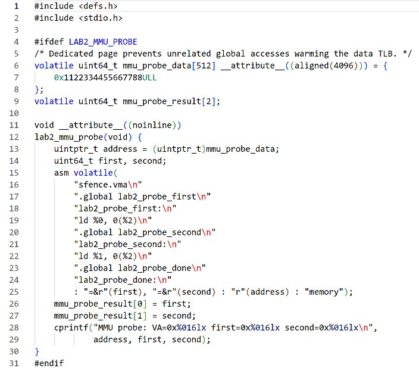

图5-2-1 两条相邻的加载指令便于分别观察首次缺失和后续访问。

#### 5.2.2 最终提示词

```text
在同一个QEMU 4.1.1进程上使用宿主GDB和RISC-V目标GDB。用两条同址ld构造可重复的访问，在目标端定位指令，在宿主端用地址条件断点排除无关访存。

记录第一次缺失的调用栈、SATP、根页表地址、索引、PTE、最终物理地址和软件TLB槽位；执行第二次读取，检查结果与目标地址填充次数。最后使用同一条ld的物理位置作Bare模式对照。

解释本次根层大页为什么不需要查满三级，以及QEMU软件TLB中的宿主地址偏移与客体物理地址有什么区别。
```

#### 5.2.3 调试中的问题与修正

最初查看 TLB 时使用了 `$cpuenv->tlb`，但 GDB 提示这个结构没有该成员。结合宿主 QEMU 4.1.1 源码后，将访问位置改为 `RISCVCPU.neg.tlb`，才读到槽位标签和 `addend`。

另外，仅看两次读取值相同，不能判断第二次一定命中 TLB。后续保留目标地址的填充断点，并统计命中次数，配合单步执行和寄存器结果一起判断。具体观察过程见下文第 5.2.4—5.2.9 节。

#### 5.2.4 编译探针并确认输出

```bash
make -B -j4 PMM=buddy MMU_PROBE=1
make PMM=buddy MMU_PROBE=1 qemu
```

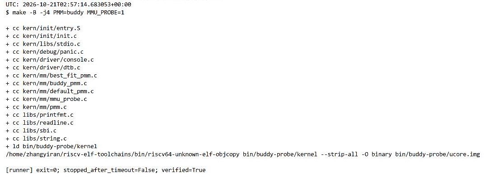

图5-2-2 生成带访存探针的调试镜像。

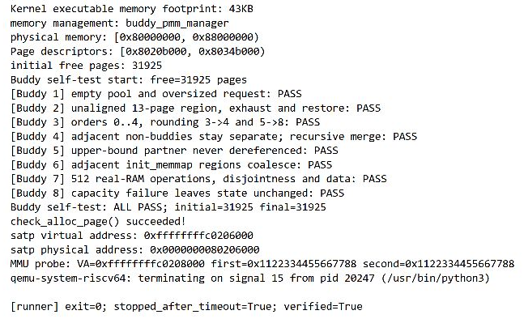

图5-2-3 两次读取均得到预置值 `0x1122334455667788`。

双 GDB 的完整过程由 `tools/debug_mmu.py` 协调，运行方式为：

```bash
python3 tools/debug_mmu.py
```

脚本需要宿主 GDB、RISC-V GDB 和 Python 的 `pexpect`。

#### 5.2.5 目标端定位第一条加载指令

宿主 GDB 启动 QEMU，QEMU 使用 `-S -gdb tcp:127.0.0.1:12345` 暂停并等待连接。目标 GDB 加载 `bin/buddy-probe/kernel` 后执行：

```gdb
target remote 127.0.0.1:12345
break *lab2_probe_first
continue
x/3i $pc
info registers pc satp
p/x &mmu_probe_data
```

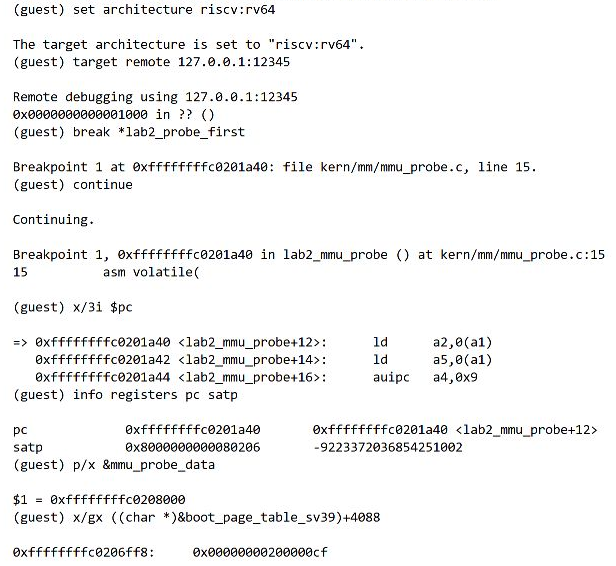

图5-2-4 目标停在第一条 `ld` 前。

本次构建中，PC 为 `0xffffffffc0201a40`，第一条指令是 `ld a2,0(a1)`，第二条是 `ld a5,0(a1)`。数据虚拟地址为 `0xffffffffc0208000`，SATP 为 `0x8000000000080206`。这些地址以本次编译结果为准，重新编译后应再次读取。

#### 5.2.6 宿主端捕获第一次TLB缺失

暂停宿主 GDB，并针对这次数据读取设置条件断点：

```gdb
break riscv_cpu_tlb_fill if address == 0xffffffffc0208000 && access_type == 0
continue
```

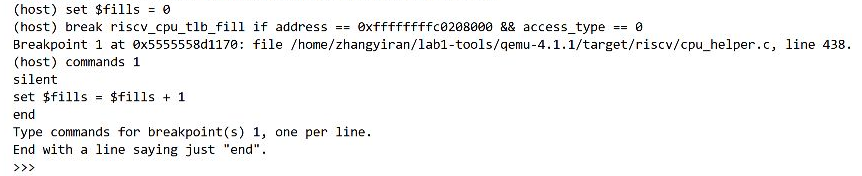

图5-2-5 条件断点只匹配目标地址的数据读取。

随后在目标 GDB 中执行一次 `si`，宿主便停在对应的缺失处理入口。

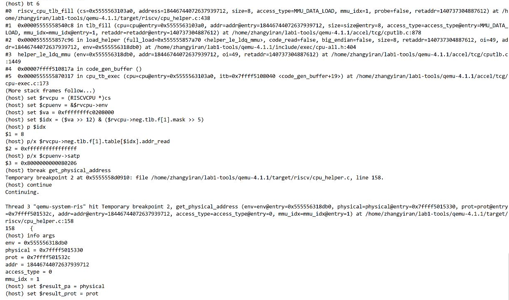

图5-2-6 调用栈包含 `helper_le_ldq_mmu → load_helper → tlb_fill → riscv_cpu_tlb_fill`。

在 QEMU 的 `load_helper` 中，先检查该地址对应的软件 TLB 标签，未命中后再检查 victim TLB，仍不能满足时才进入填充过程。本次观察的槽位索引为8，填充前 `addr_read=0xffffffffffffffff`。

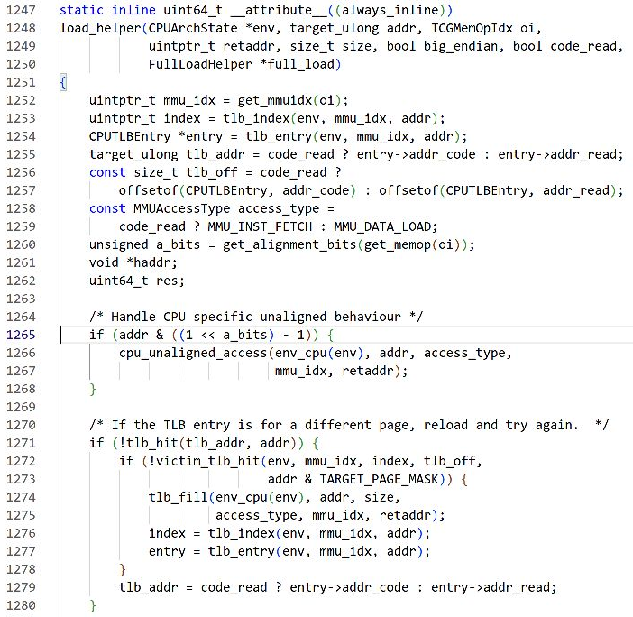

图5-2-7 实际调试版本中的查询和缺失处理分支。普通内存访问的快速命中也可能由 TCG 生成的机器码直接完成，不一定每次都进入这个 C 函数。

#### 5.2.7 观察Sv39页表查询

继续进入 `get_physical_address`，在读出页表项后检查变量。SATP 的 MODE 为8，即 Sv39；根页表物理地址为 `0x80206000`。

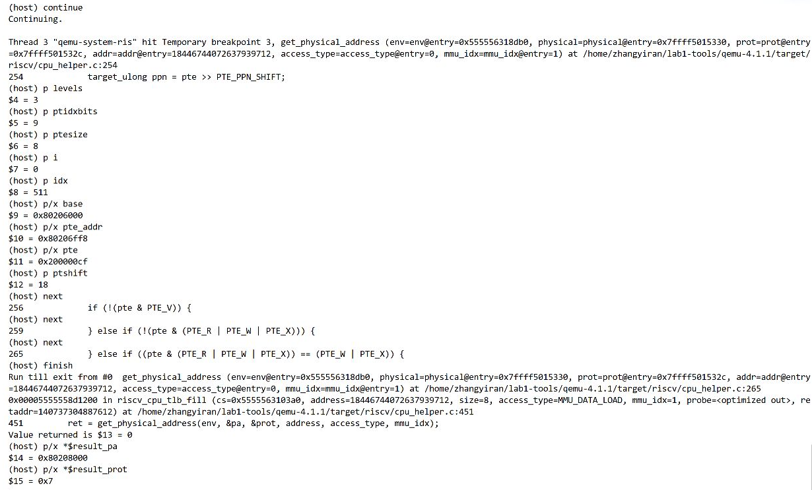

图5-2-8 页表查询时的实际变量值。

根据这些值，可以核对地址计算：

```text
VA             = 0xffffffffc0208000
根页表物理地址 = 0x80206000
VPN[2]         = (VA >> 30) & 0x1ff = 511
PTE地址        = 0x80206000 + 511 × 8 = 0x80206ff8
PTE            = 0x200000cf
PTE中的PPN     = PTE >> 10 = 0x80000
PA             = 0x80000000 + (VA & 0x3fffffff)
               = 0x80208000
```

本次 PTE 的 V、R、W、X、A、D 位已设置，U 位未设置。它在根层就被识别为叶子，对应1 GiB大页，因此没有继续访问下一级页表。Sv39最多支持三级查询，但并不要求每次都走满三级。

PTE 中的物理页号低18位为0，满足根层大页的对齐要求。检查权限后，QEMU 返回的物理地址为 `0x80208000`，与上述计算一致。

#### 5.2.8 检查填充后的TLB及第二次访问

完成 `tlb_set_page` 后，同一个槽位的 `addr_read` 更新为 `0xffffffffc0208000`。槽位中的 `addend` 用于把客体虚拟地址转换为宿主进程中的内存地址。

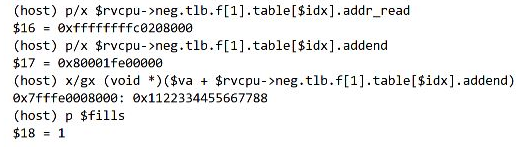

图5-2-9 标签和宿主地址偏移已写入。

本次 `VA + addend` 得到的宿主地址为 `0x7fffe0008000`，读取的数据仍是 `0x1122334455667788`。这里要区分三个地址：内核使用的虚拟地址、翻译后的 RISC-V 物理地址，以及 QEMU 进程中的宿主地址。

继续宿主执行后，目标端第一次单步完成，停在第二条 `ld` 前。

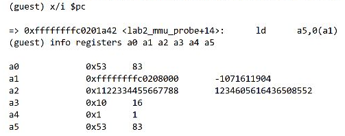

图5-2-10 第一条加载完成后的目标端状态。

再执行一次 `si`，两个目的寄存器都得到相同的数据：

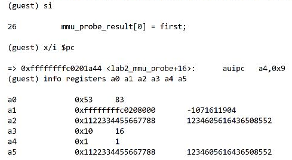

图5-2-11 `a2`、`a5` 的值均为 `0x1122334455667788`。

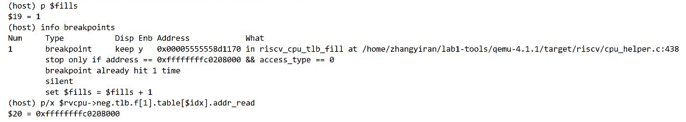

图5-2-12 断点仍只命中1次，`$fills` 也为1。

第一次访问进入缺失处理并完成填充，第二次指令正常执行且没有新增目标地址的填充，这些结果说明第二次访问复用了已有翻译。这里观察的是 QEMU 软件 TLB 的行为，没有测量真实处理器的访问时间。

#### 5.2.9 Bare模式对照

对照时令 `satp=0`，并把 PC 和数据地址改为对应物理地址，使同一条 `ld` 能在关闭分页后执行：

```gdb
set $satp = 0
set $pc = 0x80201a40
set $a1 = 0x80208000
```

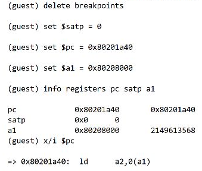

图5-2-13 PC 和数据地址均已改为物理地址。

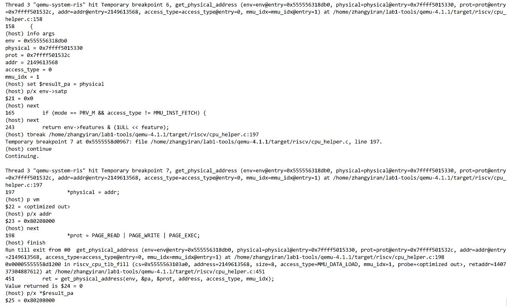

图5-2-14 `VM_1_10_MBARE` 分支直接令 `physical=addr`，不再遍历 Sv39 页表。

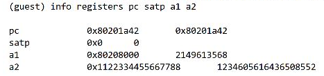

图5-2-15 读取值仍是 `0x1122334455667788`。

Bare 模式下，QEMU 仍要将客体地址转换成宿主内存或设备访问，所以还能进入软件 TLB 相关路径。它与真实处理器中的硬件 TLB 不能直接等同。这次对照只用于调试，取证结束后关闭该次 QEMU，没有继续用修改后的寄存器状态运行正常内核。

### 5.3 3号成员测试与验证

**成员：** 张旗庭（2413788）

#### 5.3.1 调试环境与整体思路

我们进行实验涉及三个部分，一个是在Windows上运行的wsl Ubuntu虚拟机，它是宿主机；第二个是QEMU4.1.1，模拟 RISC-V CPU，使我们能够在其中启动和调试 uCore；第三个是uCore 内核，是操作系统内核。同时， QEMU内部也实现了 CPU 地址翻译和软件 TLB 等机制。

我们使用两个GDB，观察QEMU 程序本身和QEMU 中运行的 uCore。前者观察页表遍历和 TLB ，后者观察内核开启分页的过程。我们使用了三个终端，功能如下：

- 终端 1： make debug，启动 QEMU，相当于启动模拟计算机。
- 终端 2： 普通 GDB，附加到正在运行的 QEMU 进程，调试 QEMU 的 C 语言实现，让我们知道 QEMU 是怎样进行地址转换的。
- 终端 3： RISC-V GDB，通过 QEMU 提供的 GDB Stub 接口连接到模拟 CPU，让我们知道 uCore 的 CPU 正在访问哪个地址。

在本次调试中可以看到许多QEMU 4.1.1 源码中已有的 C 函数，并了解其功能。
本次主要追踪**内核取指访问**（`MMU_INST_FETCH`），流程为：软件 TLB 查询未命中 → 需要建立当前虚拟地址的映射 → 遍历 Sv39 页表，计算物理地址 → 通过 tlb_set_page_with_attrs() 更新软件 TLB → 返回查询路径。

#### 5.3.2 开启分页、找到根页表

我们在终端3，先加载生成的uCore 内核 ELF 文件，然后我们希望在 uCore 内核入口设置断点，但是按照符号 kern_entry 设置断点，但是这时ELF的内核入口已经被写成了虚拟地址0xffffffffc0200000，后来在客体 RISC-V GDB 中设置硬件执行断点。

<p align="center">
  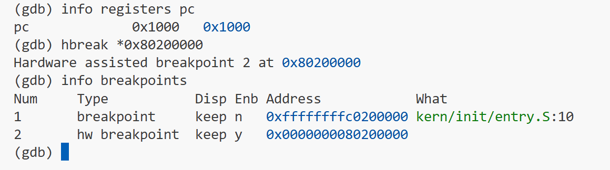
</p>

我们继续单步执行 uCore 的启动汇编代码，在内核物理入口 `0x80200000` 附近观察到，启用分页前 `satp = 0`。

<p align="center">
  
</p>

执行 `entry.S` 中的 `csrw satp, t0` 后，寄存器值变为：

```text
satp = 0x8000000000080206
```

<p align="center">
  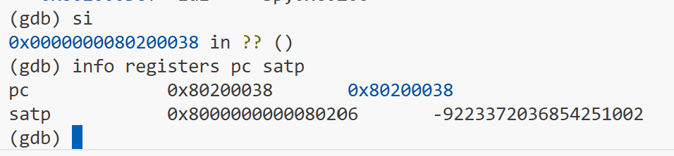
</p>

其高位模式字段为 `8`，即 Sv39；根页表物理页号为 `0x80206`，故根页表物理地址为 `0x80206000`。该地址也与内核启动日志中的 `satp physical address: 0x80206000` 相符。

当我们执行完

```asm
csrw satp, t0
sfence.vma
```

后，此时PC在0x8020003c，再次si时出现了取值页故障，当时我们在 GDB 中看到：
scause = 0xc，0xc 对应 RISC-V 的指令页故障，这是因为启动页表的根层索引 511 对应一项有效的 1 GiB 大页映射，低地址 0x8020003c 不在这次页表建立的虚拟地址映射范围中。

<p align="center">
  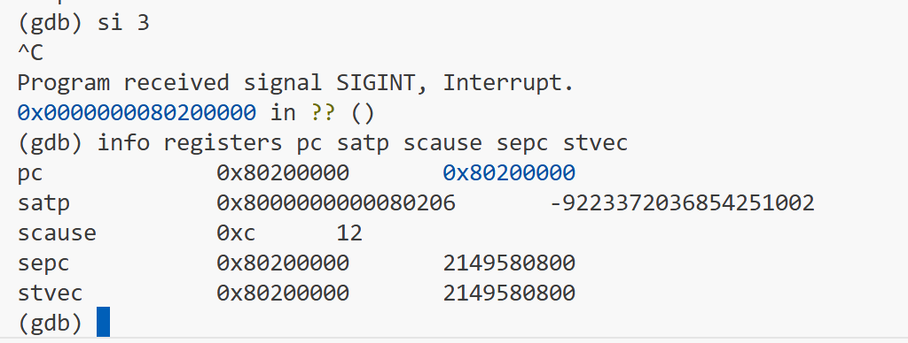
</p>

我们为了继续验证高地址映射，人工选定并设置的一个 PC=0xffffffffc020003c，就是0x8020003c对应的高地址。

#### 5.3.3 Sv39 页表遍历与物理地址计算

接下来在终端2中进入 QEMU 的 C 源码，观察模拟器如何读取页表、解析页表项，并把虚拟地址转换成物理地址。

当 QEMU 模拟 CPU 从0xffffffffc020003c取指时，终端 2 的宿主机 GDB 在 QEMU 的 riscv_cpu_tlb_fill() 函数处停了下来。然后我们在终端 2 中使用 step 进入 QEMU 的 get_physical_address()，开始真正观察页表遍历。

QEMU 针对 Sv39 设置 `levels = 3`、`ptidxbits = 9`、`ptesize = 8`，理论上最多遍历三级页表。

本次实际调试的根层索引为 `511`，对应的页表项地址为：
$$
\begin{aligned}
\texttt{pte\_addr}
&= 0x80206000 + 511 \times 8 \\
&= 0x80206ff8
\end{aligned}
$$

<p align="center">
  
</p>

<p align="center">
  
</p>

根页表项地址为 `0x80206ff8`，读取结果如下：

```text
pte_addr = 0x80206ff8
pte      = 0x200000cf
ppn      = 0x80000
ptshift  = 18
```

<p align="center">
  
</p>

由于根层 PTE 的 R/W/X 位均有效，它已经是叶子页表项，表示 **1 GiB 大页映射**。因此本次在第一级就完成了页表查询，没有继续进入后两级。

ptshift = 18表示当前大页映射需要从虚拟页号中补入的低 18 位。虚拟地址 = 0xffffffffc020003c，12 位页内偏移是03c，低30位还剩下18位就是0x200。计算如下：

<p align="center">
  
</p>

```text
物理页号             = 0x80200
物理页基址 *physical = 0x80200000
页内偏移                 = 0x3c
最终客体物理地址 PA       = 0x8020003c
```

因此，本次实测对应关系为 **`VA 0xffffffffc020003c → PA 0x8020003c`**。


#### 5.3.4 QEMU 软件 TLB 的查询与填充


在 `accel/tcg/cputlb.c` 的 `get_page_addr_code()` 中，QEMU 使用 `tlb_hit()` 检查取指地址对应的软件 TLB 项。此次进入了未命中分支，经过页表翻译成功后，调用路径为：

```text
get_page_addr_code()         //查询取指地址的缓存映射；未命中时启动填充流程
  -> tlb_fill()            //通用的 TLB 填充入口，转交给目标架构的实现
  -> riscv_cpu_tlb_fill()   //RISC-V 专用的地址翻译和 TLB 填充处理
  -> get_physical_address()  //按照当前分页模式查询页表，计算物理地址及权限
  -> tlb_set_page()      //将地址翻译结果交给通用 TLB 设置逻辑
  -> tlb_set_page_with_attrs()  //构造并写入实际的软件 TLB 表项
```

在 `tlb_set_page()` 的入口，实际观察到以下参数：

| 参数 | 调试结果 |
|---|---|
| 虚拟页基址 `vaddr` | `0xffffffffc0200000` |
| 物理页基址 `paddr` | `0x80200000` |
| 权限 `prot` | `0x7`（读、写、执行） |
| `mmu_idx` | `1` |
| 填充粒度 `size` | `4096` 字节 |

<p align="center">
  
</p>

在 `tlb_set_page_with_attrs()` 中，我们继续观察了 TLB 表项的定位和写入。`tlb_entry()`：找到要使用的缓存位置，`copy_tlb_helper_locked(te, &tn)`：写入构造好的表项。

调试时读取到新表项的 `tn.addr_code = 0xffffffffc0200000`，但旧表项 `te->addr_code` 因编译优化无法直接显示。

<p align="center">
  
</p>

后续 `riscv_cpu_tlb_fill()` 返回 `true`。

<p align="center">
  
</p>

`get_page_addr_code()` 正常返回十进制 `2097212`，即 `0x20003c`，与本次客体物理地址减去 QEMU RAM 基址 `0x80000000` 后的偏移一致。

<p align="center">
  
</p>

这验证了**首次未命中、地址翻译、TLB 填充、填充后重新查询并正常返回**的过程。

#### 5.3.5 分页模式对比及调试问题

**Bare 与 Sv39：** 根据 QEMU 源码，`satp` 为 Bare 模式时，`get_physical_address()` 直接执行 `*physical = addr` 并返回，不进行 Sv39 页表遍历；Sv39 模式下则需要依据 PTE 完成虚拟地址到物理地址的映射。

<p align="center">
  
</p>

**软件 TLB 与硬件 TLB：** QEMU 以宿主机软件数据结构模拟客体地址转换与访问权限，相关代码位于 `cputlb.c`，如下：

<p align="center">
  
</p>


真实 RISC-V 处理器的硬件 TLB 通常由处理器 MMU 维护，以减少重复页表遍历。

调试中主要遇到以下问题：

1. **启用分页后出现取指页故障。** `entry.S` 的早期根页表仅映射高半区；在低地址继续单步时出现 `scause = 0xc`。为继续观察高半区映射，本次调试人工将 PC 设置为对应的高虚拟地址 `0xffffffffc020003c`。**这是调试用的人工干预，并非正常启动流程或内核缺陷修复。**


---

## 六、实验总结与收获：

### 6.1 对操作系统的理解

#### 1号成员：张懿鸾 2413669

通过本次实验，我对操作系统物理内存管理和虚拟地址转换的理解更加具体了。以前学习物理页、页表和地址转换时，更多是在理解概念，而通过实现 `page_init()` 和 Best-Fit 分配算法，我进一步认识到，操作系统不仅需要探测物理内存，还需要通过 Page 描述符记录页面状态，并合理管理空闲的连续物理页。之后通过 GDB 调试 QEMU 源码，我观察到了虚拟地址查询页表、计算物理地址以及 TLB 填充和命中的过程。这让我对课堂上学习的内存管理机制有了更直观的认识，也体会到操作系统中各个模块之间的联系。


#### 2号成员：张祎然 2412419
物理页描述符和空闲块组织。 以前我容易把 base 当成内存地址本身，也容易把 property 的值当成空闲状态。结合代码后可以区分：Page 是物理页的管理记录，链表连接空闲块首页，标志位表示当前状态，块长度则说明这个块有多大。

连续分配和碎片。 First-Fit、Best-Fit、Buddy 都解决连续页分配问题，但选择块的方式不同。Buddy 把5页请求变成8页，产生3页内部碎片；两个相邻却不是伙伴的16页块，暂时不能满足32页申请。这说明总空闲页数相同，并不代表能满足的请求也相同。

伙伴关系与合并。 Buddy 的合并不能只看“相邻”和“大小相同”，还要属于同一个对齐的父块。绝对物理页号的异或计算把这层关系体现出来。合并时更新首页、提高阶数，以及避免重复计数，都是实现中需要一起考虑的细节。

页表和TLB。 双 GDB 把课上的地址翻译过程对应到了 SATP、索引和 PTE 的实际值。根层出现叶子时可以直接完成大页映射；TLB 保存已有翻译，后续访问可以省去重复查询。QEMU 还需要将客体地址对应到宿主内存，因此它的软件 TLB 多了一层模拟器自身的处理。

#### 3号成员：张旗庭 2413788

通过本次实验，我对**物理页管理、对象分配和虚拟内存映射**之间的关系有了更清楚的认识。Best-Fit、Buddy 等物理页分配器负责管理物理页面；本次实现的简化 SLUB 在获得物理页后，进一步将页内空间划分为不同尺寸的对象槽；页表与 TLB 则解决 CPU 使用虚拟地址访问内存时的地址转换问题。这些机制分工不同，但共同支持内核的内存管理。

对于 Sv39，我原先主要理解为“三级页表”，实际调试后认识到，**三级代表最大遍历深度，不代表每次一定遍历三级**。本次根层 PTE 就是 1 GiB 大页叶子项，因此只需一次 PTE 读取即可确定映射。

对于 TLB，QEMU 中的软件 TLB 是用软件模拟地址翻译缓存，与真实 CPU 的硬件 TLB 在作用上相似，但实现位置和维护方式不同。通过查看 Bare 和 Sv39 的不同分支，也进一步区分了“地址直接使用”和“按页表转换”两种路径。

本实验还有一些重要但未深入实现的操作系统机制，例如进程地址空间隔离、缺页异常、实际 Linux SLUB 的更复杂管理策略等。

### 6.2 AI 协作开发的经验

#### 1号成员：张懿鸾 2413669

本次实验让我体会到，AI 不仅可以辅助编写代码，也可以帮助分析陌生源码、设计调试方案和理解运行结果。在实现物理内存初始化和 Best-Fit 算法时，我通过明确任务要求、限制修改范围以及分阶段审查和验证，逐步完善了实现方案；在 GDB 调试过程中，则通过向 AI 提供实际的终端输出，不断调整断点和调试步骤。不过，我也发现，AI 给出的命令和分析不一定完全适用于当前环境，仍然需要结合实际源码、运行结果和实验要求进行核对。今后我会更加注重先明确问题、再借助 AI 分析，最后通过实际测试验证的协作方式，而不是直接照搬 AI 生成的内容。

#### 2号成员：张祎然 2412419
前期逐段阅读代码的方式对我比较有帮助。例如，我写错链表初始化、函数实参和指针成员访问时，先弄清变量类型，再改代码，比直接替换整个函数更容易理解。后续 AI 也参与了双 GDB 调试。

这次对提示词的一个体会是，先明确接口和约束，再讨论实现。把“整块释放”“使用绝对物理页号”“失败后状态不变”等条件写清楚，代码和测试才不容易采用不同的假设。报告中的结果以保存的编译、运行和调试记录为依据，完整问答见 [prompt.md](prompt.md)。

#### 3号成员：张旗庭 2413788

本次使用 AI 主要完成两类工作：一是辅助设计 SLUB 模块与测试方案；二是辅助阅读 QEMU 源码、制定双 GDB 调试步骤并分析异常结果。SLUB 的两份完整生成提示词及其设计约束已记录在 **4.5.3**。

在写SLUB及其测试模块的时候，虽然大模型写的很快，也能得到一个有效的模块，但是其中仍然存在一些问题，比如分的cache类别比较少。这些都是后续还可以优化的部分。虽然大模型显著提高了初版代码的生成效率，但是依旧不能替代开发者对代码逻辑和运行结果的判断。

GDB调试中，AI对我帮助最大的是将较大的调试任务拆解为可验证的小步骤。刚开始面对三个终端，两个层面的调试，遇到了许多困难。有了AI的指导和自己动手看调试结果，这个分支任务得以顺利完成，也真实地看到内存访问的步骤，对于内存管理的理解也更深了。